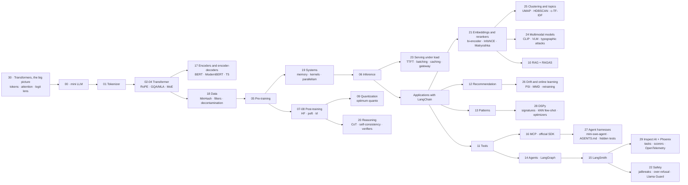

# LLM Edu Suite — Documentation in English

🇪🇸 [Versión en español](../es/README.md) · [Main README](../../README.md)

A hands-on LLM engineering course in two halves, with a map to start from: notebook 30 (transformers, the big picture) is read before anything else. It follows one sentence through a real small model, SmolLM2-135M, from tokens to embeddings, attention, the prediction layer by layer (the logit lens) and the next-token distribution, and shows where the parameters live, without training anything. Then:

1. **Inside the model (notebooks 00–06):** we build a language model from scratch in PyTorch (tokenizer, attention, RoPE, MoE, training, inference) to understand how it works.
2. **With the industry's tools (notebooks 07–16):** fine-tuning with Hugging Face (`transformers`, `peft`, `trl`), quantization with `optimum-quanto`, RAG with LangChain evaluated with RAGAS, agents with LangGraph, observability and evaluation with LangSmith, and the Model Context Protocol with the official SDK.

Notebook 17 (encoders and encoder-decoders) completes the architecture topic and is read right after 04: an encoder from scratch with MLM, ModernBERT fine-tuned for classification, embeddings + logistic regression against an LLM, and Flan-T5 with its cross-attention.

Notebook 18 (data engineering) is read right before 05, because it is what happens to text before pre-training: exact deduplication and MinHash + LSH written from scratch, quality filtering with rules and with a classifier, benchmark decontamination and synthetic data, on a real FineWeb sample, plus two models trained on raw and clean data to measure what changes.

Notebook 19 (systems) is read right after 05: it measures on the GPU where the memory and the time of a training run go (weights, gradients, Adam and activations; bf16 and activation checkpointing; FlashAttention and the attention kernels; profiling, CUDA graphs and MFU) and how training is split across several GPUs, with real DDP in two processes and a ZeRO / FSDP calculator for 7B and 70B.

Notebook 20 (reasoning and test-time compute) is read right after 08: GRPO there is how reasoning is trained, here is how it is used and measured. On GSM8K with `qwen2.5:3b` it compares a direct answer with chain of thought, self-consistency (maj@k against pass@k), best-of-N with a 7B judge as verifier and the distilled reasoning model DeepSeek-R1-Distill 1.5B, puts them all on one cost-accuracy curve, ranks them with Bradley-Terry and measures how consistent a pairwise LLM judge is when the order of the answers is swapped.

Notebook 21 (embeddings and rerankers) is read right before 10: it opens up the retrieval layer that RAG is built on. On SciFact it compares BM25 with three embedding models (with and without task prefixes), writes InfoNCE by hand and fine-tunes a small bi-encoder with in-batch and hard negatives, shrinks the vectors with Matryoshka truncation and int8 / binary quantization with rescoring, and tries hybrid retrieval with two cross-encoder rerankers, measuring both quality and latency.

Notebook 22 (safety and guardrails) is read right after 15: observability tells you what the system did; this notebook is about what it should and should not do. With `qwen2.5:3b` and `qwen2.5:7b` on public benchmarks (JailbreakBench and XSTest) it measures both sides of safety, harmful requests refused and safe requests wrongly refused, then three published jailbreak templates, Llama Guard 3 (1B) as an input filter, a safety system prompt and the layers combined, after validating its refusal judge against human labels.

Notebook 23 (serving under load) is read right after 06: 06 opens up a single generation, this one serves models the way an application does, through an HTTP server and many requests at a time. With a streaming client against Ollama it measures TTFT, TPOT and throughput, prefill against decode as the prompt grows, what prefix caching saves, one request slot against four from 1 to 8 requests in flight (and Little's law), the same 1.5B model in GGUF Q4_K_M, Q8_0 and FP16 (memory, speed and accuracy), and a small gateway with fallbacks, timeouts and a cost-aware cascade from `qwen2.5:3b` to `qwen2.5:7b`.

Notebook 24 (multimodal models) is read right after 21: CLIP is trained with the same contrastive loss as a text embedding model, with images on one side. On 37 cat and dog breeds (Oxford-IIIT Pet) it measures CLIP zero-shot with bare class names, one prompt template and an ensemble of five, a linear probe with 1 to ~100 labelled images per breed, and `qwen2.5vl:3b` through Ollama as a classifier (accuracy, latency, tokens per image and what resolution changes); then structured extraction from synthetic invoice images with a JSON schema, clean and degraded, and a typographic attack, a wrong breed written on the image, against both CLIP and the VLM.

Notebook 25 (clustering and topic modeling) is also read right after 21, before 24: it uses the same embeddings to find out what is inside a pile of unlabeled text. On Banking77's 3,080 customer messages, treated as unlabeled logs, it compares two embedding models and UMAP before k-means, tries to choose the number of clusters with the silhouette score, lets HDBSCAN find the clusters and the noise on its own, describes each cluster with c-TF-IDF keywords and a name from `qwen2.5:3b`, and runs an emerging-intent monitoring loop. The 77 intent labels are used only to measure each step (ARI, NMI, purity).

Notebook 26 (online learning and drift) is read right after 12: it replays MovieLens-1M as a weekly stream and measures how a frozen recommender ages against weekly retraining, a sliding window and online updates with decay (with prequential, test-then-train evaluation), whether PSI on the input distribution notices the change, and whether drift-triggered retraining beats a schedule. Then, on Banking77, it asks whether a shift in what users ask can be detected from embeddings alone, with centroid shift, MMD with a permutation test and a classifier two-sample test.

Notebook 27 (agent harnesses) is read right after 16: it opens up the layer that turns a model into a coding agent, the kind of program Claude Code and Codex CLI are. It reads the source of mini-swe-agent, a minimal harness, function by function, extends it with a sandboxed environment and a permission policy, and runs it with three local models on ten coding tasks scored by hidden tests. Then it measures what an `AGENTS.md` project-memory file adds and what a prompt injection planted in the repository does.

Notebook 28 (DSPy) is read right after 13: it stops writing prompts by hand. On notebook 17's Banking77 sample it declares the classifier as a DSPy signature, compares random few-shot examples with nearest-neighbour examples chosen per message and with retrieval alone, runs three prompt optimizers (bootstrap random search, MIPROv2 and GEPA, with `qwen2.5:7b` writing instructions for the 3B model), and measures what a bigger model and a router that calls the LLM only when the neighbours disagree add, in accuracy, latency and LLM calls.

Notebook 29 (evaluation and tracing frameworks) is read right after 15: it puts the same ideas on open-source infrastructure that runs on the laptop. It reproduces notebook 20's GSM8K result as an Inspect AI task, measures how much the scorer and sampling epochs change the number, and traces a LangChain pipeline over OpenTelemetry to a self-hosted Phoenix server, reading latency and tokens per step back from the trace store, writing evaluations onto the traces as annotations and measuring what tracing costs.

Everything runs locally: **Ollama** serves the LLMs (`qwen2.5:3b` and `nomic-embed-text`) and the training models are Hugging Face SmolLM2. An NVIDIA GPU makes it fast (the published results were measured on an RTX 3060, 6 GB); CPU works too, except for notebook 19, which needs a CUDA GPU. LangSmith is optional.

## Pages

| Page | What it is for |
|---|---|
| [Installation and environment](installation.md) | `.venv`, CUDA PyTorch, Ollama and its models, the `.env`, the LangSmith key, troubleshooting |
| [Notebook guide](notebooks_guide.md) | the 31 notebooks one by one: what you build, with which tools, which concepts and which results |
| [Theoretical foundations](foundations.md) | the theory behind each technique and pattern: the problem it solves, the idea, why it is used today, how it fails |
| [Module reference](module_reference.md) | the `llm_edu_suite/` package (the from-scratch model and `config.py`) and where each topic is taught with frameworks |
| [Command-line scripts](cli_scripts.md) | `mini_llm`, `train`, `sample`, `finetune` (TRL), `rag_demo` (LangChain), `mcp_server` (FastMCP), `harness_run` (mini-swe-agent), `inspect_tasks/gsm8k_cot` (Inspect AI) |
| [Case study](case_study.md) | the project as a portfolio case: v1 from scratch, v2 with frameworks, decisions, problems and results |
| [Glossary](glossary.md) | GQA, logit lens, LoRA, DPO, GRPO, RAGAS, LCEL, DSPy signature, StateGraph, MCP, span, OpenTelemetry, SLO… |

## Topic map

| Topic | Folder | Notebooks | Tools |
|---|---|---|---|
| Start here | `notebooks/00_start_here/` | 30 · transformers, the big picture (read first) · 00 · a complete mini LLM | `transformers` (30) · PyTorch |
| Architecture | `notebooks/01_architecture/` | 01 tokenization · 02 attention, RoPE and normalization · 03 efficient attention · 04 FFN and MoE · 17 encoders and encoder-decoders | PyTorch from scratch · `transformers` and `scikit-learn` (17) |
| Pre-training and inference | `notebooks/02_pretraining_and_inference/` | 18 data engineering (deduplication, filtering, decontamination) · 05 pre-training · 19 systems (memory, precision, kernels, parallelism) · 06 inference · 23 serving under load (TTFT, batching, caching, GGUF, gateways) · 09 quantization | PyTorch · `datasets` and `transformers` (18) · `torch.profiler` and `torch.distributed` (19) · Ollama over HTTP (23) · `optimum-quanto` |
| Post-training | `notebooks/03_post_training/` | 07 SFT, LoRA, distillation and model merging · 08 DPO and GRPO · 20 reasoning and test-time compute | `transformers` · `peft` · `trl` · LangChain (Ollama) (20) |
| Applications | `notebooks/04_applications/` | 21 embeddings and rerankers · 25 clustering and topic modeling (UMAP, HDBSCAN, c-TF-IDF) · 24 multimodal models (CLIP, VLMs, document extraction) · 10 RAG · 12 recommendation · 26 online learning and drift · 13 application patterns · 28 prompt optimization with DSPy (signatures, kNN few-shot, MIPROv2, GEPA) | LangChain · RAGAS · PyTorch · `sentence-transformers` (21, 25, 28) · `umap-learn` and `scikit-learn` (25) · CLIP with `transformers` and `qwen2.5vl:3b` through Ollama (24) · DSPy (28) |
| Agents and MCP | `notebooks/05_agents_and_mcp/` | 11 tools and structured output · 14 agentic AI · 16 MCP · 27 agent harnesses (mini-swe-agent, coding tasks, `AGENTS.md`) | LangChain · LangGraph · `mcp` SDK · mini-swe-agent through Ollama (27) |
| LLMOps | `notebooks/06_llmops/` | 15 observability and evaluation · 29 evaluation and tracing frameworks (Inspect AI, Phoenix) · 22 safety: refusals, jailbreaks and guard models | LangSmith · Inspect AI and Arize Phoenix on OpenTelemetry (29) · Llama Guard 3 through Ollama (22) |

## Suggested learning path

0. **Overview:** 30, to see what a real model does with a sentence, then 00, to build a whole one and see how the pieces fit before studying them one by one. After 30 you should know that a model reads token ids, that its output is a probability distribution turned into text by a decoding rule, and that most of its parameters are in the feed-forward layers.
1. **Architecture:** 01 → 02 → 03 → 04 → 17. Afterwards you should be able to write a transformer from memory and know when an encoder or an encoder-decoder is a better fit than a decoder-only model.
2. **Data, training and inference:** 18 → 05 → 19 → 06 → 23. First which text goes into the model and why, then how a model is trained on it and what that training costs in memory and time, on one GPU and on many. After 23 you should know what users wait for when a model is served (TTFT, TPOT, percentiles), why batching, prefix caching and quantized weights help, and how to size a server from its request rate.
3. **Post-training with Hugging Face:** 07 → 08 → 20, then 09 (quantization). After 20 you should know what reasoning tokens buy, when voting or a verifier is worth its cost, and how to tell whether a judge can be trusted.
4. **Applications with LangChain:** 21 → 25 → 24 → 10 → 13 → 28 → 12 → 26. After 21 you should know how to choose, fine-tune, compress and evaluate a retriever before putting it into RAG. After 25 you should know how to find the topics in unlabeled logs, why the number of clusters is a choice rather than a discovery, and how to watch for new intents. After 24 you should know when to classify images with embeddings and when a VLM is worth its cost, what an image costs in tokens, and why text inside an image is untrusted input. After 26 you should know why a model that worked last month may not work now, how to evaluate it on a stream, and why watching input distributions alone can miss the drift that matters. After 28 you should know how to write an LLM step as a signature instead of a prompt, why the examples you put in a prompt matter more than its wording, what prompt optimizers search and when they cannot help, and why a non-LLM baseline and a cascade come before any of them. Golden rule: **build your evaluation set before the system**.
5. **Agents:** 11 → 14 → 16 → 27 and finally 15, to see how everything is observed and evaluated in production, then 29 and 22. After 27 you should know what a coding agent's harness does besides calling the model, why an agent's own "done" needs hidden tests behind it, and why the defence against instructions hidden in a repository belongs in the harness. After 29 you should know how to define an evaluation as code (dataset, solver, scorer, epochs), why a framework has to reproduce your trusted number before you adopt it, why the scorer is part of the metric, and how OpenTelemetry traces, spans and annotations give you per-step latency, tokens and searchable failures on your own machine. After 22 you should know how to measure a model's refusals and its over-refusals, why a model's own refusals are not enough of a defence, and what a guard model costs in false positives.

## Principles

- **Understand the inside, then use the real tool.** The model is built by hand because that is how attention or the KV-cache stop being magic; applications are built with the frameworks you will use at work, with their current APIs.
- **Everything is evaluated, honestly.** Each notebook ends with the metric a practitioner would report. When something does not help (an LLM re-ranker that hurts, plain DPO that degrades the model, a noisy small judge), the notebook shows it and explains why.
- **Local first.** Ollama and small models: anyone can reproduce the course on a laptop at no cost. To use a cloud provider, change `LLM_PROVIDER` in `.env`.
