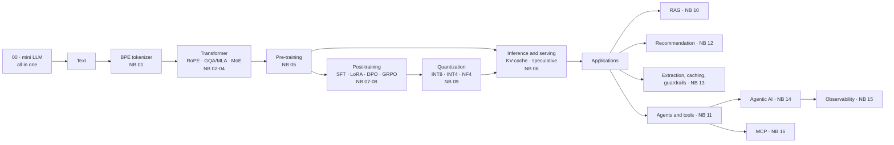

# LLM Edu Suite — English documentation

🇪🇸 [Versión en español](../es/README.md) · [Main README](../../README.md)

A hands-on lab for understanding how modern LLM-based systems work, from the tokenizer to the transformer, fine-tuning, quantization, RAG, agents, observability and the Model Context Protocol. Every piece is implemented in readable, commented code, exercised in a notebook and **evaluated** with the metrics a production team would use.

Everything runs on **CPU** and automatically uses an **NVIDIA GPU** when one is available. The published results were measured on a laptop with a 6 GB RTX 3060.

## Pages

| Page | What it is for |
|---|---|
| [Installation and environment](installation.md) | Create the `.venv` (with CUDA if you have a GPU), register the Jupyter kernel, connect a real LLM and fix common problems |
| [Notebooks guide](notebooks_guide.md) | The 17 notebooks one by one: what each one builds, which concepts it explains, what results it gets and in which order to study them |
| [Module reference](module_reference.md) | The `llmsuite/` package module by module: concepts, formulas, the actual API, examples and production equivalents |
| [Command-line scripts](cli_scripts.md) | `mini_llm.py`, `train.py`, `sample.py`, `finetune.py`, `rag_demo.py`, `mcp_server.py`: arguments, internal stages and measured results |
| [Case study](case_study.md) | The project told as a portfolio case: goals, design decisions, verification, bugs found and results |
| [Glossary](glossary.md) | Technical terms ES ↔ EN (GQA, MLA, LoRA, DPO, GRPO, NF4, RRF, nDCG, span, SLO, MCP…) |

## Topic map

| Topic | Folder | Notebooks |
|---|---|---|
| Start here | `notebooks/00_start_here/` | 00 · a complete mini LLM in a single notebook |
| Architecture | `notebooks/01_architecture/` | 01 tokenization · 02 attention, RoPE and normalization · 03 efficient attention · 04 FFN and MoE |
| Pre-training and inference | `notebooks/02_pretraining_and_inference/` | 05 pre-training · 06 inference and serving · 09 quantization |
| Post-training | `notebooks/03_post_training/` | 07 SFT, LoRA and distillation · 08 DPO and GRPO |
| Applications | `notebooks/04_applications/` | 10 RAG · 12 recommender systems · 13 modern applications |
| Agents and MCP | `notebooks/05_agents_and_mcp/` | 11 tools and structured output · 14 agentic AI · 16 Model Context Protocol |
| LLMOps | `notebooks/06_llmops/` | 15 observability |

## Suggested learning path

0. **Big picture:** 00. A complete GPT in one notebook, to see how all the pieces fit together before studying them separately.
1. **Architecture:** 01 → 02 → 03 → 04. By the end you should be able to write a transformer from memory.
2. **Training and inference:** 05 → 06. Read the Llama 3 and DeepSeek-V3 technical reports alongside.
3. **Post-training:** 07 → 08. Then reproduce it with `trl` on a real 0.5–1B-parameter model.
4. **Systems:** 09 → 06 again. Quantize, serve with vLLM and measure TTFT and throughput.
5. **Applications:** 10 → 13 → 12. Golden rule: **build your evaluation set before the system**.
6. **Agents:** 11 → 14 → 16 → 15. First the basic loop, then the patterns, then the protocol for connecting tools and, finally, how to observe all of it in production.

## Project principles

- **Understand it from the inside first, then reach for the real tool.** Each technique fits in a few dozen readable lines, and the notebook names its production equivalent (`trl`, `peft`, vLLM, FAISS, OpenTelemetry, the MCP SDKs…).
- **One model class, many architectures.** `ModelConfig` switches the attention type, the FFN (dense or MoE) and the normalization, so every comparison is a fair one.
- **Everything is evaluated, honestly.** Perplexity, exact match, recall@k, nDCG, KL, TTFT, p95, cost. When a technique does not help in the toy setting, the notebook says so and explains why.
- **Offline first.** Synthetic corpora with known structure, which make it possible to compute the theoretical optimum, and a deterministic `MockLLM`: everything runs with no downloads and no API keys, and switching to real data or models takes one line.
