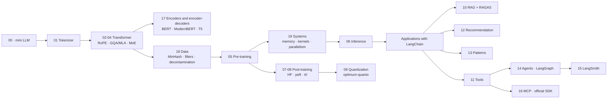

# LLM Edu Suite — Documentation in English

🇪🇸 [Versión en español](../es/README.md) · [Main README](../../README.md)

A hands-on LLM engineering course in two halves:

1. **Inside the model (notebooks 00–06):** we build a language model from scratch in PyTorch (tokenizer, attention, RoPE, MoE, training, inference) to understand how it works.
2. **With the industry's tools (notebooks 07–16):** fine-tuning with Hugging Face (`transformers`, `peft`, `trl`), quantization with `optimum-quanto`, RAG with LangChain evaluated with RAGAS, agents with LangGraph, observability and evaluation with LangSmith, and the Model Context Protocol with the official SDK.

Notebook 17 (encoders and encoder-decoders) completes the architecture topic and is read right after 04: an encoder from scratch with MLM, ModernBERT fine-tuned for classification, embeddings + logistic regression against an LLM, and Flan-T5 with its cross-attention.

Notebook 18 (data engineering) is read right before 05, because it is what happens to text before pre-training: exact deduplication and MinHash + LSH written from scratch, quality filtering with rules and with a classifier, benchmark decontamination and synthetic data, on a real FineWeb sample, plus two models trained on raw and clean data to measure what changes.

Notebook 19 (systems) is read right after 05: it measures on the GPU where the memory and the time of a training run go (weights, gradients, Adam and activations; bf16 and activation checkpointing; FlashAttention and the attention kernels; profiling, CUDA graphs and MFU) and how training is split across several GPUs, with real DDP in two processes and a ZeRO / FSDP calculator for 7B and 70B.

Everything runs locally: **Ollama** serves the LLMs (`qwen2.5:3b` and `nomic-embed-text`) and the training models are Hugging Face SmolLM2. An NVIDIA GPU makes it fast (the published results were measured on an RTX 3060, 6 GB); CPU works too, except for notebook 19, which needs a CUDA GPU. LangSmith is optional.

## Pages

| Page | What it is for |
|---|---|
| [Installation and environment](installation.md) | `.venv`, CUDA PyTorch, Ollama and its models, the `.env`, the LangSmith key, troubleshooting |
| [Notebook guide](notebooks_guide.md) | the 20 notebooks one by one: what you build, with which tools, which concepts and which results |
| [Theoretical foundations](foundations.md) | the theory behind each technique and pattern: the problem it solves, the idea, why it is used today, how it fails |
| [Module reference](module_reference.md) | the `llm_edu_suite/` package (the from-scratch model and `config.py`) and where each topic is taught with frameworks |
| [Command-line scripts](cli_scripts.md) | `mini_llm`, `train`, `sample`, `finetune` (TRL), `rag_demo` (LangChain), `mcp_server` (FastMCP) |
| [Case study](case_study.md) | the project as a portfolio case: v1 from scratch, v2 with frameworks, decisions, problems and results |
| [Glossary](glossary.md) | GQA, LoRA, DPO, GRPO, RAGAS, LCEL, StateGraph, MCP, span, SLO… |

## Topic map

| Topic | Folder | Notebooks | Tools |
|---|---|---|---|
| Start here | `notebooks/00_start_here/` | 00 · a complete mini LLM | PyTorch |
| Architecture | `notebooks/01_architecture/` | 01 tokenization · 02 attention, RoPE and normalization · 03 efficient attention · 04 FFN and MoE · 17 encoders and encoder-decoders | PyTorch from scratch · `transformers` and `scikit-learn` (17) |
| Pre-training and inference | `notebooks/02_pretraining_and_inference/` | 18 data engineering (deduplication, filtering, decontamination) · 05 pre-training · 19 systems (memory, precision, kernels, parallelism) · 06 inference · 09 quantization | PyTorch · `datasets` and `transformers` (18) · `torch.profiler` and `torch.distributed` (19) · `optimum-quanto` |
| Post-training | `notebooks/03_post_training/` | 07 SFT, LoRA and distillation · 08 DPO and GRPO | `transformers` · `peft` · `trl` |
| Applications | `notebooks/04_applications/` | 10 RAG · 12 recommendation · 13 application patterns | LangChain · RAGAS · PyTorch |
| Agents and MCP | `notebooks/05_agents_and_mcp/` | 11 tools and structured output · 14 agentic AI · 16 MCP | LangChain · LangGraph · `mcp` SDK |
| LLMOps | `notebooks/06_llmops/` | 15 observability and evaluation | LangSmith |

## Suggested learning path

0. **Overview:** 00, to see how the pieces fit before studying them one by one.
1. **Architecture:** 01 → 02 → 03 → 04 → 17. Afterwards you should be able to write a transformer from memory and know when an encoder or an encoder-decoder is a better fit than a decoder-only model.
2. **Data, training and inference:** 18 → 05 → 19 → 06. First which text goes into the model and why, then how a model is trained on it and what that training costs in memory and time, on one GPU and on many.
3. **Post-training with Hugging Face:** 07 → 08, then 09 (quantization).
4. **Applications with LangChain:** 10 → 13 → 12. Golden rule: **build your evaluation set before the system**.
5. **Agents:** 11 → 14 → 16 and finally 15, to see how everything is observed and evaluated in production.

## Principles

- **Understand the inside, then use the real tool.** The model is built by hand because that is how attention or the KV-cache stop being magic; applications are built with the frameworks you will use at work, with their current APIs.
- **Everything is evaluated, honestly.** Each notebook ends with the metric a practitioner would report. When something does not help (an LLM re-ranker that hurts, plain DPO that degrades the model, a noisy small judge), the notebook shows it and explains why.
- **Local first.** Ollama and small models: anyone can reproduce the course on a laptop at no cost. To use a cloud provider, change `LLM_PROVIDER` in `.env`.
