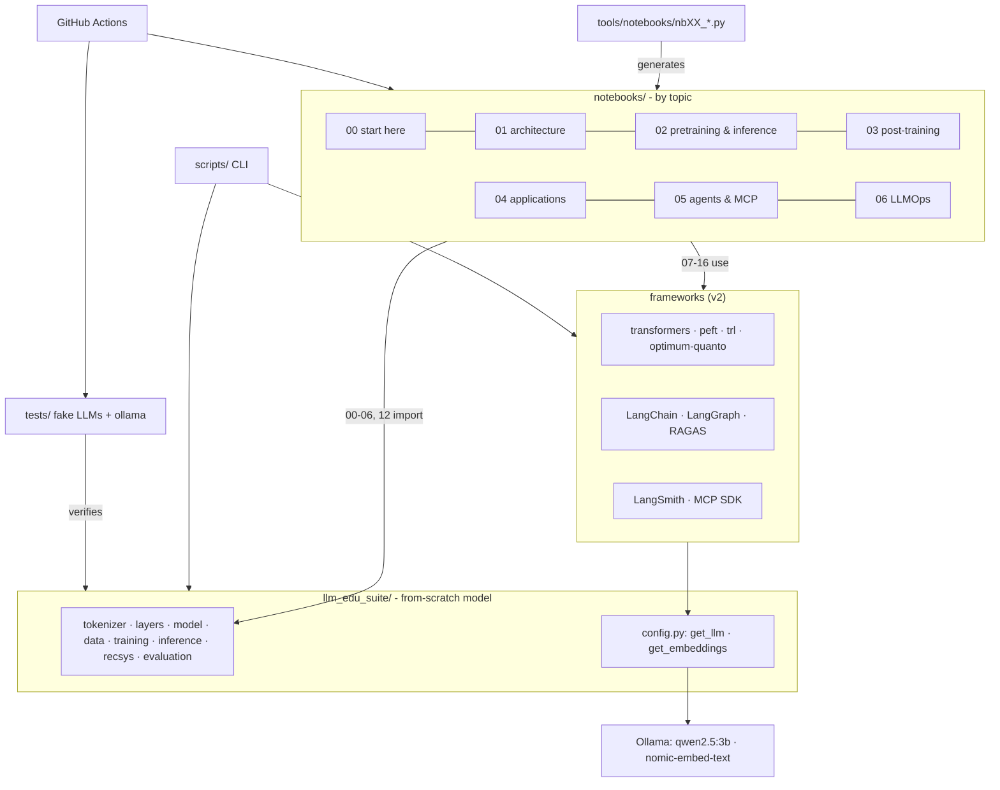

# Case study: LLM Edu Suite

🇪🇸 [Versión en español](../es/caso_de_estudio.md) · [← Back to the index](README.md)

> **Summary.** A hands-on LLM engineering course in two halves: a language model built **from scratch in PyTorch** to understand how it works inside, and applications built with **the tools the industry uses** (Hugging Face `transformers`/`peft`/`trl`, LangChain, LangGraph, LangSmith, RAGAS and the official MCP SDK), with local models through Ollama. 17 executed and evaluated notebooks, docs in Spanish and English, and CI. The project had two versions: **v1** implemented everything by hand and I took it to a state verified end to end (bugs fixed, experiments redesigned); **v2** replaced the application layer with real frameworks. Every decision is documented with measured numbers.

> Section 11 describes the move to v2 (real frameworks), and section 12 version 2.1 (theory in every notebook, a real recommender on MovieLens-1M and evaluation with intervals). Sections 2–8 tell the v1 story, which is still the basis of the from-scratch model.

## 1. Context and goal

LLMs are usually learned "top down": you call an API and chain prompts. This project does the opposite. It implements every layer in readable code to understand **why** things work and **how to measure** whether they do.

Goals:

1. **Educational**: serve as a study guide organized by topic, with theory, code and evaluation in one place.
2. **Rigorous**: every technique is evaluated with the metric a production team would use (perplexity, exact match, recall@k, nDCG, KL, TTFT, p95, cost per request…).
3. **Reproducible and accessible**: everything runs on a laptop, on CPU, with no downloads or API keys, and with fixed seeds.
4. **Honest**: when a technique does not help in the toy setting, the notebook says so and explains why.

## 2. Scope (v1)

| Area | What was built |
|---|---|
| Architecture | byte-level BPE; RMSNorm, RoPE (with Llama 3.1-style scaling); MHA/GQA/MQA/MLA; sliding window, Longformer, block-sparse, linear attention and hybrids; SwiGLU; MoE with aux-loss and aux-free balancing |
| Training | full pipeline, AdamW with parameter groups, cosine/WSD, AMP, gradient accumulation, clipping, checkpoints |
| Inference | sampling strategies, KV-cache, speculative decoding from scratch, batching, cache sizing |
| Post-training | SFT with loss masking, LoRA (and its failure mode), distillation, DPO, DPO+NLL, GRPO |
| Efficiency | per-tensor/per-row/block-wise absmax quantization, NF4, a fully quantized model |
| Applications | hybrid RAG (BM25 + dense + RRF), sequential recommender (SASRec), extraction, classification, semantic cache, anti-injection guard, batch processing with cost tracking |
| Agents | tools with JSON Schema, agent loop, structured output; budgets and loop detection, plan-and-execute, verifier-based reflection, short- and long-term memory, multi-agent supervisor, trajectory evaluation |
| LLMOps | OpenTelemetry-style traces and spans, cost per request, percentiles, SLOs, online quality scores, PII redaction, sampling, JSONL and OTLP export |
| Protocols | Model Context Protocol from scratch: JSON-RPC 2.0, server, client, in-memory and stdio transports, agent bridge, security controls, and a real MCP server compatible with Claude Code and Claude Desktop |

## 3. Project architecture

Three design decisions:

- **The notebooks are generated from code** (`tools/notebooks/nbXX_*.py`). Changes are reviewed as code, diffs are readable and the notebooks never drift out of sync. Notebook 00 also exports its cells to `scripts/mini_llm.py`, so the notebook and the script come from a single source.
- **A single configurable model class** (`ModelConfig`): every attention and FFN variant is compared on equal terms.
- **A deterministic `MockLLM`** instead of an API: the RAG, agent, observability and MCP pipelines run and are tested without a network. Switching to a real model takes one line (`OpenAICompatibleClient`).

## 4. Verification process (v1)

The first version had tests and notebooks, but the PyTorch notebooks **had never been executed**. This was the process:

1. **Isolated environment** (`.venv`, first with CPU PyTorch and then with **CUDA PyTorch for the RTX 3060**: a full run of the 17 notebooks went from ~40 to ~15 minutes). The global Python had `matplotlib 3.7` compiled against NumPy 1.x next to NumPy 2.4, and it failed on import. It is a good example of why the environment should be isolated.
2. **Tests**: 11 of 49 failed at first.
3. **Execution of every notebook** with a custom headless runner (`tools/run_notebooks.py`) and a review of every output, not just a check that no exception was raised.
4. **Documentation ↔ code cross-review**: an agent read every module to write the reference and reported 14 discrepancies. I verified them one by one before fixing them.
5. **Redesign of experiments** that ran without errors but gave results with no teaching value.

## 5. Bugs found and fixed (v1)

| Problem | Cause | Fix |
|---|---|---|
| 10 model tests failed | `.view()` on non-contiguous tensors (recent PyTorch is stricter) | `.reshape()` in `model.py`, `evaluation.py` and `finetune.py` |
| The DPO test failed with `IndexError` | `make_reverse_preferences` generated tokens 1–400 even though the vocabulary had 128 | a `token_range` parameter bounded to valid ids; in addition, the "rejected" response now always differs from the chosen one |
| `finetune.py --lora` broke in DPO | after `merge_lora` the base weights stayed frozen and the adapters no longer took part, so nothing was trainable | unfreeze the model after merging |
| `sample.py --prompt ""` failed with a tokenizer | `torch.tensor([[]])` is float32 and breaks the embedding | explicit dtype and a default start token |
| The tool timeout did not stop anything | it was checked *after* the function had finished | execution in a thread with `future.result(timeout)`, with its own test |
| `/tmp/...` paths in the notebooks | they do not exist on Windows | `tempfile.gettempdir()` |
| Notebooks without cell `id`s | required by nbformat ≥ 4.5 | deterministic ids in the generator |
| Misleading docstrings | e.g. `PreferencePair` did not exist; the MoE auxiliary loss equals top_k (not 1) under perfect balance; in GRPO the ratio is always 1 with one update per batch | documentation corrected to reflect the actual behavior |

## 6. Redesigned experiments in v1 (before → after)

The notebooks "worked", but several results taught nothing or, worse, taught something false. Every change was validated with preliminary experiments before going into the notebook.

### Fine-tuning (notebook 07)

| | Before | After | What changed |
|---|---|---|---|
| Full SFT | 44% exact match | **100%** | 1,500 examples overfitted (train loss 0.13 with test ppl 4.8). I moved to 8,000 examples and lr 2e-3 |
| LoRA | 0% at any rank | 0% → **95.3%** | **Diagnosis**: the chat role tokens never appeared in pre-training, and LoRA freezes the embeddings. The notebook now *shows* the failure, explains it and fixes it with `apply_lora(train_embeddings=True)`, the equivalent of peft's `modules_to_save` |
| Rank ablation | 0 / 0 / 0 / 0 / 0% | **1.3 / 1.3 / 48.0%** (r = 1 / 4 / 16, with 800 steps) | the ablation now has signal: learning a new behavior takes rank |
| Distillation | the distilled student (68.7%) ended up *worse* than the undistilled one (98%) | **24.7% → 98.0%** | a realistic scenario: few human labels and a teacher that labels unlabeled prompts. Logit distillation turned out to be fragile (98.7% on CPU, 44.7% on GPU), and the notebook explains it |

### Preferences and RL (notebook 08)

| | Before | After |
|---|---|---|
| Starting SFT | 4.7% (no room to improve) | 70.7% |
| DPO | 4.7% → 0%, ppl 27 → 393 | pure DPO: **70.7% → 46.7%**, ppl 1.76 → 3.66. The notebook shows *likelihood displacement* with plots |
| DPO + NLL | — | **80.0%**, ppl 1.46 (`train_dpo(nll_weight=1.0)`, the equivalent of `rpo_alpha` in trl) |
| GRPO | 4.7% → 2.0% | 70.7% → 74.0% with the exact reward and 72.7% with the dense reward. The notebook uses it to teach that the proxy reward is not the metric (Goodhart's law) |

### Other

- **Efficient attention (03)**: the comparison used global perplexity, dominated by 44 out of every 55 random tokens, so every variant came out the same (~243). I switched to measuring **copy accuracy** on the repeated tokens only, and to training for 1500 steps. Result: dense 99.9%, block-sparse 88.7%, hybrid 48.4%, sliding window 0.6% and linear 0.3%. In addition, at 300 steps even the dense model is at 0.3%: this is the *induction head* phase transition.
- **Pre-training (05)**: every ablation gave the same perplexity (2.78 versus 2.78), because the model was already at the corpus's entropy floor. The notebook now **computes the irreducible loss analytically** (4·ln 10 nats per sentence) and compares learning curves against that floor: Chinchilla's *E* term made tangible.
- **MoE (04)**: the aux-free balancing demo oscillated (`bias_lr=0.1` is huge for sigmoid scores). With 0.01 it converges from 4.0× to ~1.15× imbalance, and the notebook plots both configurations.
- **Sampling (06)**: with the same seed the strategies produced identical outputs because the distribution is very peaked. Entropy and diversity (distinct-2) are now measured, and the filtered distribution is plotted.
- **Quantization (09)**: perplexity barely moved (3 bits came out "better" than fp, through noise). I added the **KL against the fp model** and **top-1 agreement**, the metrics llama.cpp uses. They show a monotonic degradation: 98.6% agreement with NF4 at 4 bits and 88% at 2 bits.

## 7. New extensions (v1)

| Piece | Why it matters | Evidence |
|---|---|---|
| **00 · mini LLM in one notebook** | see how all the pieces fit together without jumping between modules | self-contained (torch only); also available as a script |
| **14 · agentic AI** | production agents fail through loops, cost and lack of evaluation, not just wrong answers | plan-and-execute solves 6/6 multi-step tasks versus 2/6 for a single loop; every run has a stop reason |
| **15 · observability** | without traces you can neither debug nor control the cost of an LLM system | span tree, p50/p95/p99, SLOs, quality scores and drill-down to the worst trace |
| **16 · MCP** | it is the current standard for connecting tools to LLMs | a custom server that passes 7/7 conformance checks over real stdio and works with Claude Code |

## 8. Lessons learned

1. **"It runs" is not "it works".** Every notebook ran without exceptions and yet several taught wrong conclusions. You have to read the numbers.
2. **Diagnose before tuning hyperparameters.** LoRA's 0% was not a learning-rate or rank problem but frozen embeddings for new tokens. The same failure shows up in practice when fine-tuning with a new chat template.
3. **Knowing the theoretical optimum changes the conversation.** With a corpus of known entropy, "perplexity 2.8" stops being an abstract number and comes to mean "X% from the floor".
4. **Hardware changes the results too.** When moving from CPU to GPU, models this small follow different training trajectories. The robust conclusions held; the fragile ones (logit distillation) were exposed. The text was rewritten to be true in both cases.
5. **Sensitive metrics matter.** Perplexity did not detect quantization degradation; KL did.
6. **Optimizing a proxy is not optimizing the goal.** GRPO's dense reward went up and exact match did not.
7. **Documentation ↔ code cross-review.** Writing the module reference uncovered 14 discrepancies the tests did not catch.

## 9. Stack and tools

**v1:** Python, PyTorch, NumPy, matplotlib, pytest, Jupyter/nbclient, GitHub Actions; everything else implemented by hand.

**v2:** the above for the from-scratch model, plus Hugging Face `transformers`, `peft`, `trl`, `datasets` and `optimum-quanto`; LangChain (`langchain-core`, `langchain-community`, `langchain-classic`, `langchain-ollama`), LangGraph, LangSmith, RAGAS, FAISS, BM25, Pydantic; the official `mcp` SDK (FastMCP) and `langchain-mcp-adapters`; Ollama to serve the local models.

**v2.1:** plus LightGBM (LambdaMART), `bitsandbytes` (QLoRA), a FAISS HNSW index and MovieLens-1M as a real dataset; `qwen2.5:7b` as an optional judge.

## 10. Next steps

See the [README roadmap](../../README.md#roadmap). Next: loading pretrained weights into the from-scratch transformer, reasoning at inference time (self-consistency, best-of-N), fine-tuned embeddings and rerankers for RAG, and a serving benchmark under load.

## 11. v2: from building everything to using the real tools

**Why.** v1 taught how every piece works, but it also implemented RAG, agents, tracing and MCP by hand. For a portfolio, and for day-to-day work, what matters is knowing how to **use the standard tools well** while understanding what they do inside. v2 keeps only the model from scratch (notebooks 00–06, where seeing attention or the KV-cache written out is the point) and rewrites the application layer with real frameworks. v1 stays published under the tag `v1.0-from-scratch`.

**Architecture decisions**

| Decision | Why |
|---|---|
| Local models through **Ollama** (`qwen2.5:3b`, `nomic-embed-text`) | free, offline, reproducible by anyone; fits a 6 GB GPU |
| One `llm_edu_suite/config.py` (`get_llm()`, `get_embeddings()`) read from `.env` | moving the whole course to OpenAI or Anthropic is a configuration line, not a code change |
| **LangSmith** optional | notebook 15 runs without a key; with a key, every LLM call in the course is traced |
| One generator per notebook (`tools/notebooks/nbXX_*.py`) | let several blocks be rewritten **in parallel** without conflicts, and changes are reviewed as code |
| Tests with **LangChain fake models** + integration tests marked `ollama` | GitHub CI has no GPU and no Ollama, but still checks the logic on every push |

**What was removed.** Seven in-house modules that duplicated frameworks (`rag`, `agents`, `agentic`, `observability`, `mcp`, `applications`, `llm_client`/MockLLM), plus `finetune` and `quant`. Each topic is now taught with the real tool: RAG with LangChain + RAGAS, agents with LangGraph, tracing with LangSmith, MCP with FastMCP, fine-tuning with TRL and quantization with `optimum-quanto`.

**v2 results (real models instead of toy models)**

| Notebook | Measured result |
|---|---|
| 07 · SFT/LoRA (SmolLM2-135M) | few-shot 17.5% → **full SFT 35%**, LoRA r=16 32.5% training 3.5% of the parameters. The new-token trap reproduces on the real model: **0% → 100%** once the embeddings are trained |
| 07 · distillation | a 360M teacher (87.5%) labels 600 prompts; the 135M student goes from 35% to **55%** |
| 08 · DPO/GRPO | plain DPO: exact match **30% → 7.5%** (likelihood displacement); DPO+NLL 32.5%. **GRPO: 5% → 46%** on arithmetic with only a verifier |
| 09 · quantization (SmolLM2-360M) | int8/float8 ~96% top-1 agreement at 0.41 GB; int4 73%; int2 breaks the model |
| 10 · RAG + RAGAS | hybrid BM25 + dense: **evidence MRR 0.84** vs 0.73 dense-only; RAGAS context precision 0.76 → 0.84 |
| 13 · application patterns | map-reduce 11/13 topics vs 9/13 for a silently truncated single call (6/13 in another run); injection guard **10/10 attacks, 0/10 false positives** |
| 14 · LangGraph | every guardrail stops with an explicit reason; ReAct beats plan-and-execute (80% vs 60%) with a third of the model calls |
| 15 · LangSmith | with retrieval, judged correctness goes from **0.17 to 0.83**; online feedback uncovered a real bug in a tool prompt |
| 16 · MCP | FastMCP server with **14/14 conformance checks**; the agent answers 6/6 questions through MCP |

**Real migration problems (and how they were solved)**

- **The APIs changed a lot**: in trl 1.x, `rpo_alpha` is gone (DPO+NLL is now `loss_type=["sigmoid","sft"]`); in LangChain 1.x, `EnsembleRetriever` lives in `langchain-classic` and `create_react_agent` became `langchain.agents.create_agent`; in transformers 5, `torch_dtype` became `dtype`. The notebooks use the current APIs and say so.
- **Ecosystem compatibility**: `langchain-mcp-adapters` does not support the 2.x `mcp` SDK yet, so the project pins `mcp>=1.24,<2`. A compatibility decision, not a preference.
- **One shared 6 GB GPU**: training with TRL while Ollama served the LLM filled the VRAM and **hung Ollama for over an hour**. Fix: the training notebooks cap themselves at 1.5 GB of VRAM (`set_per_process_memory_fraction`), and the LLM notebooks run one after another.
- **A small judge is noisy**: with `qwen2.5:3b` as the RAGAS judge, some correct answers get 0. The notebook shows it and recommends validating the judge and using a bigger one in production.
- **Numbers move between runs** (real LLM, LLM judge): after the final run I checked every number in the prose against its output (a script flags markdown numbers that do not appear in the outputs) and rewrote the paragraphs that had changed.

**v2 lessons**

1. **A framework does not save you from evaluating.** RAGAS, LangSmith `evaluate()` and trajectory metrics are what made it possible to say what worked and what did not.
2. **A small model changes the conclusions.** With a 3B model, ReAct beats plan-and-execute and LLM re-ranking hurts recommendation; with large models it can differ. That is why the course teaches the **method** (labelled sets, the same metrics for every design), not a universal verdict.
3. **Running everything locally has real engineering costs** (VRAM, queues, timeouts) that need to be designed for from the start.

## 12. v2.1: theory, a real recommender and evaluation with uncertainty

**Why.** v2 taught with the real tools, but it had three gaps. The theory was scattered and uneven across notebooks. The recommender was still a synthetic toy (200 items, made-up taste clusters) with an LLM re-ranker that made the list worse (hit@10 0.20 → 0.16). And comparisons on 20 questions were read without intervals, with a 3B judge grading itself. v2.1 tackles all three.

**Theory in every notebook.** Every notebook now has "Background: ..." sections before the code that uses them (the problem, the idea with its equations, why it works, what it competes with, how it fails), and there is a full theory guide in [foundations](foundations.md). Writing it meant checking claims against the installed versions, and it turned up a correction or two: in LangGraph 1.2 the default `recursion_limit` is 10,007, not 25, so an agent stuck in a loop does not stop early on its own, and every run in notebook 14 passes its own limit.

**The recommender, rebuilt from scratch** (notebook 12). It is now the industry funnel on MovieLens-1M (1,000,209 ratings, 6,040 users, 3,706 movies), with a protocol that does not fool itself: leave-last-two in time order, full ranking over the whole catalog (Krichene and Rendle, 2020), 10% of the movies held out as cold new releases, and a paired bootstrap for every comparison. And one rule: a stage only goes in if it beats the previous one on validation.

- SASRec, notebook 02's `TransformerLM` trained with the full softmax, reaches hit@10 0.293 (ItemKNN 0.125, popularity 0.036), inside the published range for this dataset.
- **The first ranker failed the gate.** Trained on a single positive per user (about 4,000 query groups), LambdaMART did not beat SASRec: the best feature was SASRec's own score, and the trees relearned it plus noise. Instead of tuning hyperparameters blindly, I looked at how RecTools' two-stage pipelines and the top Kaggle OTTO solutions do it. Two changes fixed it: fit the retrieval models on the history minus the last 8 events and turn each of those events into a ranker query (48,320 events → 35,762 queries, 1.82M rows), and give the ranker features SASRec cannot see (explicit ratings, demographics, co-visitation, time since the previous event, trending).
- With that it passes the gate (validation nDCG +0.0059 [+0.0022, +0.0096]) and on test lifts hit@10 from 0.293 to **0.307** (+1.4 points [+0.7, +2.1]). A modest, real gain, about the size a second-stage ranker usually adds over a strong first stage.
- The final re-ranking measures what it trades: one exploration slot takes hit@10 on new releases from 0.009 to 0.044 for 0.7 points overall, and MMR at λ = 0.8 raises diversity from 0.659 to 0.719 for 0.4 points.

**Where the LLM helped in recommendation, and where it did not**

| Use of the LLM | Result |
|---|---|
| per-movie keywords (`qwen2.5:7b`, offline) mixed into the item text | **worse**: content hit@10 0.033 → 0.023; validation rejected them |
| the same keywords as a ranker feature | +0.0012 [−0.0012, +0.0035]: nothing measurable, not worth an hour of LLM time |
| understanding natural-language requests and turning them into filters | **clearly better**: constraint satisfaction@5 0.60 → 0.87; 1 structured-output failure in 221 |
| personalising inside the filtered set | done by the recommender, not the LLM: hit@10 0.555 with SASRec against 0.285 with popularity |
| explanations grounded in the history | cite an anchor 97% of the time; mention a movie outside the history 7% of the time, against 13% without anchors |

Small LLMs do not beat collaborative models at ranking, but they are excellent at the language around the recommender.

**Evaluation with uncertainty, and a stronger judge** (notebook 10). `evaluation` gained `bootstrap_ci` and `paired_bootstrap_diff`, and `config` gained `judge_model()`: `qwen2.5:7b` if it is pulled (or `JUDGE_MODEL`), the chat model otherwise. With the 7B judge and its intervals, only one of the four RAGAS metrics shows a clear difference between dense and hybrid retrieval: context precision 0.79 → 0.92 (+0.13 [+0.03, +0.25]). Faithfulness (0.87 for both) and relevancy (0.78 → 0.75) do not move. The 3B judge had reported faithfulness 0.38 → 0.54 and relevancy 0.44 → 0.30: **a weak judge does not only add noise, it invents effects**. The price: 1038 s of scoring against about 7 minutes with the 3B. Notebook 15 is still judged by the 3B model (its outputs did not change; it only gained theory).

**QLoRA** (notebook 07). The same LoRA on an NF4 base with double quantization and `paged_adamw_8bit`: 37.5% exact match against 32.5% for LoRA, with the same 86.5% of fields (two requests out of 40, noise: the honest reading is "no loss"). The weights drop from 269 MB to 110 MB, but the training peak barely moves (1.41 → 1.34 GB) because activations dominate at 135M; for a 7B model it would be 14 GB → 3.6 GB. Notebook 07 raises its VRAM budget to 2 GB because it trains eleven models and the 4-bit one leaves ~0.1 GB behind.

**Dependencies and infrastructure.** `pyproject.toml` is the single source of dependencies (`requirements.txt` only contains `-e .[dev]`; `requirements-dev.txt` is gone; `openai` and `anthropic` are optional extras), with two new ones: `lightgbm>=4.5` and `bitsandbytes>=0.45`. `tools/build_notebooks.py --keep-outputs` rebuilds a notebook from its generator while keeping the outputs of code cells that did not change, which is what made it possible to add the theory without re-running hours of notebooks. CI moved to `actions/checkout@v5`, `setup-python@v6`, `ubuntu-24.04` and Python 3.11/3.12.

**v2.1 lessons**

1. **A gate before every stage changes how you work.** The first ranker would have gone in if I had only looked at its training loss; the gate rejected it and forced me to understand why. The fix was documented in industry practice, not hidden in a hyperparameter.
2. **Measuring the judge is part of measuring the system.** The faithfulness and relevancy differences v2 reported as results were artefacts of the judge. Without intervals and a stronger judge, I would still be quoting them.
3. **Use the LLM where it adds value, and say where it does not.** In recommendation, the same model made ranking worse and clearly improved request understanding. The useful result is the table, not "LLMs help" or "LLMs do not help".
4. **An interval changes the conversation.** "+1.4 points [+0.7, +2.1]" can be defended; a bare "0.307 against 0.293" cannot.
