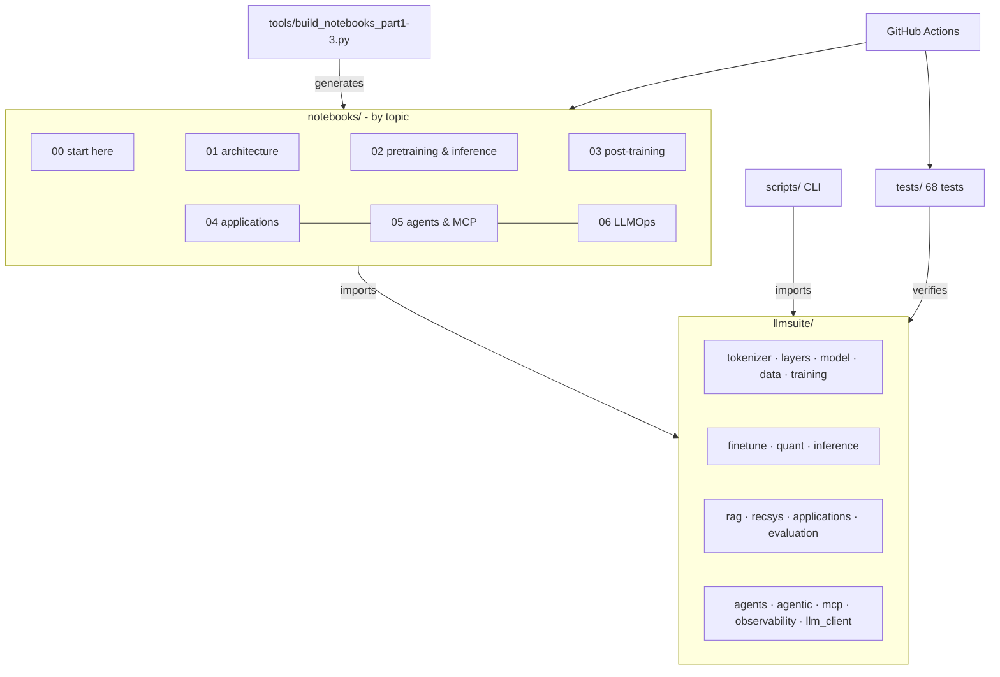

# Case study: LLM Edu Suite

🇪🇸 [Versión en español](../es/caso_de_estudio.md) · [← Back to the index](README.md)

> **Summary.** A complete LLM engineering lab built from scratch: 17 notebooks, an 18-module Python package, 6 scripts and 68 tests. It covers the whole life cycle of an LLM-based system, from the tokenizer to observable agents connected through MCP. I started from a first version generated with AI assistance and took it to a state that is **verified end to end**: I found and fixed real bugs, redesigned the experiments that gave poor results, and documented every decision with measured numbers.

## 1. Context and goal

LLMs are usually learned "top down": you call an API and chain prompts. This project does the opposite. It implements every layer in readable code to understand **why** things work and **how to measure** whether they do.

Goals:

1. **Educational**: serve as a study guide organized by topic, with theory, code and evaluation in one place.
2. **Rigorous**: every technique is evaluated with the metric a production team would use (perplexity, exact match, recall@k, nDCG, KL, TTFT, p95, cost per request…).
3. **Reproducible and accessible**: everything runs on a laptop, on CPU, with no downloads or API keys, and with fixed seeds.
4. **Honest**: when a technique does not help in the toy setting, the notebook says so and explains why.

## 2. Scope

| Area | What was built |
|---|---|
| Architecture | byte-level BPE; RMSNorm, RoPE (with Llama 3.1-style scaling); MHA/GQA/MQA/MLA; sliding window, Longformer, block-sparse, linear attention and hybrids; SwiGLU; MoE with aux-loss and aux-free balancing |
| Training | full pipeline, AdamW with parameter groups, cosine/WSD, AMP, gradient accumulation, clipping, checkpoints |
| Inference | sampling strategies, KV-cache, speculative decoding from scratch, batching, cache sizing |
| Post-training | SFT with loss masking, LoRA (and its failure mode), distillation, DPO, DPO+NLL, GRPO |
| Efficiency | per-tensor/per-row/block-wise absmax quantization, NF4, a fully quantized model |
| Applications | hybrid RAG (BM25 + dense + RRF), sequential recommender (SASRec), extraction, classification, semantic cache, anti-injection guard, batch processing with cost tracking |
| Agents | tools with JSON Schema, agent loop, structured output; budgets and loop detection, plan-and-execute, verifier-based reflection, short- and long-term memory, multi-agent supervisor, trajectory evaluation |
| LLMOps | OpenTelemetry-style traces and spans, cost per request, percentiles, SLOs, online quality scores, PII redaction, sampling, JSONL and OTLP export |
| Protocols | Model Context Protocol from scratch: JSON-RPC 2.0, server, client, in-memory and stdio transports, agent bridge, security controls, and a real MCP server compatible with Claude Code and Claude Desktop |

## 3. Project architecture

Three design decisions:

- **The notebooks are generated from code** (`tools/build_notebooks_part*.py`). Changes are reviewed as code, diffs are readable and the notebooks never drift out of sync. Notebook 00 also exports its cells to `scripts/mini_llm.py`, so the notebook and the script come from a single source.
- **A single configurable model class** (`ModelConfig`): every attention and FFN variant is compared on equal terms.
- **A deterministic `MockLLM`** instead of an API: the RAG, agent, observability and MCP pipelines run and are tested without a network. Switching to a real model takes one line (`OpenAICompatibleClient`).

## 4. Verification process

The first version had tests and notebooks, but the PyTorch notebooks **had never been executed**. This was the process:

1. **Isolated environment** (`.venv`, first with CPU PyTorch and then with **CUDA PyTorch for the RTX 3060**: a full run of the 17 notebooks went from ~40 to ~15 minutes). The global Python had `matplotlib 3.7` compiled against NumPy 1.x next to NumPy 2.4, and it failed on import. It is a good example of why the environment should be isolated.
2. **Tests**: 11 of 49 failed at first.
3. **Execution of every notebook** with a custom headless runner (`tools/run_notebooks.py`) and a review of every output, not just a check that no exception was raised.
4. **Documentation ↔ code cross-review**: an agent read every module to write the reference and reported 14 discrepancies. I verified them one by one before fixing them.
5. **Redesign of experiments** that ran without errors but gave results with no teaching value.

## 5. Bugs found and fixed

| Problem | Cause | Fix |
|---|---|---|
| 10 model tests failed | `.view()` on non-contiguous tensors (recent PyTorch is stricter) | `.reshape()` in `model.py`, `evaluation.py` and `finetune.py` |
| The DPO test failed with `IndexError` | `make_reverse_preferences` generated tokens 1–400 even though the vocabulary had 128 | a `token_range` parameter bounded to valid ids; in addition, the "rejected" response now always differs from the chosen one |
| `finetune.py --lora` broke in DPO | after `merge_lora` the base weights stayed frozen and the adapters no longer took part, so nothing was trainable | unfreeze the model after merging |
| `sample.py --prompt ""` failed with a tokenizer | `torch.tensor([[]])` is float32 and breaks the embedding | explicit dtype and a default start token |
| The tool timeout did not stop anything | it was checked *after* the function had finished | execution in a thread with `future.result(timeout)`, with its own test |
| `/tmp/...` paths in the notebooks | they do not exist on Windows | `tempfile.gettempdir()` |
| Notebooks without cell `id`s | required by nbformat ≥ 4.5 | deterministic ids in the generator |
| Misleading docstrings | e.g. `PreferencePair` did not exist; the MoE auxiliary loss equals top_k (not 1) under perfect balance; in GRPO the ratio is always 1 with one update per batch | documentation corrected to reflect the actual behavior |

## 6. Redesigned experiments (before → after)

The notebooks "worked", but several results taught nothing or, worse, taught something false. Every change was validated with preliminary experiments before going into the notebook.

### Fine-tuning (notebook 07)

| | Before | After | What changed |
|---|---|---|---|
| Full SFT | 44% exact match | **100%** | 1,500 examples overfitted (train loss 0.13 with test ppl 4.8). I moved to 8,000 examples and lr 2e-3 |
| LoRA | 0% at any rank | 0% → **95.3%** | **Diagnosis**: the chat role tokens never appeared in pre-training, and LoRA freezes the embeddings. The notebook now *shows* the failure, explains it and fixes it with `apply_lora(train_embeddings=True)`, the equivalent of peft's `modules_to_save` |
| Rank ablation | 0 / 0 / 0 / 0 / 0% | **1.3 / 1.3 / 48.0%** (r = 1 / 4 / 16, with 800 steps) | the ablation now has signal: learning a new behavior takes rank |
| Distillation | the distilled student (68.7%) ended up *worse* than the undistilled one (98%) | **24.7% → 98.0%** | a realistic scenario: few human labels and a teacher that labels unlabeled prompts. Logit distillation turned out to be fragile (98.7% on CPU, 44.7% on GPU), and the notebook explains it |

### Preferences and RL (notebook 08)

| | Before | After |
|---|---|---|
| Starting SFT | 4.7% (no room to improve) | 70.7% |
| DPO | 4.7% → 0%, ppl 27 → 393 | pure DPO: **70.7% → 46.7%**, ppl 1.76 → 3.66. The notebook shows *likelihood displacement* with plots |
| DPO + NLL | — | **80.0%**, ppl 1.46 (`train_dpo(nll_weight=1.0)`, the equivalent of `rpo_alpha` in trl) |
| GRPO | 4.7% → 2.0% | 70.7% → 74.0% with the exact reward and 72.7% with the dense reward. The notebook uses it to teach that the proxy reward is not the metric (Goodhart's law) |

### Other

- **Efficient attention (03)**: the comparison used global perplexity, dominated by 44 out of every 55 random tokens, so every variant came out the same (~243). I switched to measuring **copy accuracy** on the repeated tokens only, and to training for 1500 steps. Result: dense 99.9%, block-sparse 88.7%, hybrid 48.4%, sliding window 0.6% and linear 0.3%. In addition, at 300 steps even the dense model is at 0.3%: this is the *induction head* phase transition.
- **Pre-training (05)**: every ablation gave the same perplexity (2.78 versus 2.78), because the model was already at the corpus's entropy floor. The notebook now **computes the irreducible loss analytically** (4·ln 10 nats per sentence) and compares learning curves against that floor: Chinchilla's *E* term made tangible.
- **MoE (04)**: the aux-free balancing demo oscillated (`bias_lr=0.1` is huge for sigmoid scores). With 0.01 it converges from 4.0× to ~1.15× imbalance, and the notebook plots both configurations.
- **Sampling (06)**: with the same seed the strategies produced identical outputs because the distribution is very peaked. Entropy and diversity (distinct-2) are now measured, and the filtered distribution is plotted.
- **Quantization (09)**: perplexity barely moved (3 bits came out "better" than fp, through noise). I added the **KL against the fp model** and **top-1 agreement**, the metrics llama.cpp uses. They show a monotonic degradation: 98.6% agreement with NF4 at 4 bits and 88% at 2 bits.

## 7. New extensions

| Piece | Why it matters | Evidence |
|---|---|---|
| **00 · mini LLM in one notebook** | see how all the pieces fit together without jumping between modules | self-contained (torch only); also available as a script |
| **14 · agentic AI** | production agents fail through loops, cost and lack of evaluation, not just wrong answers | plan-and-execute solves 6/6 multi-step tasks versus 2/6 for a single loop; every run has a stop reason |
| **15 · observability** | without traces you can neither debug nor control the cost of an LLM system | span tree, p50/p95/p99, SLOs, quality scores and drill-down to the worst trace |
| **16 · MCP** | it is the current standard for connecting tools to LLMs | a custom server that passes 7/7 conformance checks over real stdio and works with Claude Code |

## 8. Lessons learned

1. **"It runs" is not "it works".** Every notebook ran without exceptions and yet several taught wrong conclusions. You have to read the numbers.
2. **Diagnose before tuning hyperparameters.** LoRA's 0% was not a learning-rate or rank problem but frozen embeddings for new tokens. The same failure shows up in practice when fine-tuning with a new chat template.
3. **Knowing the theoretical optimum changes the conversation.** With a corpus of known entropy, "perplexity 2.8" stops being an abstract number and comes to mean "X% from the floor".
4. **Hardware changes the results too.** When moving from CPU to GPU, models this small follow different training trajectories. The robust conclusions held; the fragile ones (logit distillation) were exposed. The text was rewritten to be true in both cases.
5. **Sensitive metrics matter.** Perplexity did not detect quantization degradation; KL did.
6. **Optimizing a proxy is not optimizing the goal.** GRPO's dense reward went up and exact match did not.
7. **Documentation ↔ code cross-review.** Writing the module reference uncovered 14 discrepancies the tests did not catch.

## 9. Stack and tools

Python 3.10+ · PyTorch · NumPy · matplotlib · pytest · Jupyter / nbclient · GitHub Actions. No heavy dependencies: the techniques that in production are done with `transformers`, `peft`, `trl`, vLLM, FAISS, OpenTelemetry or the MCP SDKs are implemented by hand, and every notebook names its real equivalent.

## 10. Next steps

See the [README roadmap](../../README.md#roadmap). The most relevant items: replicate the post-training pipeline with a real model (Qwen2.5-0.5B with `trl`) and connect the traces to Langfuse or Phoenix.
