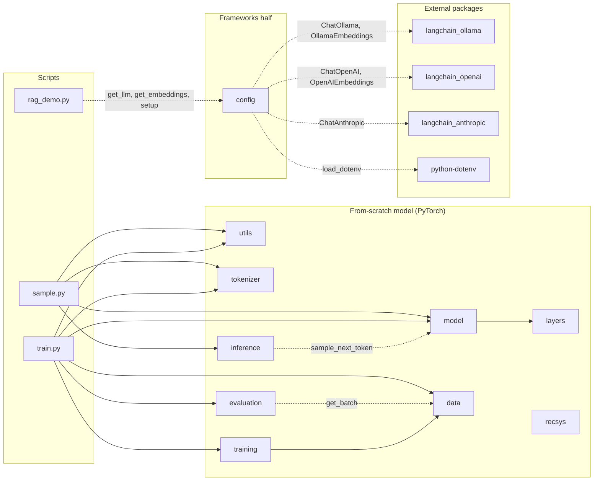

🇪🇸 [Versión en español](../es/referencia_modulos.md)

# `llm_edu_suite` module reference

> A teaching-oriented reference for every module in the package: the problem it solves, the concepts it implements, its public API (signatures checked against the code), a minimal example, its production equivalent and the notebook where you practice it.
>
> Related documents: [README](README.md) · [Installation](installation.md) · [Notebooks guide](notebooks_guide.md) · [Command-line scripts](cli_scripts.md) · [Case study](case_study.md) · [Glossary](glossary.md)

The examples for modules 1–9 use tiny configurations and run on CPU in seconds.

---

## The two halves of the course

The course has two halves, and the package only holds code for one of them.

- **First half (notebooks 00–06): the model built from scratch in PyTorch.** Seeing attention, RoPE, MoE or a KV-cache written out line by line is the best way to understand them. Modules 1–9 of this reference (`utils`, `tokenizer`, `layers`, `model`, `data`, `training`, `inference`, `recsys` and `evaluation`) are that model and its tooling. Notebook 12 (recommenders) uses them too: it reuses `TransformerLM` as a sequential recommender and loads MovieLens-1M with `recsys`, and adds FAISS, LightGBM and LangChain on top. So does notebook 17 (encoders and encoder-decoders): it trains the same `TransformerLM` with `ModelConfig(causal=False)` as an encoder, then moves on to ModernBERT and Flan-T5 with `transformers`. Notebook 18 (data engineering) trains two `TransformerLM`s with the SmolLM2 tokenizer, one on raw data and one on clean data, and uses `config.get_llm` to generate synthetic data; deduplication, filtering and decontamination are written in the notebook itself.
- **Second half (notebooks 07–16): the tools the industry uses.** Fine-tuning, quantization, RAG, agents, LLMOps and MCP are taught with real frameworks: Hugging Face `transformers` / `peft` / `trl` / `optimum-quanto`, LangChain, LangGraph, LangSmith, RAGAS and the official MCP SDK with `langchain-mcp-adapters`. For this half the package provides [`config`](#10-config), the one place where the chat model, the judge, the embedding model and tracing are chosen, and the bootstrap intervals in [`evaluation`](#9-evaluation) that notebook 10 uses to compare configurations. Notebook 20 (reasoning and test-time compute, read after 08) uses only those two: `config` for the chat model, the judge and `deepseek-r1:1.5b`, and `evaluation` for the intervals; self-consistency, the verifier and Bradley-Terry are written in the notebook itself. Notebook 21 (embeddings and rerankers, read before 10) is the same: `config` for `setup` and the `nomic-embed-text` embeddings, `evaluation` for the intervals, and everything else from `sentence-transformers` and `rank-bm25`, with nDCG@10 and recall@100 written in the notebook. Notebook 22 (safety and guardrails, read after 15) needs even less: `config` for `setup`, `get_llm` and `judge_model()` (the 7B model is both a model under test and the candidate LLM judge), and `evaluation` for the paired intervals; the keyword refusal judge, the jailbreak templates and the Llama Guard calls (with the `ollama` client) are written in the notebook. Notebook 23 (serving under load, read after 06) is the same: `config` for `setup` (the chat model, `qwen2.5:3b`) and `judge_model()` (the 7B model of the gateway and the cascade), and `evaluation` for `bootstrap_ci` and `paired_bootstrap_diff`; the streaming client, the load test, the second Ollama server and the gateway are written in the notebook with `httpx` and `asyncio`, against Ollama's HTTP API, without LangChain. Notebook 24 (multimodal models, read after 21) also keeps to the two: `config` for `setup` in the setup cell and `evaluation` for `bootstrap_ci` and `paired_bootstrap_diff`; CLIP comes from `transformers`, the linear probe from `scikit-learn`, and `qwen2.5vl:3b` is called with the `ollama` client, without LangChain. Notebook 25 (clustering and topic modeling, read after 21) uses only `config`: `setup` and `get_llm` for the model that names the clusters; the embeddings come from `sentence-transformers`, UMAP from `umap-learn`, and k-means, HDBSCAN and the metrics from `scikit-learn`, with c-TF-IDF written in the notebook. Notebook 26 (online learning and drift, read after 12) takes MovieLens-1M from [`recsys`](#8-recsys) (`download_movielens_1m`, `load_movielens_1m`) and calls `config.setup` in its setup cell; the stream, the popularity and co-visitation models, PSI and the embedding drift tests (MMD written by hand, the classifier test with `scikit-learn`) live in the notebook.

### Where did it go? (modules removed in v2)

Version 1 of the package had its own implementations of these topics. In v2 they were removed, and each topic is taught with the standard framework in its notebook:

| Topic (v1 module) | Where it is taught | Framework and classes used |
|---|---|---|
| SFT, LoRA, distillation (`finetune`) | 07 · `notebooks/03_post_training/07_finetuning_sft_lora.ipynb` | `transformers`: `AutoTokenizer` (`apply_chat_template`), `AutoModelForCausalLM`; `peft`: `LoraConfig`, `get_peft_model`, `PeftModel` (`merge_and_unload`; `load_adapter` + `add_weighted_adapter` for model merging); `trl`: `SFTConfig`, `SFTTrainer` (masking via `completion_only_loss` / `assistant_only_loss`); `datasets.Dataset` |
| DPO and GRPO (`finetune`) | 08 · `notebooks/03_post_training/08_preference_rl_dpo_grpo.ipynb` | `trl`: `DPOConfig`, `DPOTrainer`, `GRPOConfig`, `GRPOTrainer` (verifiable reward); `peft.LoraConfig` |
| Chat template, loss masking, preference pairs (`data.ChatFormat`, `make_reverse_task`, `make_reverse_preferences`) | 07 and 08 | `tokenizer.apply_chat_template` and TRL's `prompt` / `completion` (SFT) or `prompt` / `chosen` / `rejected` (DPO) datasets |
| Absmax, block-wise and NF4 quantization (`quant`) | 09 · `notebooks/02_pretraining_and_inference/09_quantization.ipynb` | Section 1 does absmax, blocks and NF4 by hand; then `optimum.quanto`: `quantize`, `freeze`, `qint8`, `qint4`, `qint2`, `qfloat8` |
| RAG: chunking, embeddings, BM25, dense search, RRF, citations (`rag`) | 10 · `notebooks/04_applications/10_rag.ipynb` | `DirectoryLoader`, `TextLoader`, `RecursiveCharacterTextSplitter`, `FAISS`, `BM25Retriever`, `EnsembleRetriever` (RRF); an LCEL chain with `ChatPromptTemplate`, `RunnableParallel`, `RunnablePassthrough`, `RunnableLambda`, `StrOutputParser`; evaluation with RAGAS (`Faithfulness`, `AnswerRelevancy`, `ContextPrecision`, `ContextRecall`, `llm_factory`). Also the [`rag_demo.py`](cli_scripts.md#rag_demopy) script |
| Tools, argument validation, agent loop, structured output (`agents`) | 11 · `notebooks/05_agents_and_mcp/11_agents_tools_structured_output.ipynb` | `@tool` (`langchain_core.tools`), `convert_to_openai_tool`, `.bind_tools()`, `AIMessage` / `ToolMessage`, `create_agent`, `ToolErrorMiddleware`; Pydantic (`BaseModel`, `Field`, `field_validator`) with `.with_structured_output()`; `GenericFakeChatModel` for deterministic tests |
| Extraction, classification, map-reduce summarization, semantic cache, injection guard, batching (`applications`) | 13 · `notebooks/04_applications/13_modern_llm_applications.ipynb` | `.with_structured_output()` + Pydantic, `FewShotChatMessagePromptTemplate`, `RecursiveCharacterTextSplitter`, `InMemoryCache`, a hand-written `SemanticCache` on the `BaseCache` interface with `set_llm_cache`, `.batch()` and `get_usage_metadata_callback` |
| LLM client, `MockLLM` (`llm_client`) | every notebook from 10 to 16 | [`config.get_llm()`](#10-config) returns `ChatOllama`, `ChatOpenAI` or `ChatAnthropic`; for tests without a model, `GenericFakeChatModel` from `langchain_core` |
| Budgets, plan-and-execute, reflection, memory, supervisor, trajectory evaluation (`agentic`) | 14 · `notebooks/05_agents_and_mcp/14_agentic_ai.ipynb` | LangGraph: `StateGraph`, `START`, `END`, `MessagesState`, `InMemorySaver`, `InMemoryStore`, `interrupt`, `Command`, `GraphRecursionError`; `create_agent` with `ModelCallLimitMiddleware`, `ToolCallLimitMiddleware`, `HumanInTheLoopMiddleware`, `dynamic_prompt`, `ToolRuntime`. Section 10 adds a supervisor (agents wrapped in `@tool` functions) and handoffs (tools that return `Command(goto=..., graph=Command.PARENT)`); section 11 adds a code-execution sandbox written in the notebook (`subprocess` with `python -I`, a scrubbed environment and a timeout, plus a PEP 578 audit hook) and a pandas agent on top of it |
| Traces, PII redaction, percentiles, SLOs, evaluation (`observability`) | 15 · `notebooks/06_llmops/15_observability_llmops.ipynb` | LangSmith: `@traceable`, `tracing_context`, `Client` (`create_feedback`, `create_dataset`, `create_examples`), `evaluate`, `create_anonymizer`; LangChain's `wait_for_all_tracers` |
| MCP server and client, transports (`mcp`) | 16 · `notebooks/05_agents_and_mcp/16_mcp_model_context_protocol.ipynb` | The official `mcp` SDK: `FastMCP`, `ToolAnnotations`, `ClientSession`, `StdioServerParameters`, `stdio_client`, `create_connected_server_and_client_session`, `McpError`, `CallToolResult`; `langchain-mcp-adapters`: `MultiServerMCPClient`, `load_mcp_tools`. Section 9 adds the client features (`Context` with `create_message`, `elicit` and `list_roots`; `sampling_callback`, `elicitation_callback`, `list_roots_callback` on `ClientSession`) and a remote server with a bearer token (`streamablehttp_client`, the SDK's `TokenVerifier` and `AuthSettings`). Also the [`mcp_server.py`](cli_scripts.md#mcp_serverpy) script, with `--http --require-token` |
| LLM re-ranking and explanation (`recsys.llm_rerank`, `explain_recommendation`) | 12 · `notebooks/04_applications/12_recommender_systems.ipynb`, section 8 | Since v2.1 the LLM no longer re-orders the list (it made it worse): it turns requests into filters with `get_llm().with_structured_output(..., method="function_calling", include_raw=True)` and writes explanations grounded in the history with `ChatPromptTemplate`. The rest of the funnel uses PyTorch (SASRec, two-tower), FAISS (an HNSW index) and LightGBM (`objective="lambdarank"`) |
| LLM-as-judge (`evaluation.pairwise_judge`, `rubric_score`) | 10, 15, 20 and 22 | RAGAS metrics with the judge from [`config.judge_model()`](#10-config) and intervals from `evaluation.bootstrap_ci` / `paired_bootstrap_diff` (10); LangSmith evaluators with a judge built on `.with_structured_output()` (15); a 7B verifier for best-of-N and a pairwise judge asked in both orders, with a Bradley-Terry ranking (20); a refusal judge built on `.with_structured_output()` with a `Literal` label, measured against XSTest's human labels and beaten by a regular expression (22) |

`perplexity_on_examples` was removed as well: in 07 and 08 the Hugging Face models are evaluated with task metrics (valid JSON, exact match, correct fields), not with perplexity.

---

## Contents

| # | Module | What it contains | Needs `torch` | Imported by notebooks |
|---|---|---|---|---|
| 1 | [`utils`](#1-utils) | seeding, device, parameter counting, timer, mask printing | yes | 01–06, 12, 17–19 |
| 2 | [`tokenizer`](#2-tokenizer) | byte-level BPE tokenizer | no | 01, 05 |
| 3 | [`layers`](#3-layers) | RMSNorm, RoPE, MHA/GQA/MQA, MLA, efficient attention, SwiGLU, MoE | yes | 02, 03, 04 |
| 4 | [`model`](#4-model) | configurable `TransformerLM` (causal or bidirectional), KV-cache, sampling | yes | 02–06, 12, 17–19 |
| 5 | [`data`](#5-data) | synthetic and text corpora, batching for pretraining | yes | 01–06, 17 |
| 6 | [`training`](#6-training) | LR schedules, grouped AdamW, training loop, checkpoints | yes | 02–06, 17 |
| 7 | [`inference`](#7-inference) | speculative decoding, batched generation, KV-cache sizing | yes | 06 |
| 8 | [`recsys`](#8-recsys) | MovieLens-1M (download, loading, time-ordered split with cold items, full-ranking ranks and metrics); synthetic catalog, small SASRec and embedding rankers | partial | 12, 26 |
| 9 | [`evaluation`](#9-evaluation) | perplexity, exact match, F1/ROUGE-L, recall/nDCG/MRR, bootstrap intervals, faithfulness proxy, latency, classification | partial | 02, 04, 05, 06, 10, 12, 17, 20, 21, 22, 23, 24 |
| 10 | [`config`](#10-config) | `get_llm`, `get_judge_llm`, `get_embeddings`, `setup`: models and services for notebooks 10–16, read from `.env` | no | 10–18, 20–26 |

"Partial" means the module imports `torch` optionally (`try/except ImportError`): the pure metrics and the synthetic data work without PyTorch, anything that touches a model does not. `config` does not need `torch`, but it does need `langchain-ollama` (or `langchain-openai` / `langchain-anthropic`, depending on the provider) and, optionally, `python-dotenv`.

Notebooks 07, 08 and 09 import nothing from `llm_edu_suite`: they work with Hugging Face directly. Neither does notebook 00: it is a self-contained mini LLM, like [`mini_llm.py`](cli_scripts.md#mini_llmpy).

**Where the notebooks live.** The notebooks are grouped into topic folders inside `notebooks/`. The number still gives the order of the course:

| Folder | Notebooks |
|---|---|
| `notebooks/00_start_here/` | 00 (a complete mini LLM from start to finish) |
| `notebooks/01_architecture/` | 01–04, 17 (read after 04) |
| `notebooks/02_pretraining_and_inference/` | 18 (read before 05), 05, 19 (read after 05), 06, 23 (read after 06), 09 |
| `notebooks/03_post_training/` | 07, 08, 20 (read after 08) |
| `notebooks/04_applications/` | 21 (read before 10), 25 (read after 21), 24 (read after 21), 10, 12, 26 (read after 12), 13 |
| `notebooks/05_agents_and_mcp/` | 11, 14, 16, 27 (read after 16) |
| `notebooks/06_llmops/` | 15, 22 (read after 15) |

For example, notebook 05 is `notebooks/02_pretraining_and_inference/05_pretraining.ipynb`. `python tools/run_notebooks.py 05` finds it by number wherever it lives (see [command-line scripts](cli_scripts.md#tools-and-makefile-targets)).

---

## Dependency map

The diagram is derived from the real `import` statements in the code. An arrow `A --> B` means "A imports B". Dashed arrows are *lazy* imports (inside a function), which only run if you call that function.



Three details the diagram does not show:

- `utils`, `tokenizer`, `layers`, `data`, `recsys` and `config` import no other `llm_edu_suite` module. They are the leaves of the graph. `config` imports the chosen provider's LangChain class only when you call `get_llm` or `get_embeddings`.
- Some modules work together through *duck typing* without importing each other. `recsys.train_sasrec` and `recsys.sasrec_rank` take a `TransformerLM` but do not import `model`. `recsys.content_embeddings` accepts any LangChain embeddings object (for example `config.get_embeddings()`) without importing `config`. `evaluation.benchmark_generation` and `evaluation.perplexity` work with any model that has `.generate` or `forward(x, y) -> (logits, loss)`.
- The `finetune.py`, `mcp_server.py` and `mini_llm.py` scripts import nothing from `llm_edu_suite`: `finetune.py` uses `transformers` / `peft` / `trl`, `mcp_server.py` uses the official MCP SDK (`FastMCP`, and `TokenVerifier` / `AuthSettings` for `--require-token`) and `rank_bm25`, and `mini_llm.py` is self-contained on purpose.

---

## 1. `utils`

**What it solves.** Small utilities every notebook needs: reproducibility, device selection, parameter counting, timing and printing attention masks as text. In a real LLM project, reproducibility (seeds) and parameter counts are the first things any experiment reports.

**Key concepts.**
- *Reproducibility*: `seed_everything` sets the seeds of `random`, NumPy and PyTorch (CUDA included). On GPU, atomic kernels can still introduce non-determinism.
- *Optional MPS*: `get_device` does not pick Apple MPS by default because RoPE uses complex tensors, which MPS only partly supports.

**Public API.**

| Signature | What it does |
|---|---|
| `seed_everything(seed: int = 0) -> None` | Seeds `random`, `numpy`, `torch` (and CUDA if present). |
| `get_device(prefer: str \| None = None, allow_mps: bool = False) -> str` | Returns `prefer` if given; otherwise `"cuda"` > (`"mps"` if `allow_mps`) > `"cpu"`. |
| `count_params(module: nn.Module, trainable_only: bool = False) -> int` | Number of parameters (optionally only trainable ones). |
| `human(n: float) -> str` | Human-readable format: `1234567 -> '1.23M'`. |
| `timer(label: str = "")` | *Context manager* that prints the elapsed time in ms. |
| `show_mask(mask: torch.Tensor, name: str = "", max_t: int = 24) -> None` | Prints a boolean (T, T) mask: `█` = the query (row) sees the key (column). |

**Example.**

```python
from llm_edu_suite.utils import seed_everything, get_device, human, timer, show_mask
from llm_edu_suite.layers import sliding_window_mask

seed_everything(0)
print(get_device())                 # 'cpu' or 'cuda'
print(human(3_030_000))             # '3.03M'
with timer("mask"):
    show_mask(sliding_window_mask(8, window=3), "sliding window w=3")
```

**In production:** `transformers.set_seed`, `accelerate.Accelerator().device`, `torch.utils.benchmark`.

**Notebooks:** imported by 01–06, 12, 17, 18 and 19, in the setup cell (`seed_everything`, `get_device`, `count_params`, `human`; `show_mask` in 01–06).

---

## 2. `tokenizer`

**What it solves.** An LLM does not see text, it sees integers. The tokenizer defines the vocabulary and, with it, how many tokens a text takes. That drives the cost per request, how much fits in the context window and how well languages and code are represented. GPT-2, Llama 3 and most modern models use **byte-level BPE**.

**Key concepts.**
- *Why bytes?* Starting from the 256 possible bytes, any string (emoji, Chinese, code) can be encoded without an `<UNK>` token.
- *Pre-tokenization*: the regex `\s*\S+|\s+` splits text into "word with its leading space" or "run of whitespace". Merges never cross those boundaries (GPT-2 style). This keeps tokens linguistically meaningful and makes training fast, because the work is done once per *unique chunk*, weighted by its frequency.
- *Training*: repeat `vocab_size - 256 - n_special` times: count adjacent pairs, merge the most frequent one into a new id and record `(a, b) -> new_id`.
- *Deterministic encoding*: within each chunk, the earliest learned merge (lowest id) is applied first. This reproduces the training order exactly.
- *Special tokens* (`<|bos|>`, `<|eos|>`, `<|pad|>`): they get the last ids, after the merges.
- *Compression*: bytes per token. More compression means shorter sequences, which makes compute cheaper and fits more text in the context.

**Public API.**

| Signature | What it does |
|---|---|
| `ByteBPETokenizer(special_tokens: tuple[str, ...] = ("<\|bos\|>", "<\|eos\|>", "<\|pad\|>"))` | Creates an empty tokenizer (just the 256 bytes). |
| `.train(text: str, vocab_size: int, verbose: bool = False) -> ByteBPETokenizer` | Learns merges up to `vocab_size` (bytes + merges + specials). |
| `.encode(text: str, add_bos: bool = False, add_eos: bool = False) -> list[int]` | Text to ids (with a per-chunk cache). |
| `.decode(ids: list[int]) -> str` | Ids to text (`errors="replace"` in case a token splits a UTF-8 character). |
| `.vocab_size`, `.bos_id`, `.eos_id`, `.pad_id` | Properties. |
| `.save(path: str)` / `ByteBPETokenizer.load(path: str)` | JSON persistence (merges + specials). |
| `compression_ratio(tok, text: str) -> float` | UTF-8 bytes per token. |

**Example.**

```python
from llm_edu_suite.tokenizer import ByteBPETokenizer, compression_ratio
from llm_edu_suite.data import template_text_corpus

text = template_text_corpus(300)
tok = ByteBPETokenizer().train(text, vocab_size=400)
ids = tok.encode("the router selects", add_eos=True)
print(tok.vocab_size, round(compression_ratio(tok, text), 2))   # 400  ~2.9
print(tok.decode(ids[:-1]))                                     # 'the router selects'
```

**In production:** `tiktoken` (OpenAI), Hugging Face `tokenizers` / `AutoTokenizer` (Rust), SentencePiece (Gemma, T5). They work the same way, but are orders of magnitude faster and handle chat templates.

**Notebooks:** 01 (compression and *fertility* vs vocabulary size) and 05 (tokenizing a real corpus before pretraining).

---

## 3. `layers`

**What it solves.** The building blocks of a modern *decoder-only* transformer. Every attention shares the signature `forward(x, freqs_cis, start_pos=None) -> (B, T, C)`, so `model` can swap them without changing anything else. Shape conventions: `B` batch, `T` sequence, `C` = `d_model`, `H` heads, `Dh = C // H`.

### 3.1 RMSNorm

$$y = \frac{x}{\sqrt{\tfrac{1}{C}\sum_i x_i^2 + \varepsilon}} \cdot \gamma$$

Unlike LayerNorm, it neither subtracts the mean nor has a bias. It is cheaper and in practice just as stable. The computation is done in fp32 even when `x` arrives in bf16, because the sum of squares needs that precision. Used by Llama, Mistral, DeepSeek and Gemma.

### 3.2 RoPE (Rotary Position Embeddings)

The dimensions of each head are grouped in pairs: $(x_{2i}, x_{2i+1})$ is treated as a complex number and rotated according to the absolute position $m$:

$$\tilde{x}^{(i)}_m = x^{(i)}_m \cdot e^{\,i\, m\, \theta_i}, \qquad \theta_i = \text{base}^{-2i/D_h}$$

Because rotations compose by adding angles, the product $\langle \tilde q_m, \tilde k_n\rangle$ depends only on $n - m$. You get **relative attention** with no extra parameters. A good mental picture is a clock with many hands: the first pairs spin fast (fine local resolution) and the last ones spin slowly (long-range signal).

`precompute_freqs_cis(..., scaling=...)` implements **Llama 3.1-style frequency scaling** to extend the context. High-frequency pairs are left alone, low-frequency ones are divided by `factor`, and there is a smooth interpolation in between (NTK-aware / YaRN family).

### 3.3 MHA → GQA → MQA

`GroupedQueryAttention` uses `n_heads` query heads and `n_kv_heads` key/value heads. Each K/V head is shared by `n_heads / n_kv_heads` queries:

| Configuration | Name | KV-cache per token and layer |
|---|---|---|
| `n_kv_heads == n_heads` | MHA | $2 \cdot H \cdot D_h$ |
| `1 < n_kv_heads < n_heads` | GQA (Llama 3, Mistral) | $2 \cdot H_{kv} \cdot D_h$ |
| `n_kv_heads == 1` | MQA | $2 \cdot D_h$ |

Why does it matter? During decoding, the bottleneck is reading the KV-cache from memory. GQA shrinks it `H / H_kv` times with barely any quality loss. With `causal=False` the same class is the attention of an **encoder**: no mask, every token sees every other (BERT), and `supports_cache` is then `False`, because an encoder reads the whole input at once. The class includes a KV-cache: call it with `start_pos=0` on the prompt (*prefill*) and then with `start_pos=t` and one token per step (*decode*). The `qk_norm` option applies per-head RMSNorm to q and k to keep attention logits from growing (OLMo 2, Gemma 3).

### 3.4 MLA (Multi-head Latent Attention, DeepSeek-V2/V3)

MLA goes one step beyond GQA. The K and V of **all** heads are derived from a single low-dimensional latent $c_{kv} \in \mathbb{R}^{r}$ (`kv_lora_rank`), and that is what gets cached:

$$c_{kv} = \text{RMSNorm}(W_{a} x), \qquad [k^{nope}, v] = W_{b}\, c_{kv}$$

The catch is that RoPE does not commute with the compression: the rotation depends on position and the up-projection does not. So each head is split into a **position-free** part (`qk_nope_dim`, coming from the latent) and a small **rotary** part (`qk_rope_dim`). The rotary part is computed directly and shared across heads, as in MQA.

- Cache per token and layer: `kv_lora_rank + qk_rope_dim`. In DeepSeek-V3 that is 512 + 64 = 576 values, versus 2 · 128 · 128 = 32,768 for a 128-head MHA.
- **GQA vs MLA**: GQA saves memory by *sharing* heads, which reduces expressiveness. MLA saves by *compressing* (low-rank) and keeps distinct heads. It usually saves more at equal or better quality, at the price of more FLOPs and a more complex implementation.
- This is the "naive" form, which reconstructs K and V from the latent. Production code uses the *absorb* trick, folding $W_b$ into the query so attention runs directly against the latent.

### 3.5 Efficient attention

| Class | Pattern | Cost | Notes |
|---|---|---|---|
| `SlidingWindowAttention` | each token sees the previous `window` tokens | $O(T \cdot w)$ in theory | Mistral, Gemma's local layers. With a boolean mask, SDPA still computes T×T; real savings come from kernels that skip blocks (FlexAttention) or from a truncated KV-cache. |
| `LongformerAttention` | window + global positions that see and are seen by everyone (causally) | $O(T \cdot w + T \cdot g)$ | Pattern only: the paper uses separate projections for the globals. |
| `BlockSparseAttention` | per query: top-`top_blocks` blocks chosen by content + local window | dynamic | Simplified NSA/DSA. A cheap *indexer* scores each block with $q \cdot \overline{k}_{block}$. The chosen mask is kept in `last_mask`. |
| `LinearAttention` | $\text{softmax}(qk^\top)$ is replaced by $\phi(q)\phi(k)^\top$, with $\phi = \text{ELU}+1$ | $O(T)$, fixed $D_h \times D_h$ state | The state is $S_t = \sum_{s\le t} \phi(k_s) v_s^\top$. Parallel `cumsum` mode for training and recurrent `step()` for inference. It loses softmax's "exact lookup" ability, which is why it is used in hybrids (Qwen3-Next, Kimi Linear). No RoPE. |

Only `GroupedQueryAttention` and `MultiHeadLatentAttention` have a KV-cache (`supports_cache = True`). The others recompute over the whole sequence.

### 3.6 SwiGLU

$$\text{FFN}(x) = W_{down}\big(\text{SiLU}(W_{gate}\,x) \odot W_{up}\,x\big)$$

It has three matrices instead of two. To keep the parameter count of a classic $4C$ FFN, $d_{ff} \approx \tfrac{8}{3} C$ is used. `swiglu_hidden_dim` applies Llama's rule: $\tfrac{2}{3}\cdot 4C$, optionally scaled and rounded up to a multiple.

### 3.7 Mixture of Experts (MoE)

The FFN is replaced by `n_experts` FFNs (experts) and a *router* that sends each token to its `top_k` best experts. **Total** parameters grow, but **active parameters per token** (the compute) do not. The risk is *collapse*: the router sends everything to a few experts and the rest never learn. There are two strategies to prevent it:

**a) Softmax + auxiliary loss** (Switch Transformer, Mixtral), `routing="softmax"`:

$$\mathcal{L}_{aux} = E \sum_{e=1}^{E} f_e \cdot P_e$$

Here $f_e$ is the mean number of routing *slots* per token that expert $e$ receives (each token fills `top_k` slots, so $\sum_e f_e = k$ and under uniform load $f_e = k/E$) and $P_e$ is the mean probability the router assigns to it. Minimizing this product pushes toward uniform load. As in the Hugging Face Mixtral implementation, $f_e$ is not divided by $k$, so at perfect balance the loss is **≈ `top_k`** (not ≈ 1). The scale only changes the effective coefficient; the gradient still pushes toward balance. `TransformerLM` adds it to the loss multiplied by `aux_loss_coef`. The downside is that it is an extra gradient competing with the language objective.

**b) Auxiliary-loss-free** (DeepSeek-V3), `routing="auxfree"` with `AuxFreeRouter`:
- Scores are sigmoids, not softmax.
- A **per-expert bias** that *only affects selection*: `topk(scores + bias)` decides **who**, while the normalized raw score decides **how much** it weighs.
- The bias is updated online, without gradients: `bias -= bias_lr * sign(load - mean(load))`. It lowers the bias of overloaded experts and raises that of underused ones.
- `aux_loss` returns 0: balancing does not interfere with the LM gradient.

**Shared experts** (`n_shared > 0`, DeepSeekMoE): an FFN that processes every token. It absorbs common knowledge and lets the routed experts specialize.

Dispatch is a Python loop over experts (clear, but slow). Production code uses grouped GEMMs and expert parallelism.

### `layers` public API

| Signature | What it does |
|---|---|
| `RMSNorm(dim: int, eps: float = 1e-6)` | RMS normalization with a learnable gain. |
| `precompute_freqs_cis(head_dim: int, max_seq_len: int, base: float = 10000.0, scaling: dict \| None = None) -> Tensor` | Complex table $e^{i m\theta_i}$ of shape `(max_seq_len, head_dim // 2)`. `scaling = {"factor", "orig_len", "low", "high"}`. |
| `apply_rope(x: Tensor, freqs_cis: Tensor, start_pos: int = 0) -> Tensor` | Rotates `x` of shape `(B, T, H, Dh)` starting at position `start_pos`. |
| `causal_mask(T, device=None)` | Lower-triangular `(T, T)` mask. |
| `sliding_window_mask(T, window, device=None)` | Causal and also `i - j < window`. |
| `longformer_mask(T, window, global_idx, device=None)` | Window + global rows and columns (causal). |
| `GroupedQueryAttention(d_model, n_heads, n_kv_heads, qk_norm=False, dropout=0.0, causal=True)` | MHA/GQA/MQA with KV-cache. `causal=False` drops the mask (bidirectional attention) and disables the cache (`supports_cache = False`). Methods `clear_cache()`, `kv_cache_bytes_per_token(dtype_bytes=2)`. |
| `MultiHeadLatentAttention(d_model, n_heads, kv_lora_rank, qk_nope_dim, qk_rope_dim, v_dim, q_lora_rank=None)` | MLA with compressed cache. Same cache methods. |
| `SlidingWindowAttention(d_model, n_heads, window)` | Local attention. |
| `LongformerAttention(d_model, n_heads, window, global_idx=(0,))` | Window + globals. |
| `BlockSparseAttention(d_model, n_heads, block=16, top_blocks=2, local_window=32)` | Content-selected blocks. Attribute `last_mask`. |
| `LinearAttention(d_model, n_heads)` | Linear attention. Methods `init_state(batch_size, device=None)` and `step(x_t, state) -> (y, state)`. |
| `SwiGLU(d_model, d_ff)` | Gated FFN. |
| `swiglu_hidden_dim(d_model, multiple_of=64, ffn_dim_multiplier=None) -> int` | Llama's rule for `d_ff`. |
| `AuxFreeRouter(d_model, n_experts, top_k, bias_lr=0.01)` | Sigmoid router with a balancing bias. `forward(xf) -> (topk_i, topk_w, scores)`. |
| `MoE(d_model, d_ff, n_experts, top_k, n_shared=0, routing="softmax")` | `forward(x) -> (y, aux_loss)`. Attribute `last_load`: routed slots per expert / N tokens in the last batch (sums to `top_k`; uniform = `k/E`). |

**Example.**

```python
import torch
from llm_edu_suite.layers import (precompute_freqs_cis, GroupedQueryAttention,
                             MultiHeadLatentAttention, MoE)

x = torch.randn(2, 16, 64)                      # (B, T, C)
f = precompute_freqs_cis(head_dim=16, max_seq_len=64)

mqa = GroupedQueryAttention(64, n_heads=4, n_kv_heads=1)
mla = MultiHeadLatentAttention(64, n_heads=4, kv_lora_rank=16, qk_nope_dim=8, qk_rope_dim=8, v_dim=16)
print(mqa(x, f).shape, mla(x, f).shape)                                   # (2, 16, 64) x2
print(mqa.kv_cache_bytes_per_token(), mla.kv_cache_bytes_per_token())     # 64  48  (bf16)

moe = MoE(64, 128, n_experts=4, top_k=2, n_shared=1, routing="auxfree").train()
y, aux = moe(x)
print(y.shape, aux.item(), moe.router.bias)     # aux = 0; the bias has already moved
```

**In production:** `torch.nn.functional.scaled_dot_product_attention` + FlashAttention-2/3; `torch.nn.attention.flex_attention` (PyTorch ≥ 2.5) for arbitrary masks without the T×T cost; the `LlamaAttention` / `DeepseekV3Attention` / `MixtralSparseMoeBlock` implementations in `transformers`; Megatron-LM and DeepSpeed-MoE for expert parallelism; `flash-linear-attention` (fla) for linear attention and Gated DeltaNet.

**Notebooks:** 02 (RMSNorm, numerically verified RoPE, MHA→GQA→MLA, KV-cache), 03 (efficient attention on a long-range copy task) and 04 (SwiGLU, MoE, aux-loss vs aux-free, shared experts).

---

## 4. `model`

**What it solves.** Assembles the `layers` pieces into a complete language model, **a single configurable class**. Comparing GQA with MLA, or dense with MoE, comes down to changing one `ModelConfig` field, so comparisons are fair.

```
tokens -> embedding -> N x Block -> RMSNorm -> lm_head -> logits

Block (pre-norm):
    x = x + Attn(RMSNorm(x))      # mixes information across tokens
    x = x + FFN(RMSNorm(x))       # transforms each token (dense SwiGLU or MoE)
```

**Key concepts.**
- *Pre-norm*: normalizing before each sub-block and adding to the residual stabilizes training of deep models. `sandwich_norm=True` also normalizes the output of each sub-block (Gemma 2).
- *Tied embeddings* (`tie_embeddings=True`): `lm_head.weight` is the same matrix as `tok_emb.weight`. Saves `V · C` parameters, which matters in small models.
- *GPT-2 initialization*: weights drawn from $\mathcal{N}(0, 0.02)$. Projections that write into the residual (`wo`, `w_down`, `out`) are scaled by $1/\sqrt{2N}$ so the variance does not grow with depth.
- *Hybrid patterns*: `hybrid_pattern="LLLG"` repeats the pattern across layers. `L` = the `attn` attention (e.g. `linear` or `swa`) and `G` = global GQA. This is the Gemma 3 (local:global) and Qwen3-Next (linear:full) design.
- *MoE every k layers*: `moe_every=2` puts MoE in layers 1, 3, 5… and dense SwiGLU in the rest.
- *Loss*: cross-entropy (`ignore_index=-100`) plus `aux_loss_coef · aux_total / n_layers`.
- *Active parameters*: `num_active_params()` subtracts `(E - k)` experts per MoE layer.
- *Sampling*: temperature (`<= 0` means greedy), top-k, top-p (*nucleus*, keeps the first token that crosses `p`) and CTRL repetition penalty (divides positive logits and multiplies negative ones for already-generated tokens). `next_token_distribution` returns the exact distribution the sampler draws from (after temperature, top-k and top-p; filtered tokens get probability 0), handy for visualizing the effect of each knob. `sample_next_token` uses it internally.
- *Causal or bidirectional*: `causal=False` turns the model into a BERT-style **encoder**: attention has no mask and every position sees the whole sequence. It is only implemented for `attn="gqa"` (with another attention, or a `hybrid_pattern` that uses one, `build_attention` raises `ValueError`), and there is no KV-cache (`supports_cache` is `False`). It is trained with MLM: the input carries the hidden tokens and `targets` is aligned with it, with `-100` at the positions that are not graded (notebook 17).
- *Generation with KV-cache*: if every layer has `supports_cache`, it *prefills* with `start_pos=0` and then decodes one token per step. If any layer lacks it, the full sequence is recomputed at every step (correct, but $O(T^2)$ per token). Generation stops when `max_seq_len` is reached.

**Public API.**

| Signature | What it does |
|---|---|
| `ModelConfig(vocab_size=512, max_seq_len=256, d_model=128, n_layers=4, n_heads=8, n_kv_heads=2, d_ff=None, dropout=0.0, attn="gqa", hybrid_pattern=None, window=64, global_idx=(0,), block=16, top_blocks=2, qk_norm=False, sandwich_norm=False, kv_lora_rank=32, qk_nope_dim=16, qk_rope_dim=8, v_dim=16, moe=False, n_experts=4, top_k=2, n_shared_experts=0, moe_routing="softmax", aux_loss_coef=0.01, moe_every=1, rope_base=10000.0, rope_scaling=None, tie_embeddings=True, norm_eps=1e-6, causal=True)` | Configuration *dataclass*. `attn` ∈ `gqa \| mla \| swa \| longformer \| blocksparse \| linear`. `causal=False` gives bidirectional attention (an encoder; `gqa` only, no KV-cache). `d_ff=None` applies Llama's rule (multiple of 8). Property `head_dim` and method `to_dict()`. |
| `build_attention(cfg, layer_idx) -> nn.Module` | Factory for each layer's attention (honors `hybrid_pattern`). |
| `Block(cfg, layer_idx)` | Pre-norm block. `forward(x, freqs_cis, start_pos=None) -> (x, aux)`. |
| `TransformerLM(cfg)` | The model. |
| `.forward(idx, targets=None, start_pos=None) -> (logits, loss \| None)` | `idx` (B, T). `targets` with `-100` = ignore. `start_pos` = cache mode. |
| `.generate(idx, max_new_tokens, temperature=1.0, top_k=None, top_p=None, eos_id=None, repetition_penalty=1.0) -> Tensor` | Autoregressive sampling (returns prompt + generated tokens). |
| `.num_params(trainable_only=False)`, `.num_active_params()`, `.kv_cache_bytes_per_token(dtype_bytes=2)` | Parameter and memory accounting. |
| `.supports_cache` (property), `.clear_cache()` | KV-cache management. |
| `.save(path)` / `TransformerLM.load(path, map_location="cpu")` | Checkpoint `{"config", "state_dict"}`. |
| `next_token_distribution(logits, temperature=1.0, top_k=None, top_p=None) -> Tensor` | `(B, V) -> (B, V)`: probabilities after temperature, top-k and top-p (sum to 1; filtered tokens are exactly 0). |
| `sample_next_token(logits, temperature=1.0, top_k=None, top_p=None) -> Tensor` | `(B, V) -> (B, 1)`. Greedy if `temperature <= 0`; otherwise samples from `next_token_distribution`. |
| `apply_repetition_penalty(logits, generated, penalty) -> Tensor` | CTRL penalty. |
| `config_from_hf_llama(hf_config, max_seq_len=None) -> ModelConfig` | `ModelConfig` equivalent to a Hugging Face `LlamaConfig` (Llama, Mistral, Qwen2, SmolLM2): sizes, KV heads, `rope_theta` (also from transformers 5's `rope_parameters`), `rms_norm_eps`, tied embeddings. Rejects scaled RoPE and models with biases. |
| `rope_rotate_half_to_interleaved(w, n_heads, head_dim) -> Tensor` | Reorders the rows of a q or k projection from the *rotate_half* convention (Hugging Face, GPT-NeoX) to the interleaved one (ours, and Meta's original Llama). |
| `load_hf_llama(model, hf_state_dict, permute_rope=True) -> list[str]` | Copies a Hugging Face `state_dict` into `TransformerLM` (name mapping + q/k permutation). Raises if a tensor is missing or a shape differs. `permute_rope=False` only serves to see what breaks without the permutation. Notebook 06, section 6. |

**Example.**

```python
import torch
from llm_edu_suite.model import ModelConfig, TransformerLM

cfg = ModelConfig(vocab_size=128, d_model=64, n_layers=2, n_heads=4, n_kv_heads=2, max_seq_len=64)
model = TransformerLM(cfg)
print(model.num_params(), model.kv_cache_bytes_per_token())     # 100672  256

idx = torch.randint(0, 128, (4, 32))
logits, loss = model(idx[:, :-1], idx[:, 1:])                   # training: next-token
out = model.generate(torch.tensor([[1, 2, 3]]), max_new_tokens=5, temperature=0.0)
print(out.shape)                                                # (1, 8)

moe_cfg = ModelConfig(vocab_size=128, d_model=64, n_layers=4, moe=True, n_experts=8, top_k=2,
                      moe_every=2, hybrid_pattern="LG", attn="swa", window=16)
m2 = TransformerLM(moe_cfg)
print(m2.num_params(), m2.num_active_params(), m2.supports_cache)   # swa has no cache -> False
```

**In production:** `transformers.LlamaForCausalLM` / `AutoModelForCausalLM` + `GenerationConfig`; nanoGPT and `litgpt` as readable references; `torchtitan` for pretraining at scale.

**Notebooks:** 02–06, 12 (the recommender reuses `TransformerLM` unchanged), 17 (the same model with `causal=False`, trained with MLM, against the decoder of the same size) and 18 (two models with 4 layers of width 256, ~16M parameters with SmolLM2's 49k vocabulary, trained on the same 12.3M tokens of the raw crawl and of the clean corpus) and 19 (a 29.4M-parameter model, width 512 and 8 layers, to measure memory, bf16, checkpointing, profiling and MFU; one with 6 layers of width 256 for the CUDA graphs, and one with 2 layers of width 64 trained with DDP in two processes). The [`train.py`](cli_scripts.md#trainpy) and [`sample.py`](cli_scripts.md#samplepy) scripts use it too.

---

## 5. `data`

**What it solves.** It is the glue between the data and the from-scratch model: it generates *offline* corpora with learnable structure, reads real text and builds next-token batches. The chat template, loss masking and preference pairs are no longer here: in notebooks 07 and 08 Hugging Face (`tokenizer.apply_chat_template`) and TRL handle them (see the [topic table](#where-did-it-go-modules-removed-in-v2)).

**Key concepts.**
- *Structured synthetic corpus*: a lexicon of `n_words` "words", each 2 to 4 random tokens, separated by `sep`. The first token of each word is uncertain (1 in 60), but the rest is fixed by the lexicon. A model that learns the lexicon brings the loss far below $\ln V$. This explains the perplexity of ≈ 2.65 in the *smoke test* (see [cli_scripts.md](cli_scripts.md#trainpy)).
- *Template text corpus*: deterministic English sentences ("the router selects the top experts in parallel.") for training the tokenizer and tiny models without downloading anything.
- *Next-token*: `y` is `x` shifted by one position.
- *Random sampling vs a full pass*: `get_batch` takes contiguous windows at random positions (the usual choice in pretraining); `TokenDataset` cuts the tensor into non-overlapping windows so a `DataLoader` can go through all of it.
- *Contiguous split*: `train_val_split` cuts the tensor into two spans (it does not shuffle tokens), so validation is text the model has not seen.

**Public API.**

| Signature | What it does |
|---|---|
| `synthetic_structured_corpus(n_tokens: int = 200_000, vocab: int = 512, n_words: int = 60, sep: int = 0, seed: int = 0) -> torch.Tensor` | 1-D synthetic corpus (`long`). |
| `template_text_corpus(n_sentences: int = 2000, seed: int = 0) -> str` | English sentences generated from templates (for the tokenizer). |
| `load_text_file(path: str) -> str` | Reads a `.txt` as UTF-8 (tiny shakespeare, for example). |
| `train_val_split(data: torch.Tensor, val_frac: float = 0.1)` | Contiguous split; returns `(train, val)`. |
| `get_batch(data: torch.Tensor, block_size: int, batch_size: int, device: str = "cpu", generator: torch.Generator \| None = None)` | Random contiguous windows; returns `(x, y)` of shape `(batch_size, block_size)`. |
| `TokenDataset(data: torch.Tensor, block_size: int)` | `Dataset` of non-overlapping windows (for `DataLoader`); each item is `(x, y)`. |

**Example.**

```python
import torch
from llm_edu_suite.data import synthetic_structured_corpus, train_val_split, get_batch, TokenDataset

data = synthetic_structured_corpus(10_000, vocab=256)
tr, va = train_val_split(data)                         # 9000 and 1000 tokens
x, y = get_batch(tr, block_size=32, batch_size=4)
print(x.shape, (x[:, 1:] == y[:, :-1]).all())          # (4, 32)  True: y is x shifted
loader = torch.utils.data.DataLoader(TokenDataset(tr, block_size=32), batch_size=8, shuffle=True)
```

**In production:** Hugging Face `datasets` with *streaming*; sequence *packing*; datatrove / FineWeb for real corpora; `tokenizer.apply_chat_template` and TRL's dataset formats for post-training (notebooks 07 and 08).

**Notebooks:** 01 and 05 (text corpus, `load_text_file`), 02–04 and 06 (synthetic corpus, `train_val_split`), 05 (`get_batch`) and 17 (`synthetic_structured_corpus`, `train_val_split` and `get_batch` for the MLM loop).

---

## 6. `training`

**What it solves.** The pretraining loop, the same one used with real LLMs. Only the data loader and multi-GPU distribution (DDP/FSDP) change.

**Key concepts.**
- *LR schedule* (`lr_schedule`):
  - `cosine`: linear warmup followed by cosine decay down to `min_ratio · max_lr` (GPT-3, Llama).
    $$\eta(t) = \eta_{max}\left[r + (1-r)\tfrac{1}{2}\left(1 + \cos\pi p\right)\right],\quad p = \tfrac{t - w}{T - w}$$
  - `wsd` (Warmup-Stable-Decay): warmup, constant LR and linear decay over the last 20 % (MiniCPM, DeepSeek). Lets you extend training without fixing its length up front.
- *AdamW with two groups*: matrices (`dim >= 2`) get *weight decay* and vectors (norm gains, biases) do not. `beta2 = 0.95` is used instead of 0.999, the LLM convention because it is more robust to loss spikes. `fused=True` is enabled automatically on CUDA.
- *Gradient accumulation*: simulates batches `grad_accum` times larger.
- *Clipping*: the **gradient norm before clipping** is logged; it is one of the most useful training health signals.
- *Mixed precision*: bf16 autocast (fp16 with `GradScaler` on GPUs without bf16). With `amp=None` it is enabled only on CUDA.
- *Validation and checkpoint* every `eval_every` steps and at the last one.

**Public API.**

| Signature | What it does |
|---|---|
| `lr_schedule(step, max_lr, warmup, total, min_ratio=0.1, kind="cosine") -> float` | LR at a given step (`cosine` \| `wsd`). |
| `make_optimizer(model, lr, weight_decay=0.1, betas=(0.9, 0.95), fused=None)` | AdamW with decay/no-decay groups. |
| `TrainConfig(steps=500, batch_size=32, block_size=64, max_lr=3e-3, min_lr_ratio=0.1, warmup=50, schedule="cosine", weight_decay=0.1, grad_clip=1.0, grad_accum=1, eval_every=100, eval_batches=10, amp=None, compile=False, log=True, checkpoint_path=None, seed=0)` | Hyperparameters. |
| `TrainResult` | `train_losses`, `val_losses` (lists of `(step, loss)`), `grad_norms`, `lrs`, `wall_time`. |
| `estimate_loss(model, data, block_size, batch_size, device, n_batches=10) -> float` | Mean validation loss (eval mode). |
| `train_lm(model, train_data, val_data, cfg, device="cpu") -> TrainResult` | The full loop. |
| `plot_training(res, title="training")` | Three matplotlib panels: loss, LR and gradient norm (log scale). |

**Example.**

```python
from llm_edu_suite.data import synthetic_structured_corpus, train_val_split
from llm_edu_suite.model import ModelConfig, TransformerLM
from llm_edu_suite.training import TrainConfig, train_lm, lr_schedule

tr, va = train_val_split(synthetic_structured_corpus(50_000, vocab=256))
model = TransformerLM(ModelConfig(vocab_size=256, d_model=64, n_layers=2, max_seq_len=64))
res = train_lm(model, tr, va, TrainConfig(steps=100, warmup=10, eval_every=50, schedule="wsd"))
print(res.val_losses[-1], max(res.grad_norms))
print([round(lr_schedule(s, 1e-3, 10, 100, kind="wsd"), 5) for s in (0, 50, 85, 99)])
```

**In production:** `transformers.Trainer`, `accelerate`, PyTorch Lightning; `torchtitan` / Megatron-LM / `nanotron` with FSDP2 plus tensor and *pipeline* parallelism; Weights & Biases for logging.

**Notebooks:** 05 (full pipeline, schedule ablation, `plot_training`) and, as a utility, 02–04, 06 and 17 (`train_lm` trains the reference decoder; the encoder uses its own MLM loop). The [`train.py`](cli_scripts.md#trainpy) script uses it from the command line.

---

## 7. `inference`

**What it solves.** Serving techniques beyond basic sampling: speeding up decoding without changing the output distribution, generating for several users at once and estimating KV-cache memory, which is usually what limits the batch size.

**Key concepts.**
- *Speculative decoding* (Leviathan et al. 2023 / Chen et al. 2023). A small *draft* model proposes k tokens. The *target* model verifies all of them in **a single forward pass**:
  1. the draft samples $x_1..x_k$ with probabilities $q_i$;
  2. the target computes $p_i$ at the k+1 positions;
  3. $x_i$ is accepted with probability $\min(1, p_i(x_i)/q_i(x_i))$; on the first rejection, sample from $\text{norm}(\max(0, p_i - q_i))$ and stop;
  4. if all are accepted, add one extra token from $p_{k+1}$.

  This rejection sampling makes the output follow the target's distribution **exactly**. The speed-up comes from the fact that verifying k tokens costs about the same as one decoding step, because decoding is memory-bound rather than compute-bound. The implementation is batch-1 and cache-free (it recomputes) for clarity, and requires both models to have a `.cfg` attribute.
- *KV-cache memory*:
  $$\text{bytes} = 2 \cdot L \cdot H_{kv} \cdot D_h \cdot \text{context} \cdot \text{batch} \cdot \text{bytes per element}$$
  For example, Llama-3-8B (32 layers, 8 KV heads, Dh = 128, bf16) needs 128 KiB per token, **1 GiB per 8k sequence**.
- *Batched generation with left padding*: the last token of each prompt lands in the final position. Padding tokens are **not masked** in attention and RoPE positions are shifted per row. That is acceptable for a demo, but production uses per-sequence `position_ids`, padding masks and PagedAttention.

**Public API.**

| Signature | What it does |
|---|---|
| `speculative_decode(target, draft, idx, max_new_tokens, k=4, temperature=1.0, eos_id=None) -> (idx, stats)` | `stats`: `proposed`, `accepted`, `rounds`, `acceptance_rate`, `tokens_per_round`. |
| `kv_cache_memory(n_layers, n_kv_heads, head_dim, context, batch=1, dtype_bytes=2) -> dict` | `bytes_per_token`, `total_bytes`, `total_gb`. |
| `batched_generate(model, prompts, max_new_tokens, pad_id, temperature=0.0, eos_id=None) -> list[list[int]]` | Left-padded batched generation (recompute mode, no padding mask). |

**Example.**

```python
import torch
from llm_edu_suite.inference import kv_cache_memory, speculative_decode, batched_generate
from llm_edu_suite.model import ModelConfig, TransformerLM

print(kv_cache_memory(n_layers=32, n_kv_heads=8, head_dim=128, context=8192))
# {'bytes_per_token': 131072, 'total_bytes': 1073741824, 'total_gb': 1.0}

target = TransformerLM(ModelConfig(vocab_size=128, d_model=64, n_layers=4, max_seq_len=64))
draft = TransformerLM(ModelConfig(vocab_size=128, d_model=32, n_layers=1, n_heads=4, max_seq_len=64))
out, stats = speculative_decode(target, draft, torch.tensor([[1, 2, 3]]), max_new_tokens=20, k=4)
print(stats["acceptance_rate"], stats["tokens_per_round"])
print(batched_generate(target, [[1, 2], [3, 4, 5]], max_new_tokens=5, pad_id=0))
```

With untrained models the acceptance rate is meaningless. The interesting part is training target and draft on the same corpus (notebook 06).

**In production:** vLLM (PagedAttention, *continuous batching*, `--speculative-config` with draft, n-gram, EAGLE or MTP); SGLang; TensorRT-LLM; `transformers` `generate(assistant_model=...)` for *assisted generation*; Medusa / EAGLE.

**Notebooks:** 06 (TTFT, tokens/s vs batch size, checking that the distribution is preserved). The [`sample.py`](cli_scripts.md#samplepy) script uses `speculative_decode`.

---

## 8. `recsys`

**What it solves.** It shows that modern recommenders run on the same machinery as LLMs, and gives notebook 12 what it needs to evaluate honestly on real data. It has two parts. The **MovieLens-1M** part (v2.1) downloads and loads the dataset, makes the time-ordered split with cold items, and computes ranks and metrics with full ranking; notebook 12 builds the whole funnel on top (SASRec, two-tower, LightGBM, exploration, MMR and the LLM layer). The **synthetic** part (a catalog with hidden taste clusters, a small SASRec, embedding rankers) was notebook 12 in v2; it is kept because the tests use it and it runs on CPU in seconds.

**Key concepts.**
- *Sequential recommendation = next-token prediction* (SASRec 2018, Meta's HSTU). `TransformerLM` is reused **unchanged**: the vocabulary is the catalog (`vocab_size = n_items + 1`, with 0 = padding) and the "sentence" is the user's history. That is why `MovieLens` re-indexes the movies to 1..n_items.
- *Leave-last-two split in time order* (`temporal_split`): for every user the last event is the test target, the one before it the validation target, and everything earlier is history. A `cold_frac` of the items (among those with at least `min_count` ratings, so they do appear as targets) is removed from every history and training sequence, as if they were new releases nobody has watched; they can still be targets, which is what the cold segment measures.
- *Full ranking* (`target_ranks`): the target's rank among **all** items, after removing the padding id and what the user has already seen. Ranking against 100 sampled negatives inflates the metrics and can change which model looks best (Krichene and Rendle, 2020).
- *Per-user metrics* (`rank_metrics`): arrays of hit@k, nDCG@k and reciprocal rank, not averages, so they can be segmented (warm against cold) and fed to `evaluation.paired_bootstrap_diff`. With one relevant item, nDCG@k is $1/\log_2(r+2)$ for the 0-based rank $r$.
- *Synthetic part*: each item belongs to a latent taste cluster and each user has 1–2 favourites; with probability `stickiness` the next item comes from a favourite, with a Zipf popularity bias. Left padding (recent items at the end), padding targets set to `-100`, leave-one-out protocol. `content_embeddings` uses TF-IDF by default, or any LangChain embeddings object.

**Public API: MovieLens-1M (notebook 12).**

| Signature | What it does |
|---|---|
| `ML1M_URL` | URL of the official GroupLens zip. |
| `download_movielens_1m(cache_dir: str \| None = None) -> str` | Downloads (6 MB) and unzips MovieLens-1M once; returns the folder with `movies.dat`, `ratings.dat` and `users.dat`. Defaults to `data/cache/`, which git ignores: the GroupLens license does not allow redistributing the data. |
| `MovieLens(titles, genres, years, genre_names, events, demographics)` | Dataclass with item ids re-indexed to 1..n_items (`titles[0] == ""` is the padding). `events`: `{user: [(timestamp, item, rating), ...]}` in time order; `demographics`: `{user: (gender, age code, occupation code)}`; `years`: release year per id. Property `n_items`. |
| `load_movielens_1m(folder: str) -> MovieLens` | Parses the three `.dat` files. Only movies with at least one rating are kept (3,706); timestamp ties keep the file order, so the sequence is deterministic. |
| `temporal_split(data: MovieLens, cold_frac: float = 0.1, min_count: int = 20, seed: int = 0) -> dict` | Leave-last-two split with cold items. Returns `users`, `cold` (a set of ids), `train` (sequences), `valid` and `test` (lists of `(history, target)`), `valid_time` and `test_time` (target timestamps). |
| `target_ranks(scores, histories: list[list[int]], targets: list[int])` | `scores` is a `(users, n_items + 1)` tensor; returns each target's rank (0 = first) among all unseen items. Needs torch. |
| `rank_metrics(ranks, k: int = 10) -> dict` | `{"hit@k", "ndcg@k", "rr"}`, each a per-user array. Accepts tensors or arrays. |

**Public API: synthetic part (tests and quick examples).**

| Signature | What it does |
|---|---|
| `Catalog(n_items: int, titles: list[str], descriptions: list[str], genres: list[str], item_cluster: np.ndarray)` | Catalog dataclass (`item_cluster` is the hidden cluster, never shown to the model). |
| `make_catalog(n_items: int = 200, n_clusters: int = 8, seed: int = 0) -> Catalog` | Synthetic catalog. |
| `make_interactions(catalog: Catalog, n_users: int = 500, min_len: int = 8, max_len: int = 25, stickiness: float = 0.75, seed: int = 0) -> list[list[int]]` | Sessions (ids 1..n_items). |
| `leave_one_out_split(sessions: list[list[int]])` | Returns `(train, test)` with `test = [(history, target), ...]`. |
| `popularity_ranker(train_sessions: list[list[int]], n_items: int)` | Returns a function `rank(history, k=10) -> list[int]` that excludes seen items. |
| `sessions_to_tensor(sessions: list[list[int]], max_len: int, pad: int = 0)` | Left-pads and truncates to `(N, max_len)` (needs torch). |
| `train_sasrec(model, train_sessions: list[list[int]], max_len: int = 32, steps: int = 400, batch_size: int = 64, lr: float = 2e-3, device: str = "cpu", log_every: int = 100, seed: int = 0)` | Next-item training with AdamW; returns the list of losses. |
| `sasrec_rank(model, history: list[int], k: int = 10, max_len: int = 32, device: str = "cpu", exclude_seen: bool = True) -> list[int]` | Top-k from the logits at the last position. |
| `item_embeddings_from_model(model) -> np.ndarray` | Normalized collaborative embeddings (rows of `tok_emb`). |
| `content_embeddings(catalog: Catalog, embedder=None) -> np.ndarray` | Normalized content embeddings (row 0 = padding). TF-IDF by default; `embedder` = any LangChain embeddings object. |
| `embedding_rank(E: np.ndarray, history: list[int], k: int = 10, recency_decay: float = 0.8) -> list[int]` | Cosine ranking against the user vector (a recency-weighted mean), excluding seen items. |

**Example** (MovieLens-1M; the first run downloads 6 MB).

```python
import torch
from llm_edu_suite.recsys import download_movielens_1m, load_movielens_1m, temporal_split, target_ranks, rank_metrics
from llm_edu_suite.evaluation import bootstrap_ci

ml = load_movielens_1m(download_movielens_1m())
split = temporal_split(ml, cold_frac=0.1)
print(ml.n_items, len(split["users"]), len(split["cold"]))       # 3706 6040 370

# popularity baseline: the same score for every user
counts = torch.bincount(torch.tensor([i for s in split["train"] for i in s]), minlength=ml.n_items + 1).float()
hist, tgt = zip(*split["test"])
ranks = target_ranks(counts.expand(len(hist), -1), list(hist), list(tgt))
m = rank_metrics(ranks, k=10)
print(bootstrap_ci(m["hit@10"]))       # (0.036, 0.031, 0.040): mean and 95 % interval, the notebook's popularity
```

**In production:** *two-tower* models (TensorFlow Recommenders, TorchRec) with an ANN index (FAISS, ScaNN); SASRec/BERT4Rec in RecBole or RecTools; HSTU / *generative recommenders* (Meta); LambdaMART rankers with LightGBM, XGBoost or CatBoost; NVIDIA Merlin, RecTools and RePlay for two-stage pipelines.

**Notebooks:** 12 (`download_movielens_1m`, `load_movielens_1m`, `temporal_split`, `target_ranks`, `rank_metrics` throughout; the funnel, SASRec on `TransformerLM`, the two-tower model, the LightGBM ranker, exploration, MMR and the LLM layer live in the notebook itself) and 26 (`download_movielens_1m` and `load_movielens_1m`, whose `events` it flattens into one time-ordered stream of ratings). The synthetic functions are used by the tests (`tests/`).

---

## 9. `evaluation`

**What it solves.** Without evaluation there is no engineering. The from-scratch notebooks end with the metrics a practitioner would report, and they come from this module. The text, ranking and classification metrics are pure Python and do not need torch. LLM-as-judge evaluation is no longer here: it is done with RAGAS (notebook 10) and with LangSmith evaluators (notebook 15).

**Key concepts.**
- *Perplexity*: $\text{PPL} = \exp\big(\tfrac{1}{N}\sum -\log p(x_t \mid x_{<t})\big)$. It is the "effective number of choices" the model is hesitating between. PPL = V means uniform guessing, and PPL = 1 means total certainty. `perplexity` estimates it on random windows (it uses `data.get_batch`).
- *Exact match*: the share of answers that are exactly right. It is the natural metric for verifiable tasks (reversal, math, extraction).
- *Token-F1* (SQuAD-style): F1 over the bags of tokens of prediction and reference. *ROUGE-L*: an F1 based on the longest common subsequence, which is order-sensitive.
- *Ranking*: with `ranked` and a `relevant` set,
  - recall@k = |top-k ∩ rel| / |rel|; precision@k = |top-k ∩ rel| / k; hit@k = 1 if at least one relevant item is in the top-k;
  - MRR = 1 / position of the first relevant item;
  - nDCG@k = $\sum_{i \le k,\, d_i \in rel} \frac{1}{\log_2(i+1)} \big/ \text{IDCG}$ (binary relevance).
- *Bootstrap intervals* (`bootstrap_ci`): resample the per-example scores with replacement (2,000 times by default), recompute the mean, and take the $\alpha/2$ and $1-\alpha/2$ quantiles. With 20 questions the interval is wide, which is the honest answer to "is 0.54 really better than 0.38?". NaNs (a judge call that failed) are dropped first.
- *Paired bootstrap* (`paired_bootstrap_diff`): the mean of the differences `b - a` over the same examples (same questions or users, two systems), with its interval. If it excludes 0, the difference is unlikely to be noise. Pairing cancels the variation that comes from how hard each example is.
- *Faithfulness proxy* (`context_support`): the fraction of answer tokens (of length ≥ `min_len`) that appear in the retrieved context. It is cheap and crude; the real thing is an LLM judge with a rubric, such as RAGAS `Faithfulness`.
- *System benchmarks*: TTFT (time to first token, which measures *prefill*) and decode tokens/s, with CUDA synchronization and peak memory.

**Public API.**

| Signature | What it does |
|---|---|
| `perplexity(model, data, block_size: int = 64, batch_size: int = 32, n_batches: int = 20, device: str = "cpu") -> float` | PPL over random windows of a 1-D tensor. |
| `exact_match_rate(predict_fn, cases) -> float` | `cases`: `(input, expected)` pairs. |
| `token_f1(pred: str, ref: str) -> float`, `rouge_l(pred: str, ref: str) -> float` | Text overlap. |
| `recall_at_k`, `precision_at_k`, `hit_rate_at_k` `(ranked: list, relevant: set, k: int) -> float`; `mrr(ranked: list, relevant: set) -> float`; `ndcg_at_k(ranked: list, relevant: set, k: int) -> float` | Ranking metrics. |
| `evaluate_ranking(queries: list[tuple[list, set]], ks=(1, 5, 10)) -> dict` | Averages of `recall@k`, `hit@k`, `ndcg@k` and `mrr`. |
| `bootstrap_ci(values, n_boot: int = 2000, alpha: float = 0.05, seed: int = 0) -> tuple[float, float, float]` | `(mean, low, high)` with a percentile-bootstrap interval at level `1 - alpha`. Drops `None` and NaN; returns NaNs if nothing is left. |
| `paired_bootstrap_diff(a, b, n_boot: int = 2000, alpha: float = 0.05, seed: int = 0) -> tuple[float, float, float]` | Mean difference `b - a` over aligned pairs, with its interval (pairs with a NaN are dropped). |
| `context_support(answer: str, context: str, min_len: int = 4) -> float` | Faithfulness proxy. |
| `benchmark_generation(model, prompt_ids, max_new_tokens: int = 64, n_runs: int = 3, **gen_kwargs) -> dict` | `ttft_ms`, `tokens_per_s`, `batch` (+ `peak_mem_mb` on CUDA). |
| `accuracy(preds, labels) -> float`, `confusion_counts(preds, labels) -> dict` | Classification. `confusion_counts` returns `{(label, prediction): n}`. |

**Example.**

```python
from llm_edu_suite.evaluation import (token_f1, rouge_l, evaluate_ranking, context_support,
                                      exact_match_rate, accuracy, confusion_counts)

print(round(token_f1("Refunds within 30 days", "Customers can request a full refund within 30 days"), 3))  # 0.462
print(evaluate_ranking([(["a", "b", "c"], {"b"}), (["x", "y"], {"x"})], ks=(1, 3)))
# recall@1 = 0.5, recall@3 = 1.0, mrr = 0.75 ...
print(context_support("Express shipping takes 2 days", "Express shipping delivers in 1 to 2 business days"))  # 0.75
print(exact_match_rate(lambda s: s[::-1], [("abc", "cba"), ("ab", "ab")]))                                 # 0.5
print(accuracy(["a", "b", "a"], ["a", "a", "a"]), confusion_counts(["a", "b", "a"], ["a", "a", "a"]))
# 0.666...  {('a', 'a'): 2, ('a', 'b'): 1}

from llm_edu_suite.evaluation import bootstrap_ci, paired_bootstrap_diff
dense, hybrid = [0.5, 1.0, 0.0, 1.0, 0.5], [1.0, 1.0, 0.5, 1.0, 1.0]   # one score per question
print(bootstrap_ci(hybrid))                    # (0.9, 0.7, 1.0): mean and 95 % interval
print(paired_bootstrap_diff(dense, hybrid))    # (0.3, 0.1, 0.5): hybrid - dense; the interval excludes 0
```

**In production:** `lm-evaluation-harness` (EleutherAI), `lighteval`, HELM; RAGAS / TruLens / DeepEval for RAG; LangSmith (datasets, experiments and evaluators) for applications; `ranx` / `pytrec_eval` for IR; MT-Bench / AlpacaEval / Arena-Hard as LLM judges; `vllm bench` / GuideLLM / `genai-perf` for latency and *throughput*.

**Notebooks:** 02, 04 and 05 (`perplexity`), 06 (`benchmark_generation`), 10 (`bootstrap_ci` and `paired_bootstrap_diff` on the RAGAS scores) and 12 (`bootstrap_ci` and `paired_bootstrap_diff` for every comparison between recommender stages; the per-user metrics come from `recsys.rank_metrics`) and 17 (`bootstrap_ci` and `paired_bootstrap_diff` to compare the Banking77 classifiers with the LLM on the same 231-message sample) and 20 (`bootstrap_ci` for the accuracy of every reasoning strategy on the 80 GSM8K problems and `paired_bootstrap_diff` for self-consistency against greedy chain of thought) and 21 (`bootstrap_ci` for the nDCG@10 of every retriever on SciFact's 300 test queries and `paired_bootstrap_diff` for every comparison: embedding models against BM25, fine-tuned models against the base model on SciFact and NFCorpus, rerankers against the hybrid list) and 22 (`paired_bootstrap_diff` for the attack success of each jailbreak template against asking directly, over the same 100 harmful behaviours; it also imports `bootstrap_ci`) and 23 (`bootstrap_ci` for the ARC-Easy accuracy of each GGUF format and the GSM8K accuracy of each routing strategy, and `paired_bootstrap_diff` for Q4_K_M and Q8_0 against FP16 and for the cascade against always-7B) and 24 (`bootstrap_ci` for the accuracy of each CLIP zero-shot prompt variant and of `qwen2.5vl:3b` on the breeds, and `paired_bootstrap_diff` for the VLM against CLIP zero-shot and against the linear probe on the same 150 images). The [`train.py`](cli_scripts.md#trainpy) script uses `perplexity`.

---

## 10. `config`

**What it solves.** It is the one place where the models and services of the frameworks half are chosen (notebooks 10–16 and the `rag_demo.py` script). By default everything runs locally: Ollama serves the `qwen2.5:3b` chat model, the `nomic-embed-text` embedding model and, if it is pulled, the `qwen2.5:7b` judge on your own machine (on the GPU if you have one), and LangSmith records traces when you put an API key in `.env`. Everything is read from environment variables, so switching provider is a one-line change in `.env`, not a code change.

**Key concepts.**
- *A single point of configuration*: the notebooks never build `ChatOllama(...)` by hand, they call `get_llm()`. Change `LLM_PROVIDER` or `LLM_MODEL` and they all change at once.
- *Temperature 0 by default*: notebook results are as repeatable as a real LLM allows.
- *Lazy imports*: the provider's LangChain class (`langchain_ollama`, `langchain_openai` or `langchain_anthropic`) is imported inside `get_llm` / `get_embeddings`, so you only need to install the one for the provider you use.
- *Anthropic has no embeddings API*: with `LLM_PROVIDER=anthropic`, `get_embeddings()` falls back to Ollama (`OllamaEmbeddings`).
- *`.env` without overriding the environment*: `load_env()` loads the `.env` at the repository root with `override=False`, so a variable already set in your shell wins. `python-dotenv` is optional; without it, plain environment variables still work.
- *A judge stronger than the system it grades*: `judge_model()` picks the model for LLM-as-judge (RAGAS, LangSmith evaluators). Notebook 14 also uses it to choose the stronger model for its code-writing agent. `JUDGE_MODEL` wins if it is set; with Ollama, `qwen2.5:7b` if it is in the list of pulled models (`ollama_models()`), otherwise the chat model. In notebook 10, the 3B model grading itself invented differences that the 7B judge does not confirm.
- *One LangSmith project per notebook*: `setup(project=...)` sets `LANGSMITH_PROJECT` (only when LangSmith is enabled), so each notebook's traces land in their own project.

**Environment variables** (all optional):

| Variable | Values / default |
|---|---|
| `LLM_PROVIDER` | `ollama` (default) \| `openai` \| `anthropic` |
| `LLM_MODEL` | default `qwen2.5:3b` (Ollama), `gpt-4o-mini` (OpenAI), `claude-haiku-4-5` (Anthropic) |
| `JUDGE_MODEL` | the judge model; default `qwen2.5:7b` if it is pulled in Ollama, otherwise the chat model |
| `EMBEDDING_MODEL` | default `nomic-embed-text` (Ollama), `text-embedding-3-small` (OpenAI) |
| `OLLAMA_BASE_URL` | default `http://localhost:11434` |
| `LANGSMITH_TRACING` | `true` to send traces to LangSmith (needs `LANGSMITH_API_KEY`) |
| `LANGSMITH_API_KEY` | your LangSmith key |
| `LANGSMITH_PROJECT` | the project the traces go to (set by `setup(project=...)`) |

The OpenAI and Anthropic keys are read directly by `ChatOpenAI` / `ChatAnthropic` from their usual variables (`OPENAI_API_KEY`, `ANTHROPIC_API_KEY`).

**Public API.**

| Signature | What it does |
|---|---|
| `setup(project: str \| None = None, quiet: bool = False) -> dict` | Call it once at the top of a notebook: loads `.env`, sets the LangSmith project (if enabled), checks Ollama and prints what is configured (unless `quiet=True`). Returns `{"provider", "chat_model", "judge_model", "embedding_model", "ollama_running", "langsmith"}`. If Ollama does not answer, it prints how to start it and the `ollama pull` commands you need. |
| `get_llm(model: str \| None = None, temperature: float = 0.0, **kwargs)` | The LangChain chat model: `ChatOllama` (with `base_url=OLLAMA_BASE_URL`), `ChatOpenAI` or `ChatAnthropic`. `model` overrides `LLM_MODEL`; `**kwargs` go straight to the class (for example `num_predict=200` for Ollama). Raises `ValueError` for an unknown provider. |
| `judge_model() -> str` | The judge model's name: `JUDGE_MODEL`; if unset, with Ollama `qwen2.5:7b` when it is pulled (also as `qwen2.5:7b:latest`); otherwise the chat model (`LLM_MODEL` or the one in `DEFAULTS`). |
| `get_judge_llm(**kwargs)` | `get_llm(model=judge_model(), temperature=0.0, **kwargs)`: a chat model for grading. |
| `ollama_models(timeout: float = 2.0) -> list[str]` | Names of the models pulled into the local Ollama server (`/api/tags`); an empty list if it does not answer. |
| `get_embeddings(model: str \| None = None)` | The LangChain embedding model: `OpenAIEmbeddings` with `LLM_PROVIDER=openai`; `OllamaEmbeddings` otherwise (Anthropic included). |
| `ollama_available(timeout: float = 2.0) -> bool` | `True` if an Ollama server answers at `OLLAMA_BASE_URL/api/tags`. Notebooks and tests use it to fail early with a helpful message. |
| `langsmith_enabled() -> bool` | `True` if `LANGSMITH_TRACING=true` and `LANGSMITH_API_KEY` is set. |
| `provider() -> str` | The active provider (`LLM_PROVIDER` lower-cased, `ollama` by default). |
| `load_env() -> None` | Loads the project's `.env` without overriding variables already set. The other functions already call it. |
| `DEFAULTS` | A `{provider: {"chat": ..., "embeddings": ...}}` dict with the default models; the Ollama entry also has `"judge": "qwen2.5:7b"`. |
| `ROOT` | `Path` of the repository root (where `.env` is looked up). |

**Example.**

```python
from llm_edu_suite.config import setup, get_llm, get_embeddings, langsmith_enabled

info = setup(project="my-experiment")
# provider        : ollama
# chat_model      : qwen2.5:3b
# judge_model     : qwen2.5:7b        (or qwen2.5:3b if the 7B model is not pulled)
# embedding_model : nomic-embed-text
# ollama_running  : True
# langsmith       : off (add LANGSMITH_API_KEY to .env to enable)

llm = get_llm()                                   # ChatOllama(model="qwen2.5:3b", temperature=0)
print(llm.invoke("Say hello in one word.").content)

emb = get_embeddings()                            # OllamaEmbeddings(model="nomic-embed-text")
print(len(emb.embed_query("hello")))              # vector dimension

creative = get_llm(temperature=0.7, num_predict=100)   # the kwargs go to ChatOllama
```

To switch provider without touching code:

```bash
# .env
LLM_PROVIDER=openai
OPENAI_API_KEY=sk-...
LANGSMITH_TRACING=true
LANGSMITH_API_KEY=lsv2_...
```

Before using Ollama, pull the models: `ollama pull qwen2.5:3b` and `ollama pull nomic-embed-text`, and optionally `ollama pull qwen2.5:7b` for the judge (see [Installation](installation.md)).

**In production:** the same idea, with a secrets manager instead of `.env`; LangChain's `init_chat_model` to pick a provider by name; a model gateway (LiteLLM, for example) when there are many teams and providers.

**Notebooks:** 10, 11, 13, 14, 15 and 16 (`setup`, `get_llm`, `get_embeddings` in the setup cell; 10 takes the RAGAS judge from `setup()["judge_model"]`), 12 (`setup`, `get_embeddings` for the movie texts and `get_llm` for the request and explanation layer), 15 (`langsmith_enabled`), 17 (`get_embeddings` for the `nomic-embed-text` embeddings and `get_llm` to classify with `qwen2.5:3b`) and 18 (`get_llm(temperature=0.8, num_predict=220)` to write the synthetic passages with `.batch`) and 20 (`get_llm` with different `num_predict` and `temperature` for the direct answer, chain of thought and self-consistency, `get_llm(model="deepseek-r1:1.5b", num_predict=2048)` for the reasoning model, and `get_judge_llm` with `judge_model()` for the verifier and the pairwise judge) and 21 (`setup` in the setup cell and `get_embeddings` for the `nomic-embed-text` runs, with and without task prefixes) and 22 (`setup` in the setup cell, `get_llm(model=..., num_predict=150).batch(...)` for the replies of `qwen2.5:3b` and `qwen2.5:7b`, and `judge_model()` to pick the 7B model, which also serves as the structured-output refusal judge with `get_llm(model=judge_model(), num_predict=60)`) and 23 (`setup` in the setup cell, whose `chat_model` is the small model, and `judge_model()` for the 7B model of the gateway and the 3B → 7B cascade; the requests themselves go straight to Ollama's HTTP API with `httpx`) and 24 (`setup` in the setup cell, to load `.env` and check that Ollama is up; the vision model is called with the `ollama` client) and 25 (`setup` in the setup cell and `get_llm(num_predict=40).with_structured_output(TopicName, method="json_schema")` with `.batch` to name the clusters with `qwen2.5:3b`) and 26 (only `setup` in the setup cell; it calls no LLM). The [`rag_demo.py`](cli_scripts.md#rag_demopy) script uses it too.

---

## See also

- [Command-line scripts](cli_scripts.md): `train.py`, `sample.py`, `finetune.py`, `rag_demo.py`, `mini_llm.py`, `mcp_server.py`, `generate_item_keywords.py`.
- [Notebooks guide](notebooks_guide.md): the course path through all 28 notebooks (00 to 27).
- [Glossary](glossary.md): short definitions of the terms used here.
