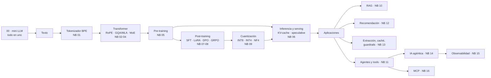

# LLM Edu Suite — Documentación en español

🇬🇧 [English version](../en/README.md) · [README principal](../../README.md)

Un laboratorio práctico para entender cómo funcionan los sistemas modernos basados en LLMs, del tokenizador al transformer, el fine-tuning, la cuantización, RAG, los agentes, la observabilidad y el Model Context Protocol. Cada pieza está implementada en código legible y comentado, se ejercita en un notebook y se **evalúa** con las métricas que usaría un equipo en producción.

Todo funciona en **CPU** y aprovecha automáticamente una **GPU NVIDIA** si la hay. Los resultados publicados se midieron en un portátil con una RTX 3060 de 6 GB.

## Páginas

| Página | Para qué sirve |
|---|---|
| [Instalación y entorno](instalacion.md) | Crear el `.venv` (con CUDA si tienes GPU), registrar el kernel de Jupyter, conectar un LLM real y resolver problemas frecuentes |
| [Guía de notebooks](guia_notebooks.md) | Los 17 notebooks uno a uno: qué construye cada uno, qué conceptos explica, qué resultados obtiene y en qué orden estudiarlos |
| [Referencia de módulos](referencia_modulos.md) | El paquete `llmsuite/` módulo a módulo: conceptos, fórmulas, API real, ejemplos y equivalentes de producción |
| [Scripts de línea de comandos](scripts_cli.md) | `mini_llm.py`, `train.py`, `sample.py`, `finetune.py`, `rag_demo.py`, `mcp_server.py`: argumentos, etapas internas y resultados medidos |
| [Caso de estudio](caso_de_estudio.md) | El proyecto contado como caso de portafolio: objetivos, decisiones de diseño, verificación, bugs encontrados y resultados |
| [Glosario](glosario.md) | Términos técnicos ES ↔ EN (GQA, MLA, LoRA, DPO, GRPO, NF4, RRF, nDCG, span, SLO, MCP…) |

## Mapa por tópicos

| Tópico | Carpeta | Notebooks |
|---|---|---|
| Empieza aquí | `notebooks/00_start_here/` | 00 · un mini LLM completo en un solo notebook |
| Arquitectura | `notebooks/01_architecture/` | 01 tokenización · 02 atención, RoPE y normalización · 03 atención eficiente · 04 FFN y MoE |
| Pre-entrenamiento e inferencia | `notebooks/02_pretraining_and_inference/` | 05 pre-entrenamiento · 06 inferencia y serving · 09 cuantización |
| Post-training | `notebooks/03_post_training/` | 07 SFT, LoRA y destilación · 08 DPO y GRPO |
| Aplicaciones | `notebooks/04_applications/` | 10 RAG · 12 sistemas de recomendación · 13 aplicaciones modernas |
| Agentes y MCP | `notebooks/05_agents_and_mcp/` | 11 tools y salida estructurada · 14 IA agéntica · 16 Model Context Protocol |
| LLMOps | `notebooks/06_llmops/` | 15 observabilidad |

## Ruta de aprendizaje sugerida

0. **Visión general:** 00. Un GPT completo en un notebook, para ver cómo encajan todas las piezas antes de estudiarlas por separado.
1. **Arquitectura:** 01 → 02 → 03 → 04. Al terminar deberías poder escribir un transformer de memoria.
2. **Entrenamiento e inferencia:** 05 → 06. Lee en paralelo los informes técnicos de Llama 3 y DeepSeek-V3.
3. **Post-training:** 07 → 08. Después, reprodúcelo con `trl` sobre un modelo real de 0,5–1B parámetros.
4. **Sistemas:** 09 → 06 otra vez. Cuantiza, sirve con vLLM y mide TTFT y throughput.
5. **Aplicaciones:** 10 → 13 → 12. Regla de oro: **construye tu set de evaluación antes que el sistema**.
6. **Agentes:** 11 → 14 → 16 → 15. Primero el bucle básico, luego los patrones, después el protocolo para conectar herramientas y, al final, cómo observarlo todo en producción.

## Principios del proyecto

- **Primero entender por dentro, después la herramienta real.** Cada técnica cabe en unas decenas de líneas legibles, y el notebook nombra su equivalente de producción (`trl`, `peft`, vLLM, FAISS, OpenTelemetry, los SDK de MCP…).
- **Una sola clase de modelo, muchas arquitecturas.** `ModelConfig` cambia el tipo de atención, la FFN (densa o MoE) y la normalización, así que todas las comparaciones son justas.
- **Todo se evalúa, con honestidad.** Perplejidad, exact match, recall@k, nDCG, KL, TTFT, p95, coste. Cuando una técnica no ayuda en el entorno de juguete, el notebook lo dice y explica por qué.
- **Offline primero.** Corpus sintéticos con estructura conocida, que permiten calcular el óptimo teórico, y un `MockLLM` determinista: todo se ejecuta sin descargas ni claves de API, y se cambia a datos o modelos reales con una línea.
