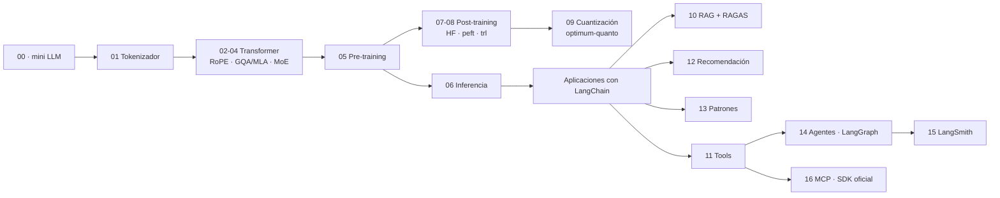

# LLM Edu Suite — Documentación en español

🇬🇧 [English version](../en/README.md) · [README principal](../../README.md)

Un curso práctico de ingeniería de LLMs en dos mitades:

1. **Por dentro (notebooks 00–06):** construimos un modelo de lenguaje desde cero en PyTorch (tokenizador, atención, RoPE, MoE, entrenamiento, inferencia) para entender cómo funciona.
2. **Con las herramientas de la industria (notebooks 07–16):** fine-tuning con Hugging Face (`transformers`, `peft`, `trl`), cuantización con `optimum-quanto`, RAG con LangChain evaluado con RAGAS, agentes con LangGraph, observabilidad y evaluación con LangSmith, y el Model Context Protocol con el SDK oficial.

Todo funciona en local: los LLMs los sirve **Ollama** (`qwen2.5:3b` y `nomic-embed-text`) y los modelos de entrenamiento son SmolLM2 de Hugging Face. Con una GPU NVIDIA va rápido (los resultados publicados se midieron en una RTX 3060 de 6 GB); en CPU también funciona. LangSmith es opcional.

## Páginas

| Página | Para qué sirve |
|---|---|
| [Instalación y entorno](instalacion.md) | `.venv`, PyTorch con CUDA, Ollama y sus modelos, el `.env`, la clave de LangSmith, problemas frecuentes |
| [Guía de notebooks](guia_notebooks.md) | los 17 notebooks uno a uno: qué construyes, con qué herramientas, qué conceptos y qué resultados |
| [Referencia de módulos](referencia_modulos.md) | el paquete `llm_edu_suite/` (el modelo desde cero y `config.py`) y dónde se enseña cada tema con frameworks |
| [Scripts de línea de comandos](scripts_cli.md) | `mini_llm`, `train`, `sample`, `finetune` (TRL), `rag_demo` (LangChain), `mcp_server` (FastMCP) |
| [Caso de estudio](caso_de_estudio.md) | el proyecto como caso de portafolio: v1 desde cero, v2 con frameworks, decisiones, problemas y resultados |
| [Glosario](glosario.md) | términos ES ↔ EN: GQA, LoRA, DPO, GRPO, RAGAS, LCEL, StateGraph, MCP, span, SLO… |

## Mapa por tópicos

| Tópico | Carpeta | Notebooks | Herramientas |
|---|---|---|---|
| Empieza aquí | `notebooks/00_start_here/` | 00 · un mini LLM completo | PyTorch |
| Arquitectura | `notebooks/01_architecture/` | 01 tokenización · 02 atención, RoPE y normalización · 03 atención eficiente · 04 FFN y MoE | PyTorch desde cero |
| Pre-entrenamiento e inferencia | `notebooks/02_pretraining_and_inference/` | 05 pre-entrenamiento · 06 inferencia · 09 cuantización | PyTorch · `optimum-quanto` |
| Post-training | `notebooks/03_post_training/` | 07 SFT, LoRA y destilación · 08 DPO y GRPO | `transformers` · `peft` · `trl` |
| Aplicaciones | `notebooks/04_applications/` | 10 RAG · 12 recomendación · 13 patrones de aplicación | LangChain · RAGAS · PyTorch |
| Agentes y MCP | `notebooks/05_agents_and_mcp/` | 11 tools y salida estructurada · 14 IA agéntica · 16 MCP | LangChain · LangGraph · SDK `mcp` |
| LLMOps | `notebooks/06_llmops/` | 15 observabilidad y evaluación | LangSmith |

## Ruta de aprendizaje sugerida

0. **Visión general:** 00, para ver cómo encajan las piezas antes de estudiarlas por separado.
1. **Arquitectura:** 01 → 02 → 03 → 04. Al terminar deberías poder escribir un transformer de memoria.
2. **Entrenamiento e inferencia:** 05 → 06.
3. **Post-training con Hugging Face:** 07 → 08, después 09 (cuantización).
4. **Aplicaciones con LangChain:** 10 → 13 → 12. Regla de oro: **construye tu set de evaluación antes que el sistema**.
5. **Agentes:** 11 → 14 → 16 y, al final, 15 para ver cómo se observa y evalúa todo en producción.

## Principios del proyecto

- **Entender por dentro, después usar la herramienta real.** El modelo se construye a mano porque así la atención o la KV-cache dejan de ser magia; las aplicaciones se construyen con los frameworks que usarás en el trabajo, con sus APIs actuales.
- **Todo se evalúa, con honestidad.** Cada notebook termina con la métrica que reportaría un profesional. Cuando algo no ayuda (un re-ranker LLM que empeora, DPO puro que degrada el modelo, un juez pequeño que hace ruido), el notebook lo muestra y explica por qué.
- **Local primero.** Ollama y modelos pequeños: cualquiera puede reproducir el curso en su portátil, sin coste. Para usar un proveedor en la nube basta con cambiar `LLM_PROVIDER` en el `.env`.
