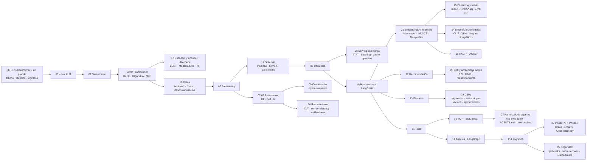

# LLM Edu Suite — Documentación en español

🇬🇧 [English version](../en/README.md) · [README principal](../../README.md)

Un curso práctico de ingeniería de LLMs en dos mitades, con un mapa para empezar: el notebook 30 (los transformers, en grande) se lee antes que nada. Sigue una frase a través de un modelo real y pequeño, SmolLM2-135M, desde los tokens hasta los embeddings, la atención, la predicción capa a capa (el logit lens) y la distribución del siguiente token, y enseña dónde están los parámetros, sin entrenar nada. Después:

1. **Por dentro (notebooks 00–06):** construimos un modelo de lenguaje desde cero en PyTorch (tokenizador, atención, RoPE, MoE, entrenamiento, inferencia) para entender cómo funciona.
2. **Con las herramientas de la industria (notebooks 07–16):** fine-tuning con Hugging Face (`transformers`, `peft`, `trl`), cuantización con `optimum-quanto`, RAG con LangChain evaluado con RAGAS, agentes con LangGraph, observabilidad y evaluación con LangSmith, y el Model Context Protocol con el SDK oficial.

El notebook 17 (encoders y encoder-decoders) completa la arquitectura y se lee justo después del 04: un encoder desde cero con MLM, ModernBERT ajustado para clasificar, embeddings + regresión logística frente a un LLM, y Flan-T5 con su cross-attention.

El notebook 18 (ingeniería de datos) se lee justo antes del 05, porque es lo que le pasa al texto antes del pre-entrenamiento: deduplicación exacta y con MinHash + LSH escrito desde cero, filtros de calidad con reglas y con un clasificador, descontaminación de benchmarks y datos sintéticos, sobre una muestra real de FineWeb, y dos modelos entrenados con datos en bruto y limpios para medir qué cambia.

El notebook 19 (sistemas) se lee justo después del 05: mide en la GPU adónde van la memoria y el tiempo de un entrenamiento (pesos, gradientes, Adam y activaciones; bf16 y activation checkpointing; FlashAttention y los kernels de atención; profiling, CUDA graphs y MFU) y cómo se reparte entre varias GPUs, con DDP real en dos procesos y una calculadora de ZeRO / FSDP para 7B y 70B.

El notebook 20 (razonamiento y cómputo en inferencia) se lee justo después del 08: allí GRPO es cómo se entrena el razonamiento; aquí, cómo se usa y cómo se mide. Sobre GSM8K con `qwen2.5:3b` compara la respuesta directa con la cadena de pensamiento, la self-consistency (maj@k frente a pass@k), best-of-N con un juez de 7B como verificador y el modelo de razonamiento destilado DeepSeek-R1-Distill 1.5B; los pone todos en una misma curva de coste y acierto, los ordena con Bradley-Terry y mide cuánto se contradice un juez LLM por pares cuando se cambia el orden de las respuestas.

El notebook 21 (embeddings y rerankers) se lee justo antes del 10: abre por dentro la capa de recuperación sobre la que se construye el RAG. Sobre SciFact compara BM25 con tres modelos de embeddings (con y sin prefijos de tarea), escribe InfoNCE a mano y ajusta un bi-encoder pequeño con negativos del batch y negativos difíciles, encoge los vectores con truncado Matryoshka y cuantización int8 / binaria con rescoring, y prueba la recuperación híbrida con dos rerankers cross-encoder, midiendo tanto la calidad como la latencia.

El notebook 22 (seguridad y guardrails) se lee justo después del 15: la observabilidad te dice qué hizo el sistema; este notebook trata de lo que debería hacer y de lo que no. Con `qwen2.5:3b` y `qwen2.5:7b` sobre benchmarks públicos (JailbreakBench y XSTest) mide las dos caras de la seguridad, las peticiones dañinas que rechaza y las seguras que rechaza sin motivo, y después tres plantillas de jailbreak publicadas, Llama Guard 3 (1B) como filtro de entrada, un system prompt de seguridad y todas las capas juntas, después de validar su juez de rechazos con etiquetas humanas.

El notebook 23 (serving bajo carga) se lee justo después del 06: el 06 abre por dentro una sola generación y este sirve los modelos como lo hace una aplicación, a través de un servidor HTTP y con muchas peticiones a la vez. Con un cliente en streaming contra Ollama mide el TTFT, el TPOT y el throughput, el prefill frente al decode según crece el prompt, lo que ahorra el prefix caching, un slot de peticiones frente a cuatro con 1 a 8 peticiones en vuelo (y la ley de Little), el mismo modelo de 1.5B en GGUF Q4_K_M, Q8_0 y FP16 (memoria, velocidad y acierto) y un gateway pequeño con fallbacks, timeouts y una cascada consciente del coste de `qwen2.5:3b` a `qwen2.5:7b`.

El notebook 24 (modelos multimodales) se lee justo después del 21: CLIP se entrena con la misma pérdida contrastiva que un modelo de embeddings de texto, solo que con imágenes en uno de los lados. Sobre 37 razas de gatos y perros (Oxford-IIIT Pet) mide CLIP en zero-shot con el nombre de la clase a secas, con una plantilla de prompt y con un ensemble de cinco, un linear probe con entre 1 y ~100 imágenes etiquetadas por raza y `qwen2.5vl:3b` en Ollama como clasificador (acierto, latencia, tokens por imagen y qué cambia con la resolución); después, extracción estructurada de imágenes de facturas sintéticas con un esquema JSON, limpias y degradadas, y un ataque tipográfico, una raza equivocada escrita sobre la imagen, contra CLIP y contra el VLM.

El notebook 25 (clustering y modelado de temas) también se lee justo después del 21, antes del 24: usa los mismos embeddings para averiguar qué hay dentro de un montón de texto sin etiquetar. Sobre los 3.080 mensajes de clientes de Banking77, tratados como logs sin etiquetar, compara dos modelos de embeddings y UMAP antes de k-means, intenta elegir el número de clusters con el silhouette score, deja que HDBSCAN encuentre por su cuenta los clusters y el ruido, describe cada cluster con palabras clave de c-TF-IDF y un nombre puesto por `qwen2.5:3b` y monta un bucle de monitorización de intenciones emergentes. Las 77 etiquetas de intención solo se usan para medir cada paso (ARI, NMI, pureza).

El notebook 26 (aprendizaje online y drift) se lee justo después del 12: reproduce MovieLens-1M como un flujo semanal y mide cómo envejece un recomendador congelado frente a reentrenarlo cada semana, a una ventana deslizante y a actualizaciones online con decaimiento (con evaluación precuencial, primero predecir y luego aprender), si el PSI de la distribución de entrada se da cuenta del cambio y si reentrenar cuando salta el drift es mejor que hacerlo según un calendario. Después, con Banking77, se pregunta si un cambio en lo que preguntan los usuarios se puede detectar solo con embeddings, con el desplazamiento del centroide, MMD con un test de permutaciones y un test de dos muestras con clasificador.

El notebook 27 (harnesses de agentes) se lee justo después del 16: abre la capa que convierte un modelo en un agente de programación, el tipo de programa que son Claude Code y Codex CLI. Lee el código de mini-swe-agent, un harness mínimo, función a función, lo amplía con un entorno aislado y una política de permisos, y lo ejecuta con Claude Haiku 5.5 (o cualquier modelo de litellm, también locales) sobre 16 tareas de programación evaluadas con tests ocultos, 3 ejecuciones cada una. Después mide qué aporta un fichero de memoria del proyecto, `AGENTS.md`, qué hace una inyección de prompt plantada en el repositorio y qué cuesta y qué da un perfil de harness moderno.

El notebook 28 (DSPy) se lee justo después del 13: deja de escribir prompts a mano. Sobre la muestra de Banking77 del 17 declara el clasificador como una signature de DSPy, compara ejemplos few-shot al azar con ejemplos vecinos elegidos para cada mensaje y con la recuperación sola, ejecuta tres optimizadores de prompts (bootstrap con búsqueda aleatoria, MIPROv2 y GEPA, con `qwen2.5:7b` escribiendo instrucciones para el 3B) y mide qué aportan un modelo más grande y un router que solo llama al LLM cuando los vecinos no se ponen de acuerdo, en acierto, latencia y llamadas al LLM.

El notebook 29 (frameworks de evaluación y trazas) se lee justo después del 15: lleva las mismas ideas a infraestructura de código abierto que corre en el portátil. Reproduce el resultado de GSM8K del 20 como una tarea de Inspect AI, mide cuánto cambian el número el scorer y las epochs muestreadas, y traza un pipeline de LangChain con OpenTelemetry hacia un servidor de Phoenix alojado en local: lee de vuelta la latencia y los tokens de cada paso desde el almacén de trazas, escribe evaluaciones sobre las trazas como anotaciones y mide lo que cuesta trazar.

Todo funciona en local: los LLMs los sirve **Ollama** (`qwen2.5:3b` y `nomic-embed-text`) y los modelos de entrenamiento son SmolLM2 de Hugging Face. Con una GPU NVIDIA va rápido (los resultados publicados se midieron en una RTX 3060 de 6 GB); en CPU también funciona, salvo el notebook 19, que necesita una GPU CUDA. LangSmith es opcional.

## Páginas

| Página | Para qué sirve |
|---|---|
| [Instalación y entorno](instalacion.md) | `.venv`, PyTorch con CUDA, Ollama y sus modelos, el `.env`, la clave de LangSmith, problemas frecuentes |
| [Guía de notebooks](guia_notebooks.md) | los 31 notebooks uno a uno: qué construyes, con qué herramientas, qué conceptos y qué resultados |
| [Fundamentos teóricos](fundamentos.md) | la teoría detrás de cada técnica y patrón: el problema que resuelve, la idea, por qué se usa hoy, cómo falla |
| [Referencia de módulos](referencia_modulos.md) | el paquete `llm_edu_suite/` (el modelo desde cero y `config.py`) y dónde se enseña cada tema con frameworks |
| [Scripts de línea de comandos](scripts_cli.md) | `mini_llm`, `train`, `sample`, `finetune` (TRL), `rag_demo` (LangChain), `mcp_server` (FastMCP), `harness_run` (mini-swe-agent), `inspect_tasks/gsm8k_cot` (Inspect AI) |
| [Caso de estudio](caso_de_estudio.md) | el proyecto como caso de portafolio: v1 desde cero, v2 con frameworks, decisiones, problemas y resultados |
| [Glosario](glosario.md) | términos ES ↔ EN: GQA, logit lens, LoRA, DPO, GRPO, RAGAS, LCEL, signature de DSPy, StateGraph, MCP, span, OpenTelemetry, SLO… |

## Mapa por tópicos

| Tópico | Carpeta | Notebooks | Herramientas |
|---|---|---|---|
| Empieza aquí | `notebooks/00_start_here/` | 30 · los transformers, en grande (se lee primero) · 00 · un mini LLM completo | `transformers` (30) · PyTorch |
| Arquitectura | `notebooks/01_architecture/` | 01 tokenización · 02 atención, RoPE y normalización · 03 atención eficiente · 04 FFN y MoE · 17 encoders y encoder-decoders | PyTorch desde cero · `transformers` y `scikit-learn` (17) |
| Pre-entrenamiento e inferencia | `notebooks/02_pretraining_and_inference/` | 18 ingeniería de datos (deduplicación, filtros, descontaminación) · 05 pre-entrenamiento · 19 sistemas (memoria, precisión, kernels, paralelismo) · 06 inferencia · 23 serving bajo carga (TTFT, batching, caché, GGUF, gateways) · 09 cuantización | PyTorch · `datasets` y `transformers` (18) · `torch.profiler` y `torch.distributed` (19) · Ollama por HTTP (23) · `optimum-quanto` |
| Post-training | `notebooks/03_post_training/` | 07 SFT, LoRA, destilación y fusión de modelos · 08 DPO y GRPO · 20 razonamiento y cómputo en inferencia | `transformers` · `peft` · `trl` · LangChain (Ollama) (20) |
| Aplicaciones | `notebooks/04_applications/` | 21 embeddings y rerankers · 25 clustering y modelado de temas (UMAP, HDBSCAN, c-TF-IDF) · 24 modelos multimodales (CLIP, VLMs, extracción de documentos) · 10 RAG · 12 recomendación · 26 aprendizaje online y drift · 13 patrones de aplicación · 28 optimización de prompts con DSPy (signatures, few-shot por vecinos, MIPROv2, GEPA) | LangChain · RAGAS · PyTorch · `sentence-transformers` (21, 25, 28) · `umap-learn` y `scikit-learn` (25) · CLIP con `transformers` y `qwen2.5vl:3b` con Ollama (24) · DSPy (28) |
| Agentes y MCP | `notebooks/05_agents_and_mcp/` | 11 tools y salida estructurada · 14 IA agéntica · 16 MCP · 27 harnesses de agentes (mini-swe-agent, tareas de programación, `AGENTS.md`) | LangChain · LangGraph · SDK `mcp` · mini-swe-agent con Claude Haiku 5.5 u Ollama (27) |
| LLMOps | `notebooks/06_llmops/` | 15 observabilidad y evaluación · 29 frameworks de evaluación y trazas (Inspect AI, Phoenix) · 22 seguridad: rechazos, jailbreaks y modelos guardián | LangSmith · Inspect AI y Arize Phoenix sobre OpenTelemetry (29) · Llama Guard 3 con Ollama (22) |

## Ruta de aprendizaje sugerida

0. **Visión general:** 30, para ver qué hace un modelo real con una frase, y después 00, para construir uno entero y ver cómo encajan las piezas antes de estudiarlas por separado. Después del 30 deberías saber que un modelo lee ids de tokens, que lo que devuelve es una distribución de probabilidad que una regla de decodificación convierte en texto, y que la mayoría de sus parámetros están en las capas feed-forward.
1. **Arquitectura:** 01 → 02 → 03 → 04 → 17. Al terminar deberías poder escribir un transformer de memoria y saber cuándo conviene un encoder o un encoder-decoder en lugar de un decoder-only.
2. **Datos, entrenamiento e inferencia:** 18 → 05 → 19 → 06 → 23. Primero qué texto entra en el modelo y por qué, después cómo se entrena con él y cuánto cuesta ese entrenamiento en memoria y tiempo, en una GPU y en muchas. Después del 23 deberías saber qué espera el usuario cuando se sirve un modelo (TTFT, TPOT, percentiles), por qué ayudan el batching, el prefix caching y los pesos cuantizados, y cómo dimensionar un servidor a partir de su tasa de peticiones.
3. **Post-training con Hugging Face:** 07 → 08 → 20, después 09 (cuantización). Después del 20 deberías saber qué compran los tokens de razonamiento, cuándo compensa votar o usar un verificador y cómo saber si te puedes fiar de un juez.
4. **Aplicaciones con LangChain:** 21 → 25 → 24 → 10 → 13 → 28 → 12 → 26. Después del 21 deberías saber elegir, ajustar, comprimir y evaluar un recuperador antes de meterlo en un RAG. Después del 25 deberías saber encontrar los temas de unos logs sin etiquetar, por qué el número de clusters es una elección y no un descubrimiento, y cómo vigilar la aparición de intenciones nuevas. Después del 24 deberías saber cuándo clasificar imágenes con embeddings y cuándo compensa pagar un VLM, cuánto cuesta una imagen en tokens y por qué el texto que aparece en una imagen es una entrada no fiable. Después del 26 deberías saber por qué un modelo que funcionaba el mes pasado puede no funcionar ahora, cómo evaluarlo sobre un flujo y por qué vigilar solo las distribuciones de entrada puede dejar pasar el drift que importa. Después del 28 deberías saber escribir un paso con un LLM como una signature en lugar de como un prompt, por qué los ejemplos que metes en un prompt importan más que su redacción, qué buscan los optimizadores de prompts y cuándo no pueden ayudar, y por qué una línea base sin LLM y una cascada van antes que cualquiera de ellos. Regla de oro: **construye tu set de evaluación antes que el sistema**.
5. **Agentes:** 11 → 14 → 16 → 27 y, al final, 15 para ver cómo se observa y evalúa todo en producción, y después 29 y 22. Al terminar el 27 deberías saber qué hace el harness de un agente de programación además de llamar al modelo, por qué el "terminado" de un agente necesita tests ocultos detrás y por qué la defensa contra instrucciones escondidas en un repositorio va en el harness. Al terminar el 29 deberías saber definir una evaluación como código (dataset, solver, scorer, epochs), por qué un framework tiene que reproducir tu número de confianza antes de adoptarlo, por qué el scorer forma parte de la métrica, y cómo las trazas, los spans y las anotaciones de OpenTelemetry te dan la latencia y los tokens de cada paso y los fallos localizables en tu propia máquina. Al terminar el 22 deberías saber medir los rechazos de un modelo y también sus rechazos de más, por qué los rechazos del propio modelo no bastan como defensa y cuánto cuesta un modelo guardián en falsos positivos.

## Principios del proyecto

- **Entender por dentro, después usar la herramienta real.** El modelo se construye a mano porque así la atención o la KV-cache dejan de ser magia; las aplicaciones se construyen con los frameworks que usarás en el trabajo, con sus APIs actuales.
- **Todo se evalúa, con honestidad.** Cada notebook termina con la métrica que reportaría un profesional. Cuando algo no ayuda (un re-ranker LLM que empeora, DPO puro que degrada el modelo, un juez pequeño que hace ruido), el notebook lo muestra y explica por qué.
- **Local primero.** Ollama y modelos pequeños: cualquiera puede reproducir el curso en su portátil, sin coste. Para usar un proveedor en la nube basta con cambiar `LLM_PROVIDER` en el `.env`.
