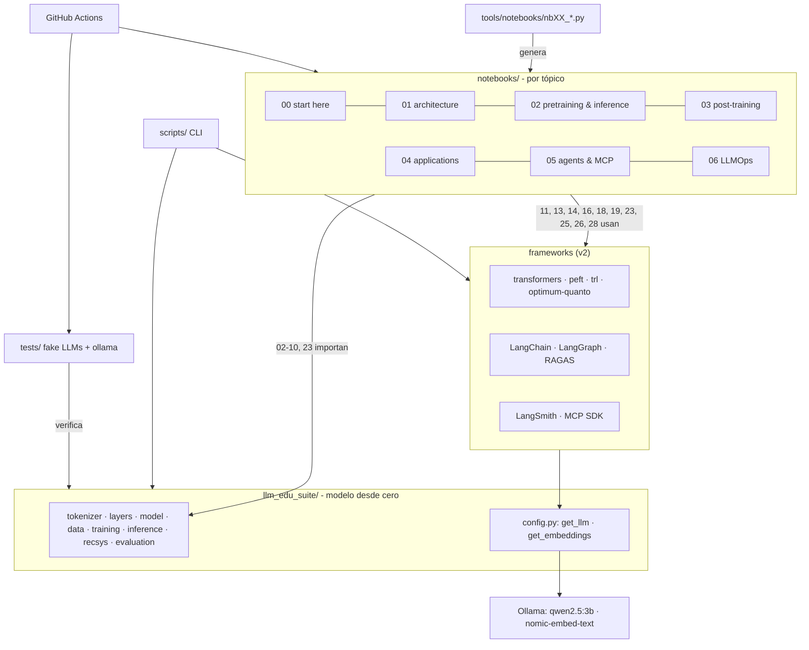

# Caso de estudio: LLM Edu Suite

🇬🇧 [English version](../en/case_study.md) · [← Volver al índice](README.md)

> **Resumen.** Un curso práctico de ingeniería de LLMs en dos mitades: un modelo de lenguaje construido **desde cero en PyTorch** para entender cómo funciona por dentro, y aplicaciones construidas con **las herramientas que usa la industria** (Hugging Face `transformers`/`peft`/`trl`, LangChain, LangGraph, LangSmith, RAGAS y el SDK oficial de MCP), con modelos locales vía Ollama. 17 notebooks ejecutados y evaluados, docs en español e inglés y CI. El proyecto tuvo dos versiones: **v1** lo implementaba todo a mano y lo llevé a un estado verificado de punta a punta (bugs corregidos, experimentos rediseñados); **v2** reemplazó la capa de aplicaciones por frameworks reales. Cada decisión está documentada con números medidos.

> La sección 11 describe la migración a v2 (frameworks reales) y la 12, la versión 2.1 (teoría en todos los notebooks, un recomendador real sobre MovieLens-1M y evaluación con intervalos). Las secciones 2–8 cuentan el trabajo de v1, que sigue siendo la base del modelo desde cero.

## 1. Contexto y objetivo

Los LLMs se suelen aprender "de arriba hacia abajo": se llama a una API y se encadenan prompts. Este proyecto hace lo contrario. Implementa cada capa en código legible para entender **por qué** funcionan las cosas y **cómo se mide** si funcionan.

Objetivos:

1. **Didáctico**: que sirva como guía de estudio ordenada por tópicos, con teoría, código y evaluación en el mismo lugar.
2. **Riguroso**: cada técnica se evalúa con la métrica que usaría un equipo en producción (perplejidad, exact match, recall@k, nDCG, KL, TTFT, p95, coste por petición…).
3. **Reproducible y accesible**: todo corre en un portátil, en CPU, sin descargas ni claves de API, con semillas fijas.
4. **Honesto**: cuando una técnica no mejora en el entorno de juguete, el notebook lo dice y explica por qué.

## 2. Alcance (v1)

| Área | Qué se construyó |
|---|---|
| Arquitectura | BPE byte-level; RMSNorm, RoPE (con escalado tipo Llama 3.1); MHA/GQA/MQA/MLA; ventana deslizante, Longformer, block-sparse, atención lineal e híbridos; SwiGLU; MoE con balanceo aux-loss y aux-free |
| Entrenamiento | pipeline completo, AdamW con grupos, cosine/WSD, AMP, acumulación, clipping, checkpoints |
| Inferencia | estrategias de muestreo, KV-cache, decodificación especulativa desde cero, batching, dimensionado de la caché |
| Post-training | SFT con loss masking, LoRA (y su modo de fallo), destilación, DPO, DPO+NLL, GRPO |
| Eficiencia | cuantización absmax por tensor/fila/bloque, NF4, modelo cuantizado completo |
| Aplicaciones | RAG híbrido (BM25 + denso + RRF), recomendador secuencial (SASRec), extracción, clasificación, caché semántica, guardia anti-inyección, procesamiento por lotes con coste |
| Agentes | tools con JSON Schema, bucle de agente, salida estructurada; presupuestos y detección de bucles, plan-and-execute, reflexión con verificador, memoria corta y larga, supervisor multi-agente, evaluación de trayectorias |
| LLMOps | trazas y spans al estilo OpenTelemetry, coste por petición, percentiles, SLOs, puntuaciones de calidad online, redacción de PII, muestreo, exportación JSONL y OTLP |
| Protocolos | Model Context Protocol desde cero: JSON-RPC 2.0, servidor, cliente, transportes en memoria y stdio, puente al agente, controles de seguridad, y un servidor MCP real compatible con Claude Code y Claude Desktop |

## 3. Arquitectura del proyecto

Tres decisiones de diseño:

- **Los notebooks se generan desde código** (`tools/notebooks/nbXX_*.py`). Los cambios se revisan como código, los diffs son legibles y los notebooks nunca se desincronizan. El notebook 01 exporta además sus celdas a `scripts/mini_llm.py`, de modo que el notebook y el script salen de una única fuente.
- **Una sola clase de modelo configurable** (`ModelConfig`): todas las variantes de atención y de FFN se comparan en igualdad de condiciones.
- **Un `MockLLM` determinista** en lugar de una API: los pipelines de RAG, agentes, observabilidad y MCP se ejecutan y se testean sin red. Basta una línea para cambiar a un modelo real (`OpenAICompatibleClient`).

## 4. Proceso de verificación (v1)

La primera versión tenía tests y notebooks, pero los notebooks con PyTorch **nunca se habían ejecutado**. Este fue el proceso:

1. **Entorno aislado** (`.venv`, primero con PyTorch CPU y después con **PyTorch CUDA para la RTX 3060**: la ejecución completa de los 17 notebooks pasó de ~40 a ~15 minutos). El Python global tenía `matplotlib 3.7` compilado contra NumPy 1.x junto a NumPy 2.4, y fallaba al importar. Es un buen ejemplo de por qué conviene aislar el entorno.
2. **Tests**: 11 de 49 fallaban al principio.
3. **Ejecución de todos los notebooks** con un ejecutor headless propio (`tools/run_notebooks.py`) y revisión de cada salida, no solo de que no hubiera excepciones.
4. **Revisión cruzada documentación ↔ código**: un agente leyó cada módulo para escribir la referencia y reportó 14 discrepancias. Las verifiqué una a una antes de corregirlas.
5. **Rediseño de experimentos** que se ejecutaban sin errores pero daban resultados sin valor didáctico.

## 5. Bugs encontrados y corregidos (v1)

| Problema | Causa | Solución |
|---|---|---|
| 10 tests del modelo fallaban | `.view()` sobre tensores no contiguos (PyTorch reciente es más estricto) | `.reshape()` en `model.py`, `evaluation.py` y `finetune.py` |
| El test de DPO fallaba con `IndexError` | `make_reverse_preferences` generaba tokens 1–400 aunque el vocabulario fuera de 128 | parámetro `token_range` acotado a ids válidos; además, la respuesta "rechazada" ahora siempre difiere de la elegida |
| `finetune.py --lora` se rompía en DPO | tras `merge_lora` los pesos base seguían congelados y los adaptadores ya no participaban, así que no había nada entrenable | descongelar el modelo después de fusionar |
| `sample.py --prompt ""` fallaba con tokenizador | `torch.tensor([[]])` es float32 y rompe el embedding | dtype explícito y token inicial por defecto |
| El timeout de las tools no cortaba nada | se comprobaba *después* de que la función terminara | ejecución en un hilo con `future.result(timeout)`, con su test |
| Rutas `/tmp/...` en los notebooks | no existen en Windows | `tempfile.gettempdir()` |
| Notebooks sin `id` de celda | exigido por nbformat ≥ 4.5 | ids deterministas en el generador |
| Docstrings engañosos | p. ej. `PreferencePair` no existía; la pérdida auxiliar de MoE vale top_k (no 1) con balance perfecto; en GRPO el ratio siempre es 1 con una actualización por lote | documentación corregida para reflejar el comportamiento real |

## 6. Experimentos rediseñados en v1 (antes → después)

Los notebooks "funcionaban", pero varios resultados no enseñaban nada o, peor, enseñaban algo falso. Cada cambio se validó con experimentos previos antes de entrar en el notebook.

### Fine-tuning (notebook 13)

| | Antes | Después | Qué cambió |
|---|---|---|---|
| SFT completo | 44% exact match | **100%** | 1.500 ejemplos sobreajustaban (pérdida de train 0,13 con ppl de test 4,8). Pasé a 8.000 ejemplos y lr 2e-3 |
| LoRA | 0% con cualquier rango | 0% → **95,3%** | **Diagnóstico**: los tokens de rol del chat nunca aparecieron en el pre-entrenamiento y LoRA congela los embeddings. Ahora el notebook *muestra* el fallo, lo explica y lo corrige con `apply_lora(train_embeddings=True)`, el equivalente a `modules_to_save` de peft |
| Ablación de rango | 0 / 0 / 0 / 0 / 0% | **1,3 / 1,3 / 48,0%** (r = 1 / 4 / 16, con 800 pasos) | la ablación ahora tiene señal: hace falta rango para aprender un comportamiento nuevo |
| Destilación | el student destilado (68,7%) quedaba *peor* que sin destilar (98%) | **24,7% → 98,0%** | escenario realista: pocas etiquetas humanas y un teacher que etiqueta prompts sin etiquetar. La destilación por logits resultó frágil (98,7% en CPU, 44,7% en GPU), y el notebook lo explica |

### Preferencias y RL (notebook 14)

| | Antes | Después |
|---|---|---|
| SFT de partida | 4,7% (sin margen para mejorar) | 70,7% |
| DPO | 4,7% → 0%, ppl 27 → 393 | DPO puro: **70,7% → 46,7%**, ppl 1,76 → 3,66. El notebook muestra el *likelihood displacement* con gráficas |
| DPO + NLL | — | **80,0%**, ppl 1,46 (`train_dpo(nll_weight=1.0)`, equivalente a `rpo_alpha` en trl) |
| GRPO | 4,7% → 2,0% | 70,7% → 74,0% con recompensa exacta y 72,7% con recompensa densa. El notebook lo usa para enseñar que la recompensa proxy no es la métrica (ley de Goodhart) |

### Otros

- **Atención eficiente (04)**: la comparación usaba la perplejidad global, dominada por 44 de cada 55 tokens aleatorios, así que todas las variantes salían igual (~243). Pasé a medir la **precisión de copia** solo en los tokens repetidos y a entrenar 1500 pasos. Resultado: denso 99,9%, block-sparse 88,7%, híbrido 48,4%, ventana deslizante 0,6% y lineal 0,3%. Además, a los 300 pasos incluso el denso está en 0,3%: es la transición de fase de las *induction heads*.
- **Pre-entrenamiento (08)**: todas las ablaciones daban la misma perplejidad (2,78 frente a 2,78), porque el modelo ya estaba en el suelo de entropía del corpus. Ahora el notebook **calcula analíticamente la pérdida irreducible** (4·ln 10 nats por frase) y compara curvas de aprendizaje contra ese suelo: es el término *E* de Chinchilla hecho tangible.
- **MoE (05)**: la demo de balanceo aux-free oscilaba (`bias_lr=0.1` es enorme para scores sigmoides). Con 0,01 converge de 4,0× a ~1,15× de desequilibrio, y el notebook grafica ambas configuraciones.
- **Muestreo (10)**: con la misma semilla las estrategias daban salidas idénticas porque la distribución está muy concentrada. Ahora se mide la entropía y la diversidad (distinct-2) y se grafica la distribución filtrada.
- **Cuantización (11)**: la perplejidad apenas cambiaba (3 bits salía "mejor" que fp, por ruido). Añadí la **KL frente al modelo fp** y el **acuerdo top-1**, las métricas que usa llama.cpp. Muestran una degradación monótona: 98,6% de acuerdo con NF4 a 4 bits y 88% a 2 bits.

## 7. Extensiones nuevas (v1)

| Pieza | Por qué importa | Evidencia |
|---|---|---|
| **01 · mini LLM en un notebook** | ver cómo encajan todas las piezas sin saltar entre módulos | autocontenido (solo torch); también disponible como script |
| **25 · IA agéntica** | los agentes en producción fallan por bucles, coste y falta de evaluación, no solo por respuestas incorrectas | plan-and-execute resuelve 6/6 tareas multi-paso frente a 2/6 de un solo bucle; cada ejecución tiene un motivo de parada |
| **26 · MCP** | es el estándar actual para conectar herramientas a LLMs | servidor propio que pasa 7/7 checks de conformidad por stdio real y funciona con Claude Code |
| **28 · observabilidad** | sin trazas no se puede depurar ni controlar el coste de un sistema LLM | árbol de spans, p50/p95/p99, SLOs, puntuaciones de calidad y drill-down a la peor traza |

## 8. Lecciones aprendidas

1. **"Se ejecuta" no es "funciona".** Todos los notebooks corrían sin excepciones y aun así varios enseñaban conclusiones equivocadas. Hay que leer los números.
2. **Diagnosticar antes de ajustar hiperparámetros.** El 0% de LoRA no era un problema de learning rate ni de rango, sino de embeddings congelados para tokens nuevos. Ese mismo fallo aparece en la práctica al hacer fine-tuning con un chat template nuevo.
3. **Conocer el óptimo teórico cambia la conversación.** Con un corpus de entropía conocida, "perplejidad 2,8" deja de ser un número abstracto y pasa a significar "a un X% del suelo".
4. **El hardware también cambia los resultados.** Al pasar de CPU a GPU, modelos tan pequeños siguen trayectorias de entrenamiento distintas. Las conclusiones robustas se mantuvieron; las frágiles (la destilación por logits) quedaron en evidencia. Los textos se reescribieron para ser ciertos en ambos casos.
5. **Las métricas sensibles importan.** La perplejidad no detectaba la degradación por cuantización; la KL sí.
6. **Optimizar un proxy no es optimizar el objetivo.** La recompensa densa de GRPO subía y el exact match no.
7. **Revisión cruzada documentación ↔ código.** Escribir la referencia de módulos destapó 14 discrepancias que los tests no veían.

## 9. Stack y herramientas

**v1:** Python, PyTorch, NumPy, matplotlib, pytest, Jupyter/nbclient, GitHub Actions; todo lo demás implementado a mano.

**v2:** lo anterior para el modelo desde cero, más Hugging Face `transformers`, `peft`, `trl`, `datasets` y `optimum-quanto`; LangChain (`langchain-core`, `langchain-community`, `langchain-classic`, `langchain-ollama`), LangGraph, LangSmith, RAGAS, FAISS, BM25, Pydantic; el SDK oficial `mcp` (FastMCP) y `langchain-mcp-adapters`; Ollama para servir los modelos locales.

**v2.1:** además LightGBM (LambdaMART), `bitsandbytes` (QLoRA), un índice HNSW de FAISS y MovieLens-1M como dataset real; `qwen2.5:7b` como juez opcional.

**v2.2–v2.11:** además `sentence-transformers`, scikit-learn, `umap-learn`, DSPy (con Optuna para MIPROv2), Arize Phoenix con OpenInference, Inspect AI (en su propio `.venv-eco`), mini-swe-agent con litellm (en su propio `.venv-harness`), y Claude Haiku 5.5 por la API de Anthropic para el harness de agentes.

## 10. Próximos pasos

El curso está completo en su alcance previsto. Lo siguiente, como paso nuevo: un *mini-R1*, la receta completa de un modelo de razonamiento tipo R1 sobre el mini LLM hecho desde cero del notebook 01 (preentrenamiento en una tarea verificable, un SFT corto con soluciones paso a paso, GRPO escrito desde cero con una recompensa de respuesta exacta), y los niveles de `effort` de un modelo de API medidos sobre el GSM8K del notebook 15. Consulta la [hoja de ruta del README](../../README.md#roadmap) y las secciones 11–13 para lo que añadió cada versión.

## 11. v2: de construirlo todo a usar las herramientas reales

**Por qué.** v1 enseñaba cómo funciona cada pieza, pero implementaba también RAG, agentes, trazas y MCP a mano. Para un portafolio y para el día a día, lo valioso es saber **usar bien las herramientas estándar** y entender qué hacen por dentro. v2 conserva desde cero solo el modelo (notebooks 00–06, donde ver la atención o la KV-cache escrita es el objetivo) y reescribe la capa de aplicaciones con frameworks reales. v1 queda publicada con el tag `v1.0-from-scratch`.

**Decisiones de arquitectura**

| Decisión | Por qué |
|---|---|
| Modelos locales con **Ollama** (`qwen2.5:3b`, `nomic-embed-text`) | gratis, offline y reproducible por cualquiera; cabe en una GPU de 6 GB |
| Un único `llm_edu_suite/config.py` (`get_llm()`, `get_embeddings()`) leído de `.env` | cambiar todo el curso a OpenAI o Anthropic es una línea de configuración, no de código |
| **LangSmith** opcional | el notebook 28 funciona sin clave; con clave, todas las llamadas del curso quedan trazadas |
| Un generador por notebook (`tools/notebooks/nbXX_*.py`) | permitió reescribir bloques **en paralelo** sin conflictos, y los cambios se revisan como código |
| Tests con **modelos falsos de LangChain** + tests de integración marcados `ollama` | la CI de GitHub no tiene GPU ni Ollama, pero sí verifica la lógica en cada push |

**Qué se eliminó.** Siete módulos propios que duplicaban frameworks (`rag`, `agents`, `agentic`, `observability`, `mcp`, `applications`, `llm_client`/MockLLM), más `finetune` y `quant`. Cada tema pasó a enseñarse con la herramienta real: RAG con LangChain + RAGAS, agentes con LangGraph, trazas con LangSmith, MCP con FastMCP, fine-tuning con TRL y cuantización con `optimum-quanto`.

**Resultados v2 (modelos reales en lugar de modelos de juguete)**

| Notebook | Resultado medido |
|---|---|
| 11 · cuantización (SmolLM2-360M) | int8/float8 ~96% de acuerdo top-1 a 0,41 GB; int4 73%; int2 rompe el modelo |
| 13 · SFT/LoRA (SmolLM2-135M) | few-shot 17,5% → **SFT completo 35%**, LoRA r=16 32,5% con el 3,5% de los parámetros. La trampa del token nuevo se reproduce en el modelo real: **0% → 100%** al entrenar los embeddings |
| 13 · destilación | un teacher de 360M (87,5%) etiqueta 600 prompts; el estudiante de 135M pasa del 35% al **55%** |
| 14 · DPO/GRPO | DPO puro: exact match **30% → 7,5%** (likelihood displacement); DPO+NLL 32,5%. **GRPO: 5% → 46%** en aritmética con solo un verificador |
| 18 · RAG + RAGAS | híbrido BM25 + denso: **MRR de evidencia 0,84** frente a 0,73 solo denso; RAGAS context precision 0,76 → 0,84 |
| 19 · patrones de aplicación | map-reduce 11/13 temas frente a 9/13 de una llamada truncada en silencio (6/13 en otra ejecución); guardia anti-inyección **10/10 ataques, 0/10 falsos positivos** |
| 25 · LangGraph | todos los guardrails paran con un motivo explícito; ReAct supera a plan-and-execute (80% frente a 60%) con un tercio de las llamadas |
| 26 · MCP | servidor FastMCP con **14/14 checks de conformidad**; el agente responde 6/6 preguntas vía MCP |
| 28 · LangSmith | con recuperación la corrección juzgada pasa de **0,17 a 0,83**; el feedback online destapó un bug real en el prompt de una tool |

**Problemas reales de la migración (y cómo se resolvieron)**

- **Las APIs cambiaron mucho**: en trl 1.x, `rpo_alpha` desapareció (DPO+NLL ahora es `loss_type=["sigmoid","sft"]`); en LangChain 1.x, `EnsembleRetriever` vive en `langchain-classic` y `create_react_agent` pasó a `langchain.agents.create_agent`; en transformers 5, `torch_dtype` pasó a `dtype`. Los notebooks usan las APIs actuales y lo explican.
- **Compatibilidad del ecosistema**: `langchain-mcp-adapters` aún no soporta el SDK `mcp` 2.x, así que el proyecto fija `mcp>=1.24,<2`. Es una decisión de compatibilidad, no de preferencia.
- **Una GPU de 6 GB compartida**: entrenar con TRL mientras Ollama servía al LLM llenó la VRAM y **colgó Ollama durante más de una hora**. Solución: los notebooks de entrenamiento se limitan a 1,5 GB de VRAM (`set_per_process_memory_fraction`) y los notebooks con LLM se ejecutan en serie.
- **El juez pequeño es ruidoso**: con `qwen2.5:3b` como juez de RAGAS, algunas respuestas correctas reciben 0. El notebook lo muestra y recomienda validar el juez y usar uno más grande en producción.
- **Los números se mueven entre ejecuciones** (LLM real, juez LLM): tras la ejecución final contrasté cada cifra del texto con su salida (un script marca los números del markdown que no aparecen en los outputs) y reescribí los párrafos que habían cambiado.

**Lecciones v2**

1. **Un framework no te ahorra evaluar.** RAGAS, LangSmith `evaluate()` y las métricas de trayectoria fueron lo que permitió decir qué funcionaba y qué no.
2. **El modelo pequeño cambia las conclusiones.** Con un 3B, ReAct gana a plan-and-execute y el re-ranking con LLM empeora la recomendación; con modelos grandes puede ser distinto. Por eso el curso enseña el **método** (sets etiquetados, mismas métricas para cada diseño), no un veredicto universal.
3. **Ejecutar todo en local tiene costes de ingeniería reales** (VRAM, colas, timeouts) que hay que diseñar desde el principio.

## 12. v2.1: teoría, un recomendador de verdad y evaluación con incertidumbre

**Por qué.** v2 enseñaba con las herramientas reales, pero tenía tres huecos. La teoría estaba repartida y era desigual entre notebooks. El recomendador seguía siendo un juguete sintético (200 ítems, clusters de gusto inventados) con un re-ranker LLM que empeoraba la lista (hit@10 0,20 → 0,16). Y las comparaciones con 20 preguntas se leían sin intervalos, con un juez de 3B que se juzgaba a sí mismo. v2.1 ataca los tres.

**Teoría en todos los notebooks.** Cada notebook tiene ahora apartados "Background: ..." antes del código que los usa (problema, idea con ecuaciones, por qué funciona, con qué compite, cómo falla), y hay una guía teórica completa en [fundamentos](fundamentos.md). Escribirla obligó a comprobar afirmaciones contra las versiones instaladas, y salió alguna corrección: en LangGraph 1.2 el `recursion_limit` por defecto es 10.007, no 25, así que un agente que entra en bucle no se detiene pronto por sí solo y cada ejecución del notebook 25 pasa su propio límite.

**El recomendador, reconstruido desde cero** (notebook 23). Ahora es el embudo de la industria sobre MovieLens-1M (1.000.209 valoraciones, 6.040 usuarios, 3.706 películas), con un protocolo que no se deja engañar: *leave-last-two* en orden temporal, ranking completo sobre todo el catálogo (Krichene y Rendle, 2020), un 10% de las películas reservadas como estrenos fríos y bootstrap pareado en cada comparación. Y una regla: una etapa solo entra si mejora a la anterior en validación.

- SASRec, el `TransformerLM` del notebook 03 entrenado con softmax completa, llega a hit@10 0,293 (ItemKNN 0,125, popularidad 0,036), dentro del rango publicado para este dataset.
- **El primer ranker no pasó la puerta.** Entrenado con un único positivo por usuario (unos 4.000 grupos de consulta), LambdaMART no superaba a SASRec: la mejor feature era la propia puntuación de SASRec y los árboles la reaprendían con ruido. En lugar de ajustar hiperparámetros a ciegas, revisé cómo lo hacen los pipelines de dos etapas de RecTools y las mejores soluciones de Kaggle OTTO. Dos cambios lo arreglaron: ajustar los modelos de recuperación sobre el historial menos los 8 últimos eventos y convertir cada uno en una consulta del ranker (48.320 eventos → 35.762 consultas, 1,82 M filas), y darle features que SASRec no ve (valoraciones explícitas, demografía, co-visitas, tiempo desde el evento anterior, tendencias).
- Con eso pasa la puerta (nDCG de validación +0,0059 [+0,0022, +0,0096]) y en test sube el hit@10 de 0,293 a **0,307** (+1,4 puntos [+0,7, +2,1]). Una ganancia modesta y real, del tamaño que suele aportar un ranker de segunda etapa sobre una primera etapa fuerte.
- El re-ranking final mide lo que intercambia: una ranura de exploración lleva el hit@10 en estrenos de 0,009 a 0,044 por 0,7 puntos globales, y MMR con λ = 0,8 sube la diversidad de 0,659 a 0,719 por 0,4 puntos.

**Dónde ayudó el LLM en recomendación, y dónde no**

| Uso del LLM | Resultado |
|---|---|
| palabras clave por película (`qwen2.5:7b`, offline) mezcladas en el texto del ítem | **peor**: hit@10 del contenido 0,033 → 0,023; la validación las rechazó |
| las mismas palabras clave como feature del ranker | +0,0012 [−0,0012, +0,0035]: nada medible, no compensa una hora de LLM |
| entender peticiones en lenguaje natural y convertirlas en filtros | **claramente mejor**: cumplimiento de restricciones@5 0,60 → 0,87; 1 fallo de salida estructurada en 221 |
| personalizar dentro del conjunto filtrado | lo hace el recomendador, no el LLM: hit@10 0,555 con SASRec frente a 0,285 con popularidad |
| explicaciones ancladas en el historial | citan un ancla el 97%; mencionan una película fuera del historial el 7% frente al 13% sin anclas |

Los LLMs pequeños no superan a los modelos colaborativos ordenando, pero son excelentes en el lenguaje que rodea al recomendador.

**Evaluación con incertidumbre, y un juez más fuerte** (notebook 18). `evaluation` ganó `bootstrap_ci` y `paired_bootstrap_diff`, y `config` ganó `judge_model()`: `qwen2.5:7b` si está descargado (o `JUDGE_MODEL`), el modelo de chat si no. Con el juez de 7B y sus intervalos, de las cuatro métricas de RAGAS solo una muestra una diferencia clara entre recuperación densa e híbrida: context precision 0,79 → 0,92 (+0,13 [+0,03, +0,25]). Faithfulness (0,87 en ambas) y relevancy (0,78 → 0,75) no se mueven. El juez de 3B había informado de faithfulness 0,38 → 0,54 y relevancy 0,44 → 0,30: **un juez débil no solo mete ruido, inventa efectos**. El precio: 1038 s de puntuación frente a unos 7 minutos con el 3B. El notebook 28 sigue juzgado por el 3B (sus salidas no cambiaron; solo ganó teoría).

**QLoRA** (notebook 13). La misma LoRA sobre el base en NF4 con doble cuantización y `paged_adamw_8bit`: 37,5% de exact match frente a 32,5% de LoRA, con el mismo 86,5% de campos (dos peticiones de 40, ruido: la lectura honesta es "sin pérdida"). Los pesos bajan de 269 MB a 110 MB, pero el pico de entrenamiento apenas se mueve (1,41 → 1,34 GB) porque a 135M dominan las activaciones; para un 7B serían 14 GB → 3,6 GB. El 07 sube su presupuesto de VRAM a 2 GB porque entrena once modelos y el de 4 bits deja ~0,1 GB ocupados.

**Dependencias e infraestructura.** `pyproject.toml` es la única fuente de dependencias (`requirements.txt` solo contiene `-e .[dev]`; `requirements-dev.txt` desapareció; `openai` y `anthropic` son extras opcionales), con dos nuevas: `lightgbm>=4.5` y `bitsandbytes>=0.45`. `tools/build_notebooks.py --keep-outputs` regenera un notebook desde su generador conservando las salidas de las celdas de código que no cambiaron, lo que permitió añadir la teoría sin volver a ejecutar horas de notebooks. La CI pasó a `actions/checkout@v5`, `setup-python@v6`, `ubuntu-24.04` y Python 3.11/3.12.

**Lecciones v2.1**

1. **Poner una puerta antes de cada etapa cambia cómo trabajas.** El primer ranker habría entrado en el sistema si solo hubiera mirado la pérdida de entrenamiento; la puerta lo rechazó y me obligó a entender por qué. La solución estaba documentada en la práctica de la industria, no en un hiperparámetro.
2. **Medir el juez es parte de medir el sistema.** Las diferencias de faithfulness y relevancy que v2 contaba como resultado eran artefactos del juez. Sin intervalos y sin un juez más fuerte, habría seguido contándolas.
3. **Usar el LLM donde aporta, y decir dónde no.** En recomendación, el mismo modelo empeoró el ranking y mejoró claramente la comprensión de peticiones. El resultado útil es la tabla, no un "los LLMs ayudan" o "no ayudan".
4. **Un intervalo cambia la conversación.** "+1,4 puntos [+0,7, +2,1]" se defiende; "0,307 frente a 0,293" a secas, no.

## 13. v2.2–v2.11: de un curso a un plan de estudios completo

**Por qué.** Después de la v2.1, el curso enseñaba bien el modelo y las aplicaciones principales, pero le faltaba lo siguiente con lo que se encuentra un ingeniero de LLMs en el trabajo: pesos reales, datos y sistemas a escala, razonamiento, servicio bajo carga, seguridad, entradas multimodales, modelos que envejecen y agentes que escriben código. Cada versión añadió una de esas áreas con las mismas reglas: resultados medidos, *Results* e *In production* al final de cada notebook, y los resultados negativos se quedan.

| versión | qué añadió | un resultado que cambió cómo se enseña el tema |
|---|---|---|
| v2.2 | los pesos publicados de SmolLM2 en el transformer hecho desde cero; encoders y encoder-decoders | salida greedy idéntica a Hugging Face (logits a menos de 3e-5); en Banking77, ModernBERT afinado (93,0 %) y embeddings + regresión logística (93,3 %) superan a un LLM de 3B con few-shot (61,9 %) |
| v2.3 | ingeniería de datos; sistemas para entrenar | un modelo entrenado sobre el crawl en bruto memoriza las páginas repetidas (pérdida 4,35 frente a 5,28 deduplicado); la memoria cuadra con la regla de 16 bytes por parámetro al MB |
| v2.4 | razonamiento y cómputo en inferencia; fusión de modelos | chain of thought 12,5 % → 85 % en GSM8K; best-of-5 con un juez de 7B salió peor que una votación simple; el entrenamiento multitarea superó a todas las fusiones |
| v2.5 | embeddings y rerankers afinados; patrones multiagente y un sandbox de código; MCP avanzado | 22 s de fine-tuning contrastivo subieron nDCG@10 de 0,648 a 0,762, por encima de modelos listos para usar más grandes |
| v2.6 | seguridad y guardrails; servicio bajo carga | la inyección de prefijo subió el éxito de los ataques del 4 % al 64 %; una cascada 3B → 7B superó a ambos modelos |
| v2.7 | multimodal; clustering y modelado de temas; aprendizaje online y drift | los monitores de entrada (PSI 0,01–0,03) no vieron una deriva de concepto que le costó al recomendador un 13 % de su tasa de aciertos |
| v2.8 | un harness de agentes (mini-swe-agent) con modelos locales | modelos de 3–8B resolvieron el 20–30 % de 10 tareas de código; 11 de 30 ejecuciones dijeron "terminado" sin estarlo |
| v2.9 | la visión general del transformer; DSPy; Inspect AI y Phoenix | un router por recuperación superó a todos los optimizadores de DSPy (0,922 frente a ≤ 0,558) con el 3 % de las llamadas al LLM; el scorer de serie de un framework movió GSM8K 5 puntos |
| v2.10 | el harness con Claude Haiku 5.5, 16 tareas × 3 ejecuciones | 100 % resueltas por 0,42 US$; cinco bugs del harness encontrados leyendo trayectorias |
| v2.11 | notebooks renumerados en orden de estudio; una guía de cierre *Del notebook a producción*; `AGENTS.md` | el número de un notebook es ahora su lugar en el curso |

**Lo que enseñó el harness de agentes (v2.8 → v2.10).** La primera versión ejecutaba tres modelos locales y medía sobre todo sus límites. Pasar el mismo harness a un modelo de API hizo visible al propio harness, porque todos los fallos que quedaban eran suyos:
- **Sin contexto de trabajo:** el agente buscaba por todo el disco (`find /`).
- **Un timeout que mataba a bash pero no a sus hijos:** un `vim` o un `find` sueltos colgaban la ejecución para siempre.
- **Un tope de 1.024 tokens por respuesta, pensado para modelos locales pequeños:** demasiado corto para un modelo que razona antes de responder.
- **Una verificación que exigía código de salida 0:** rechazaba trabajo correcto tras un `pytest` inofensivo ("no tests ran") o un `grep` vacío.
- **El enmascarado de observaciones en el cliente:** editaba el historial, y la API lo rechaza con los modelos Claude actuales (preserved thinking).

Los cinco se encontraron leyendo trayectorias, no mirando la tasa de resueltas. Una vez corregidos, la suite se saturó al 100 %, así que la comparación entre diseños de harness pasó de la precisión al costo: el perfil moderno gasta un 28 % más de tokens y no aporta nada en tareas cortas con un modelo fuerte.

**La renumeración (v2.11).** Los notebooks estaban numerados en el orden en que se escribieron, así que el orden de estudio vivía en un mapa aparte. Renumerar 31 notebooks tocó nombres de archivo, carpetas, enlaces, cada referencia cruzada, la documentación en dos idiomas, el CI y los tests. La parte mecánica fue un script con modo de prueba. Aplicaba la misma reescritura a los generadores y a los notebooks ejecutados, así que las celdas de código quedaron idénticas y `--keep-outputs` conservó todas las salidas: no hubo que reejecutar ningún notebook. La parte de sentido (los "Next:", los rangos como "notebooks 07–16" que ya no forman un bloque) fue una revisión aparte. Esa revisión encontró lo que el script hizo mal: un patrón de listas había reescrito conteos que venían detrás de un número de notebook ("NB 20, 16 de 80 respuestas" había pasado a 26).

**Lecciones de v2.2–v2.11**
1. **Un bug del harness parece un fallo del modelo.** Con un modelo débil se culpa al modelo; con uno fuerte aparecen los bugs del propio harness. Lee trayectorias antes de ajustar nada.
2. **Un control con falsos positivos es peor que ninguno.** Cuesta pasos y tokens y no le enseña nada al agente.
3. **Un benchmark saturado deja de discriminar.** Cuando todo da 100 %, compara el costo o escribe tareas más difíciles.
4. **Respeta el contrato de la API del modelo al que llamas.** Técnicas de los papers (enmascarar observaciones antiguas) pueden chocar con cómo un proveedor protege el razonamiento de sus modelos.
5. **Un refactor mecánico necesita una revisión de sentido.** Un regex puede renombrar archivos sin riesgo; no puede saber que el "16" tras una coma era un conteo.
