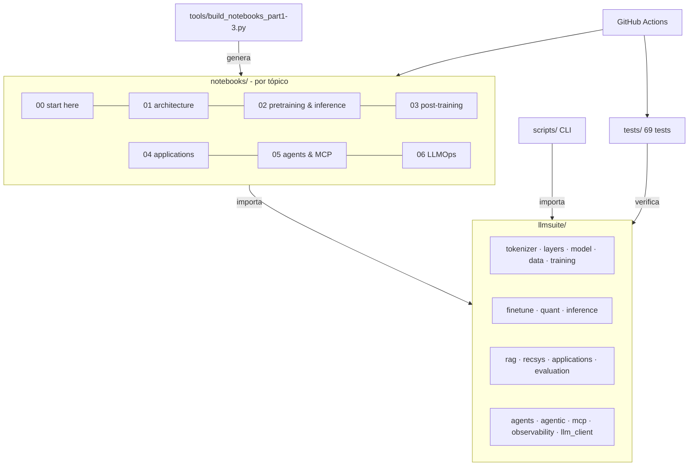

# Caso de estudio: LLM Edu Suite

🇬🇧 [English version](../en/case_study.md) · [← Volver al índice](README.md)

> **Resumen.** Un laboratorio completo de ingeniería de LLMs construido desde cero: 17 notebooks, un paquete Python de 18 módulos, 6 scripts y 69 tests. Cubre todo el ciclo de vida de un sistema basado en LLMs, desde el tokenizador hasta agentes observables conectados por MCP. Partí de una primera versión generada con asistencia de IA y la llevé a un estado **verificado de punta a punta**: encontré y corregí bugs reales, rediseñé los experimentos que daban resultados pobres y documenté cada decisión con números medidos.

## 1. Contexto y objetivo

Los LLMs se suelen aprender "de arriba hacia abajo": se llama a una API y se encadenan prompts. Este proyecto hace lo contrario. Implementa cada capa en código legible para entender **por qué** funcionan las cosas y **cómo se mide** si funcionan.

Objetivos:

1. **Didáctico**: que sirva como guía de estudio ordenada por tópicos, con teoría, código y evaluación en el mismo lugar.
2. **Riguroso**: cada técnica se evalúa con la métrica que usaría un equipo en producción (perplejidad, exact match, recall@k, nDCG, KL, TTFT, p95, coste por petición…).
3. **Reproducible y accesible**: todo corre en un portátil, en CPU, sin descargas ni claves de API, con semillas fijas.
4. **Honesto**: cuando una técnica no mejora en el entorno de juguete, el notebook lo dice y explica por qué.

## 2. Alcance

| Área | Qué se construyó |
|---|---|
| Arquitectura | BPE byte-level; RMSNorm, RoPE (con escalado tipo Llama 3.1); MHA/GQA/MQA/MLA; ventana deslizante, Longformer, block-sparse, atención lineal e híbridos; SwiGLU; MoE con balanceo aux-loss y aux-free |
| Entrenamiento | pipeline completo, AdamW con grupos, cosine/WSD, AMP, acumulación, clipping, checkpoints |
| Inferencia | estrategias de muestreo, KV-cache, decodificación especulativa desde cero, batching, dimensionado de la caché |
| Post-training | SFT con loss masking, LoRA (y su modo de fallo), destilación, DPO, DPO+NLL, GRPO |
| Eficiencia | cuantización absmax por tensor/fila/bloque, NF4, modelo cuantizado completo |
| Aplicaciones | RAG híbrido (BM25 + denso + RRF), recomendador secuencial (SASRec), extracción, clasificación, caché semántica, guardia anti-inyección, procesamiento por lotes con coste |
| Agentes | tools con JSON Schema, bucle de agente, salida estructurada; presupuestos y detección de bucles, plan-and-execute, reflexión con verificador, memoria corta y larga, supervisor multi-agente, evaluación de trayectorias |
| LLMOps | trazas y spans al estilo OpenTelemetry, coste por petición, percentiles, SLOs, puntuaciones de calidad online, redacción de PII, muestreo, exportación JSONL y OTLP |
| Protocolos | Model Context Protocol desde cero: JSON-RPC 2.0, servidor, cliente, transportes en memoria y stdio, puente al agente, controles de seguridad, y un servidor MCP real compatible con Claude Code y Claude Desktop |

## 3. Arquitectura del proyecto

Tres decisiones de diseño:

- **Los notebooks se generan desde código** (`tools/build_notebooks_part*.py`). Los cambios se revisan como código, los diffs son legibles y los notebooks nunca se desincronizan. El notebook 00 exporta además sus celdas a `scripts/mini_llm.py`, de modo que el notebook y el script salen de una única fuente.
- **Una sola clase de modelo configurable** (`ModelConfig`): todas las variantes de atención y de FFN se comparan en igualdad de condiciones.
- **Un `MockLLM` determinista** en lugar de una API: los pipelines de RAG, agentes, observabilidad y MCP se ejecutan y se testean sin red. Basta una línea para cambiar a un modelo real (`OpenAICompatibleClient`).

## 4. Proceso de verificación

La primera versión tenía tests y notebooks, pero los notebooks con PyTorch **nunca se habían ejecutado**. Este fue el proceso:

1. **Entorno aislado** (`.venv`, primero con PyTorch CPU y después con **PyTorch CUDA para la RTX 3060**: la ejecución completa de los 17 notebooks pasó de ~40 a ~15 minutos). El Python global tenía `matplotlib 3.7` compilado contra NumPy 1.x junto a NumPy 2.4, y fallaba al importar. Es un buen ejemplo de por qué conviene aislar el entorno.
2. **Tests**: 11 de 49 fallaban al principio.
3. **Ejecución de todos los notebooks** con un ejecutor headless propio (`tools/run_notebooks.py`) y revisión de cada salida, no solo de que no hubiera excepciones.
4. **Revisión cruzada documentación ↔ código**: un agente leyó cada módulo para escribir la referencia y reportó 14 discrepancias. Las verifiqué una a una antes de corregirlas.
5. **Rediseño de experimentos** que se ejecutaban sin errores pero daban resultados sin valor didáctico.

## 5. Bugs encontrados y corregidos

| Problema | Causa | Solución |
|---|---|---|
| 10 tests del modelo fallaban | `.view()` sobre tensores no contiguos (PyTorch reciente es más estricto) | `.reshape()` en `model.py`, `evaluation.py` y `finetune.py` |
| El test de DPO fallaba con `IndexError` | `make_reverse_preferences` generaba tokens 1–400 aunque el vocabulario fuera de 128 | parámetro `token_range` acotado a ids válidos; además, la respuesta "rechazada" ahora siempre difiere de la elegida |
| `finetune.py --lora` se rompía en DPO | tras `merge_lora` los pesos base seguían congelados y los adaptadores ya no participaban, así que no había nada entrenable | descongelar el modelo después de fusionar |
| `sample.py --prompt ""` fallaba con tokenizador | `torch.tensor([[]])` es float32 y rompe el embedding | dtype explícito y token inicial por defecto |
| El timeout de las tools no cortaba nada | se comprobaba *después* de que la función terminara | ejecución en un hilo con `future.result(timeout)`, con su test |
| Rutas `/tmp/...` en los notebooks | no existen en Windows | `tempfile.gettempdir()` |
| Notebooks sin `id` de celda | exigido por nbformat ≥ 4.5 | ids deterministas en el generador |
| Docstrings engañosos | p. ej. `PreferencePair` no existía; la pérdida auxiliar de MoE vale top_k (no 1) con balance perfecto; en GRPO el ratio siempre es 1 con una actualización por lote | documentación corregida para reflejar el comportamiento real |

## 6. Experimentos rediseñados (antes → después)

Los notebooks "funcionaban", pero varios resultados no enseñaban nada o, peor, enseñaban algo falso. Cada cambio se validó con experimentos previos antes de entrar en el notebook.

### Fine-tuning (notebook 07)

| | Antes | Después | Qué cambió |
|---|---|---|---|
| SFT completo | 44% exact match | **100%** | 1.500 ejemplos sobreajustaban (pérdida de train 0,13 con ppl de test 4,8). Pasé a 8.000 ejemplos y lr 2e-3 |
| LoRA | 0% con cualquier rango | 0% → **95,3%** | **Diagnóstico**: los tokens de rol del chat nunca aparecieron en el pre-entrenamiento y LoRA congela los embeddings. Ahora el notebook *muestra* el fallo, lo explica y lo corrige con `apply_lora(train_embeddings=True)`, el equivalente a `modules_to_save` de peft |
| Ablación de rango | 0 / 0 / 0 / 0 / 0% | **1,3 / 1,3 / 48,0%** (r = 1 / 4 / 16, con 800 pasos) | la ablación ahora tiene señal: hace falta rango para aprender un comportamiento nuevo |
| Destilación | el student destilado (68,7%) quedaba *peor* que sin destilar (98%) | **24,7% → 98,0%** | escenario realista: pocas etiquetas humanas y un teacher que etiqueta prompts sin etiquetar. La destilación por logits resultó frágil (98,7% en CPU, 44,7% en GPU), y el notebook lo explica |

### Preferencias y RL (notebook 08)

| | Antes | Después |
|---|---|---|
| SFT de partida | 4,7% (sin margen para mejorar) | 70,7% |
| DPO | 4,7% → 0%, ppl 27 → 393 | DPO puro: **70,7% → 46,7%**, ppl 1,76 → 3,66. El notebook muestra el *likelihood displacement* con gráficas |
| DPO + NLL | — | **80,0%**, ppl 1,46 (`train_dpo(nll_weight=1.0)`, equivalente a `rpo_alpha` en trl) |
| GRPO | 4,7% → 2,0% | 70,7% → 74,0% con recompensa exacta y 72,7% con recompensa densa. El notebook lo usa para enseñar que la recompensa proxy no es la métrica (ley de Goodhart) |

### Otros

- **Atención eficiente (03)**: la comparación usaba la perplejidad global, dominada por 44 de cada 55 tokens aleatorios, así que todas las variantes salían igual (~243). Pasé a medir la **precisión de copia** solo en los tokens repetidos y a entrenar 1500 pasos. Resultado: denso 99,9%, block-sparse 88,7%, híbrido 48,4%, ventana deslizante 0,6% y lineal 0,3%. Además, a los 300 pasos incluso el denso está en 0,3%: es la transición de fase de las *induction heads*.
- **Pre-entrenamiento (05)**: todas las ablaciones daban la misma perplejidad (2,78 frente a 2,78), porque el modelo ya estaba en el suelo de entropía del corpus. Ahora el notebook **calcula analíticamente la pérdida irreducible** (4·ln 10 nats por frase) y compara curvas de aprendizaje contra ese suelo: es el término *E* de Chinchilla hecho tangible.
- **MoE (04)**: la demo de balanceo aux-free oscilaba (`bias_lr=0.1` es enorme para scores sigmoides). Con 0,01 converge de 4,0× a ~1,15× de desequilibrio, y el notebook grafica ambas configuraciones.
- **Muestreo (06)**: con la misma semilla las estrategias daban salidas idénticas porque la distribución está muy concentrada. Ahora se mide la entropía y la diversidad (distinct-2) y se grafica la distribución filtrada.
- **Cuantización (09)**: la perplejidad apenas cambiaba (3 bits salía "mejor" que fp, por ruido). Añadí la **KL frente al modelo fp** y el **acuerdo top-1**, las métricas que usa llama.cpp. Muestran una degradación monótona: 98,6% de acuerdo con NF4 a 4 bits y 88% a 2 bits.

## 7. Extensiones nuevas

| Pieza | Por qué importa | Evidencia |
|---|---|---|
| **00 · mini LLM en un notebook** | ver cómo encajan todas las piezas sin saltar entre módulos | autocontenido (solo torch); también disponible como script |
| **14 · IA agéntica** | los agentes en producción fallan por bucles, coste y falta de evaluación, no solo por respuestas incorrectas | plan-and-execute resuelve 6/6 tareas multi-paso frente a 2/6 de un solo bucle; cada ejecución tiene un motivo de parada |
| **15 · observabilidad** | sin trazas no se puede depurar ni controlar el coste de un sistema LLM | árbol de spans, p50/p95/p99, SLOs, puntuaciones de calidad y drill-down a la peor traza |
| **16 · MCP** | es el estándar actual para conectar herramientas a LLMs | servidor propio que pasa 7/7 checks de conformidad por stdio real y funciona con Claude Code |

## 8. Lecciones aprendidas

1. **"Se ejecuta" no es "funciona".** Todos los notebooks corrían sin excepciones y aun así varios enseñaban conclusiones equivocadas. Hay que leer los números.
2. **Diagnosticar antes de ajustar hiperparámetros.** El 0% de LoRA no era un problema de learning rate ni de rango, sino de embeddings congelados para tokens nuevos. Ese mismo fallo aparece en la práctica al hacer fine-tuning con un chat template nuevo.
3. **Conocer el óptimo teórico cambia la conversación.** Con un corpus de entropía conocida, "perplejidad 2,8" deja de ser un número abstracto y pasa a significar "a un X% del suelo".
4. **El hardware también cambia los resultados.** Al pasar de CPU a GPU, modelos tan pequeños siguen trayectorias de entrenamiento distintas. Las conclusiones robustas se mantuvieron; las frágiles (la destilación por logits) quedaron en evidencia. Los textos se reescribieron para ser ciertos en ambos casos.
5. **Las métricas sensibles importan.** La perplejidad no detectaba la degradación por cuantización; la KL sí.
6. **Optimizar un proxy no es optimizar el objetivo.** La recompensa densa de GRPO subía y el exact match no.
7. **Revisión cruzada documentación ↔ código.** Escribir la referencia de módulos destapó 14 discrepancias que los tests no veían.

## 9. Stack y herramientas

Python 3.10+ · PyTorch · NumPy · matplotlib · pytest · Jupyter / nbclient · GitHub Actions. Sin dependencias pesadas: las técnicas que en producción se hacen con `transformers`, `peft`, `trl`, vLLM, FAISS, OpenTelemetry o los SDK de MCP están implementadas a mano, y cada notebook nombra su equivalente real.

## 10. Próximos pasos

Ver el [roadmap del README](../../README.md#roadmap). Lo más relevante: replicar el pipeline de post-training con un modelo real (Qwen2.5-0.5B con `trl`) y conectar las trazas a Langfuse o Phoenix.
