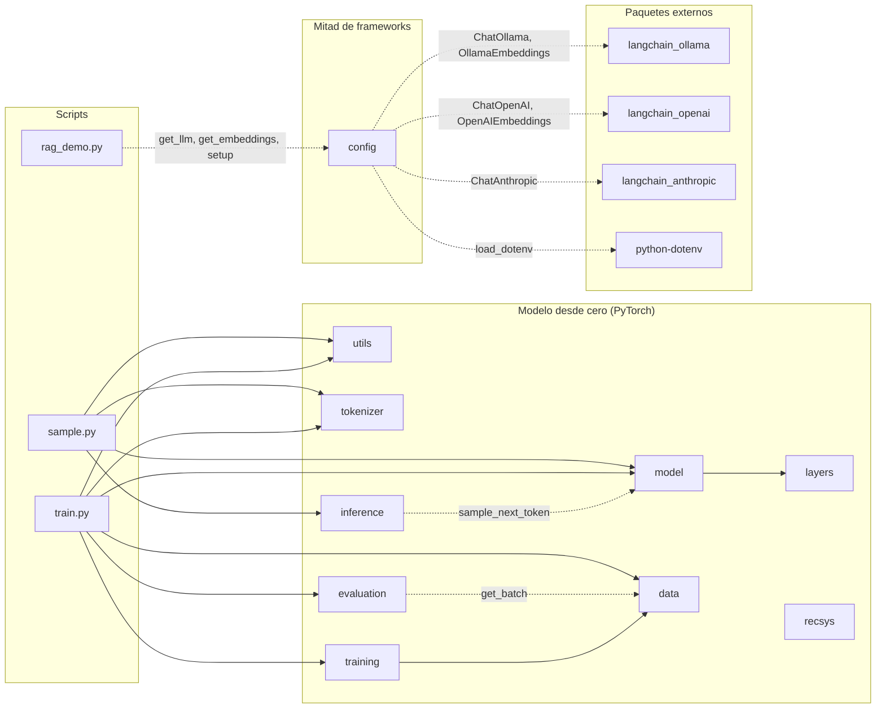

🇬🇧 [English version](../en/module_reference.md)

# Referencia de módulos de `llm_edu_suite`

> Referencia didáctica de cada módulo del paquete: qué problema resuelve, los conceptos que implementa, su API pública (con firmas verificadas contra el código), un ejemplo mínimo, su equivalente en producción y el notebook donde se practica.
>
> Documentos relacionados: [README](README.md) · [Instalación](instalacion.md) · [Guía de notebooks](guia_notebooks.md) · [Scripts de línea de comandos](scripts_cli.md) · [Caso de estudio](caso_de_estudio.md) · [Glosario](glosario.md)

Los identificadores de código (clases, funciones, argumentos) se mantienen en inglés, tal como aparecen en el paquete. Los ejemplos de los módulos 1–9 usan configuraciones diminutas y corren en CPU en segundos.

---

## Las dos mitades del curso

El curso tiene dos mitades, y el paquete solo contiene código para una de ellas.

- **Primera mitad (notebooks 00–06): el modelo construido desde cero en PyTorch.** Ver la atención, RoPE, MoE o una KV-cache escritas línea a línea es la mejor forma de entenderlas. Los módulos 1–9 de esta referencia (`utils`, `tokenizer`, `layers`, `model`, `data`, `training`, `inference`, `recsys` y `evaluation`) son ese modelo y sus herramientas. El notebook 12 (recomendadores) también los usa, porque reutiliza `TransformerLM` como recomendador secuencial.
- **Segunda mitad (notebooks 07–16): las herramientas que usa la industria.** Fine-tuning, cuantización, RAG, agentes, LLMOps y MCP se enseñan con frameworks reales: Hugging Face `transformers` / `peft` / `trl` / `optimum-quanto`, LangChain, LangGraph, LangSmith, RAGAS y el SDK oficial de MCP con `langchain-mcp-adapters`. Para esta mitad el paquete solo aporta [`config`](#10-config), el único sitio donde se eligen el modelo de chat, el de embeddings y el trazado.

### ¿Dónde está ahora...? (módulos eliminados en v2)

La versión 1 del paquete tenía implementaciones propias de estos temas. En v2 se eliminaron y cada tema se enseña con el framework estándar en su notebook:

| Tema (módulo v1) | Dónde se enseña | Framework y clases que se usan |
|---|---|---|
| SFT, LoRA, destilación (`finetune`) | 07 · `notebooks/03_post_training/07_finetuning_sft_lora.ipynb` | `transformers`: `AutoTokenizer` (`apply_chat_template`), `AutoModelForCausalLM`; `peft`: `LoraConfig`, `get_peft_model`, `PeftModel` (`merge_and_unload`); `trl`: `SFTConfig`, `SFTTrainer` (enmascarado con `completion_only_loss` / `assistant_only_loss`); `datasets.Dataset` |
| DPO y GRPO (`finetune`) | 08 · `notebooks/03_post_training/08_preference_rl_dpo_grpo.ipynb` | `trl`: `DPOConfig`, `DPOTrainer`, `GRPOConfig`, `GRPOTrainer` (recompensa verificable); `peft.LoraConfig` |
| Plantilla de chat, enmascarado de pérdida, pares de preferencia (`data.ChatFormat`, `make_reverse_task`, `make_reverse_preferences`) | 07 y 08 | `tokenizer.apply_chat_template` y datasets `prompt` / `completion` (SFT) o `prompt` / `chosen` / `rejected` (DPO) de TRL |
| Cuantización absmax, por bloques, NF4 (`quant`) | 09 · `notebooks/02_pretraining_and_inference/09_quantization.ipynb` | La sección 1 muestra absmax, bloques y NF4 a mano; después `optimum.quanto`: `quantize`, `freeze`, `qint8`, `qint4`, `qint2`, `qfloat8` |
| RAG: chunking, embeddings, BM25, búsqueda densa, RRF, citas (`rag`) | 10 · `notebooks/04_applications/10_rag.ipynb` | `DirectoryLoader`, `TextLoader`, `RecursiveCharacterTextSplitter`, `FAISS`, `BM25Retriever`, `EnsembleRetriever` (RRF); cadena LCEL con `ChatPromptTemplate`, `RunnableParallel`, `RunnablePassthrough`, `RunnableLambda`, `StrOutputParser`; evaluación con RAGAS (`Faithfulness`, `AnswerRelevancy`, `ContextPrecision`, `ContextRecall`, `llm_factory`). También el script [`rag_demo.py`](scripts_cli.md#rag_demopy) |
| Herramientas, validación de argumentos, bucle de agente, salida estructurada (`agents`) | 11 · `notebooks/05_agents_and_mcp/11_agents_tools_structured_output.ipynb` | `@tool` (`langchain_core.tools`), `convert_to_openai_tool`, `.bind_tools()`, `AIMessage` / `ToolMessage`, `create_agent`, `ToolErrorMiddleware`; Pydantic (`BaseModel`, `Field`, `field_validator`) con `.with_structured_output()`; `GenericFakeChatModel` para pruebas deterministas |
| Extracción, clasificación, resumen map-reduce, caché semántica, guardia anti-inyección, lotes (`applications`) | 13 · `notebooks/04_applications/13_modern_llm_applications.ipynb` | `.with_structured_output()` + Pydantic, `FewShotChatMessagePromptTemplate`, `RecursiveCharacterTextSplitter`, `InMemoryCache`, una `SemanticCache` propia sobre `BaseCache` con `set_llm_cache`, `.batch()` y `get_usage_metadata_callback` |
| Cliente de LLM, `MockLLM` (`llm_client`) | todos los notebooks 10–16 | [`config.get_llm()`](#10-config) devuelve `ChatOllama`, `ChatOpenAI` o `ChatAnthropic`; para pruebas sin modelo, `GenericFakeChatModel` de `langchain_core` |
| Presupuestos, plan-and-execute, reflexión, memoria, supervisor, evaluación de trayectorias (`agentic`) | 14 · `notebooks/05_agents_and_mcp/14_agentic_ai.ipynb` | LangGraph: `StateGraph`, `START`, `END`, `MessagesState`, `InMemorySaver`, `InMemoryStore`, `interrupt`, `Command`, `GraphRecursionError`; `create_agent` con `ModelCallLimitMiddleware`, `ToolCallLimitMiddleware`, `HumanInTheLoopMiddleware`, `dynamic_prompt`, `ToolRuntime` |
| Trazas, redacción de PII, percentiles, SLOs, evaluación (`observability`) | 15 · `notebooks/06_llmops/15_observability_llmops.ipynb` | LangSmith: `@traceable`, `tracing_context`, `Client` (`create_feedback`, `create_dataset`, `create_examples`), `evaluate`, `create_anonymizer`; `wait_for_all_tracers` de LangChain |
| Servidor y cliente MCP, transportes (`mcp`) | 16 · `notebooks/05_agents_and_mcp/16_mcp_model_context_protocol.ipynb` | SDK oficial `mcp`: `FastMCP`, `ToolAnnotations`, `ClientSession`, `StdioServerParameters`, `stdio_client`, `create_connected_server_and_client_session`, `McpError`, `CallToolResult`; `langchain-mcp-adapters`: `MultiServerMCPClient`, `load_mcp_tools`. También el script [`mcp_server.py`](scripts_cli.md#mcp_serverpy) |
| Re-ranking y explicación con LLM (`recsys.llm_rerank`, `explain_recommendation`) | 12 · `notebooks/04_applications/12_recommender_systems.ipynb`, sección 4 | `ChatPromptTemplate` \| `get_llm().with_structured_output(Ranking)`, con un modelo Pydantic `Ranking` |
| LLM-as-judge (`evaluation.pairwise_judge`, `rubric_score`) | 10 y 15 | Métricas de RAGAS (10); evaluadores de LangSmith con un juez hecho con `.with_structured_output()` (15) |

`perplexity_on_examples` también se eliminó: en 07 y 08 los modelos de Hugging Face se evalúan con métricas de la tarea (JSON válido, exact match, campos correctos), no con perplejidad.

---

## Índice

| # | Módulo | Qué contiene | Necesita `torch` | Lo importan los notebooks |
|---|---|---|---|---|
| 1 | [`utils`](#1-utils) | semillas, dispositivo, conteo de parámetros, cronómetro, impresión de máscaras | sí | 01–06, 12 |
| 2 | [`tokenizer`](#2-tokenizer) | tokenizador BPE a nivel de bytes | no | 01, 05 |
| 3 | [`layers`](#3-layers) | RMSNorm, RoPE, MHA/GQA/MQA, MLA, atenciones eficientes, SwiGLU, MoE | sí | 02, 03, 04 |
| 4 | [`model`](#4-model) | `TransformerLM` configurable, KV-cache, muestreo | sí | 02–06, 12 |
| 5 | [`data`](#5-data) | corpus sintéticos y de texto, batching para preentrenamiento | sí | 01–06 |
| 6 | [`training`](#6-training) | schedules de LR, AdamW con grupos, bucle de entrenamiento, checkpoints | sí | 02–06 |
| 7 | [`inference`](#7-inference) | decodificación especulativa, generación por lotes, tamaño de KV-cache | sí | 06 |
| 8 | [`recsys`](#8-recsys) | recomendador secuencial estilo SASRec, embeddings colaborativos y de contenido, leave-one-out, líneas base | parcial | 12 |
| 9 | [`evaluation`](#9-evaluation) | perplejidad, exact match, F1/ROUGE-L, recall/nDCG/MRR, proxy de fidelidad, latencia, clasificación | parcial | 02, 04, 05, 06, 12 |
| 10 | [`config`](#10-config) | `get_llm`, `get_embeddings`, `setup`: modelos y servicios de los notebooks 07–16, leídos de `.env` | no | 10–16 |

"Parcial" significa que el módulo importa `torch` de forma opcional (`try/except ImportError`): las métricas puras y los datos sintéticos funcionan sin PyTorch, lo que toca modelos no. `config` no necesita `torch`, pero sí `langchain-ollama` (o `langchain-openai` / `langchain-anthropic`, según el proveedor) y, opcionalmente, `python-dotenv`.

Los notebooks 07, 08 y 09 no importan nada de `llm_edu_suite`: trabajan directamente con Hugging Face. El notebook 00 tampoco: es un mini LLM autocontenido, como [`mini_llm.py`](scripts_cli.md#mini_llmpy).

**Dónde están los notebooks.** Los notebooks se agrupan en carpetas temáticas dentro de `notebooks/`. El número sigue indicando el orden del recorrido:

| Carpeta | Notebooks |
|---|---|
| `notebooks/00_start_here/` | 00 (un mini LLM completo de principio a fin) |
| `notebooks/01_architecture/` | 01–04 |
| `notebooks/02_pretraining_and_inference/` | 05, 06, 09 |
| `notebooks/03_post_training/` | 07, 08 |
| `notebooks/04_applications/` | 10, 12, 13 |
| `notebooks/05_agents_and_mcp/` | 11, 14, 16 |
| `notebooks/06_llmops/` | 15 |

Por ejemplo, el notebook 05 es `notebooks/02_pretraining_and_inference/05_pretraining.ipynb`. `python tools/run_notebooks.py 05` lo encuentra por número, esté donde esté (ver [scripts de línea de comandos](scripts_cli.md#herramientas-y-objetivos-del-makefile)).

---

## Mapa de dependencias

El diagrama se deriva de los `import` reales del código. Una flecha `A --> B` significa "A importa B". Las flechas discontinuas son importaciones *perezosas* (dentro de una función), que solo se ejecutan si llamas a esa función.



Hay tres detalles que el diagrama no muestra:

- `utils`, `tokenizer`, `layers`, `data`, `recsys` y `config` no importan ningún otro módulo de `llm_edu_suite`. Son las hojas del grafo. `config` importa la clase de LangChain del proveedor elegido solo cuando llamas a `get_llm` o `get_embeddings`.
- Algunos módulos colaboran por *duck typing*, sin importarse. `recsys.train_sasrec` y `recsys.sasrec_rank` reciben un `TransformerLM` pero no importan `model`. `recsys.content_embeddings` acepta cualquier objeto de embeddings de LangChain (por ejemplo `config.get_embeddings()`) sin importar `config`. `evaluation.benchmark_generation` y `evaluation.perplexity` funcionan con cualquier modelo que tenga `.generate` o `forward(x, y) -> (logits, loss)`.
- Los scripts `finetune.py`, `mcp_server.py` y `mini_llm.py` no importan nada de `llm_edu_suite`: `finetune.py` usa `transformers` / `peft` / `trl`, `mcp_server.py` usa el SDK oficial de MCP (`FastMCP`) y `rank_bm25`, y `mini_llm.py` es autocontenido a propósito.

---

## 1. `utils`

**Qué resuelve.** Son utilidades pequeñas que todos los notebooks necesitan: reproducibilidad, elegir dispositivo, contar parámetros, medir tiempo y visualizar máscaras de atención en texto. En un LLM real, la reproducibilidad (semillas) y el conteo de parámetros son lo primero que se reporta en cualquier experimento.

**Conceptos clave.**
- *Reproducibilidad*: `seed_everything` fija las semillas de `random`, NumPy y PyTorch (también CUDA). En GPU aún puede haber no-determinismo por kernels atómicos.
- *MPS opcional*: `get_device` no elige Apple MPS por defecto porque RoPE usa tensores complejos, que MPS soporta solo en parte.

**API pública.**

| Firma | Qué hace |
|---|---|
| `seed_everything(seed: int = 0) -> None` | Fija semillas de `random`, `numpy`, `torch` (y CUDA si existe). |
| `get_device(prefer: str \| None = None, allow_mps: bool = False) -> str` | Devuelve `prefer` si se da; si no, `"cuda"` > (`"mps"` si `allow_mps`) > `"cpu"`. |
| `count_params(module: nn.Module, trainable_only: bool = False) -> int` | Número de parámetros (opcionalmente solo los entrenables). |
| `human(n: float) -> str` | Formato legible: `1234567 -> '1.23M'`. |
| `timer(label: str = "")` | *Context manager* que imprime el tiempo transcurrido en ms. |
| `show_mask(mask: torch.Tensor, name: str = "", max_t: int = 24) -> None` | Imprime una máscara booleana (T, T): `█` = la query (fila) ve la key (columna). |

**Ejemplo.**

```python
from llm_edu_suite.utils import seed_everything, get_device, human, timer, show_mask
from llm_edu_suite.layers import sliding_window_mask

seed_everything(0)
print(get_device())                 # 'cpu' o 'cuda'
print(human(3_030_000))             # '3.03M'
with timer("máscara"):
    show_mask(sliding_window_mask(8, window=3), "ventana deslizante w=3")
```

**En producción:** `transformers.set_seed`, `accelerate.Accelerator().device`, `torch.utils.benchmark`.

**Notebooks:** lo importan 01–06 y 12, en la celda de configuración (`seed_everything`, `get_device`, `count_params`, `human`; `show_mask` en 01–06).

---

## 2. `tokenizer`

**Qué resuelve.** Un LLM no ve texto sino enteros. El tokenizador define el vocabulario y, con él, cuántos tokens ocupa un texto. Eso determina el coste por petición, cuánto cabe en la ventana de contexto y qué tan bien se representan idiomas y código. GPT-2, Llama 3 y la mayoría de los modelos modernos usan **BPE a nivel de bytes**.

**Conceptos clave.**
- *¿Por qué bytes?* Si se parte de los 256 bytes posibles, cualquier cadena (emoji, chino, código) se puede codificar sin token `<UNK>`.
- *Pre-tokenización*: la regex `\s*\S+|\s+` corta el texto en "palabra con su espacio inicial" o "run de espacios". Las fusiones nunca cruzan esos límites (estilo GPT-2). Así los tokens tienen sentido lingüístico, y entrenar es rápido porque el trabajo se hace una vez por *chunk único*, ponderado por su frecuencia.
- *Entrenamiento*: se repite `vocab_size - 256 - n_especiales` veces lo siguiente: contar los pares adyacentes, fusionar el más frecuente en un id nuevo y registrar `(a, b) -> new_id`.
- *Codificación determinista*: dentro de cada chunk se aplica primero la fusión aprendida más temprano (id más bajo). Así se reproduce exactamente el orden del entrenamiento.
- *Tokens especiales* (`<|bos|>`, `<|eos|>`, `<|pad|>`): reciben los últimos ids, después de las fusiones.
- *Compresión*: bytes por token. Más compresión significa secuencias más cortas, lo que abarata el cómputo y deja más texto en el contexto.

**API pública.**

| Firma | Qué hace |
|---|---|
| `ByteBPETokenizer(special_tokens: tuple[str, ...] = ("<\|bos\|>", "<\|eos\|>", "<\|pad\|>"))` | Crea un tokenizador vacío (solo los 256 bytes). |
| `.train(text: str, vocab_size: int, verbose: bool = False) -> ByteBPETokenizer` | Aprende fusiones hasta `vocab_size` (bytes + fusiones + especiales). |
| `.encode(text: str, add_bos: bool = False, add_eos: bool = False) -> list[int]` | Texto a ids (con caché por chunk). |
| `.decode(ids: list[int]) -> str` | Ids a texto (`errors="replace"` por si un token parte un carácter UTF-8). |
| `.vocab_size`, `.bos_id`, `.eos_id`, `.pad_id` | Propiedades. |
| `.save(path: str)` / `ByteBPETokenizer.load(path: str)` | Persistencia en JSON (fusiones + especiales). |
| `compression_ratio(tok, text: str) -> float` | Bytes UTF-8 por token. |

**Ejemplo.**

```python
from llm_edu_suite.tokenizer import ByteBPETokenizer, compression_ratio
from llm_edu_suite.data import template_text_corpus

text = template_text_corpus(300)
tok = ByteBPETokenizer().train(text, vocab_size=400)
ids = tok.encode("the router selects", add_eos=True)
print(tok.vocab_size, round(compression_ratio(tok, text), 2))   # 400  ~2.9
print(tok.decode(ids[:-1]))                                     # 'the router selects'
```

**En producción:** `tiktoken` (OpenAI), `tokenizers` / `AutoTokenizer` de Hugging Face (Rust), SentencePiece (Gemma, T5). Funcionan igual, pero son órdenes de magnitud más rápidos y manejan plantillas de chat.

**Notebooks:** 01 (compresión y *fertility* frente al tamaño de vocabulario) y 05 (tokenizar un corpus real antes de preentrenar).

---

## 3. `layers`

**Qué resuelve.** Contiene las piezas de un transformer *decoder-only* moderno. Cada atención comparte la firma `forward(x, freqs_cis, start_pos=None) -> (B, T, C)`, así que `model` puede intercambiarlas sin cambiar nada más. Convenciones de forma: `B` batch, `T` secuencia, `C` = `d_model`, `H` cabezas, `Dh = C // H`.

### 3.1 RMSNorm

$$y = \frac{x}{\sqrt{\tfrac{1}{C}\sum_i x_i^2 + \varepsilon}} \cdot \gamma$$

A diferencia de LayerNorm, no resta la media ni tiene sesgo. Es más barata y en la práctica igual de estable. El cálculo se hace en fp32 aunque `x` venga en bf16, porque la suma de cuadrados necesita esa precisión. La usan Llama, Mistral, DeepSeek y Gemma.

### 3.2 RoPE (Rotary Position Embeddings)

Las dimensiones de cada cabeza se agrupan de dos en dos: $(x_{2i}, x_{2i+1})$ se trata como un número complejo y se rota según la posición absoluta $m$:

$$\tilde{x}^{(i)}_m = x^{(i)}_m \cdot e^{\,i\, m\, \theta_i}, \qquad \theta_i = \text{base}^{-2i/D_h}$$

Como las rotaciones se componen sumando ángulos, el producto $\langle \tilde q_m, \tilde k_n\rangle$ solo depende de $n - m$. Se obtiene **atención relativa** sin añadir parámetros. Una buena intuición es un reloj con muchas agujas: los primeros pares giran rápido (resolución local fina) y los últimos giran despacio (señal de largo alcance).

`precompute_freqs_cis(..., scaling=...)` implementa el **escalado de frecuencias estilo Llama 3.1** para extender el contexto. Los pares de alta frecuencia no se tocan, los de baja frecuencia se dividen por `factor` y entre ambos hay una interpolación suave (familia NTK-aware / YaRN).

### 3.3 MHA → GQA → MQA

`GroupedQueryAttention` usa `n_heads` cabezas de query y `n_kv_heads` cabezas de key/value. Cada K/V la comparten `n_heads / n_kv_heads` queries:

| Configuración | Nombre | KV-cache por token y capa |
|---|---|---|
| `n_kv_heads == n_heads` | MHA | $2 \cdot H \cdot D_h$ |
| `1 < n_kv_heads < n_heads` | GQA (Llama 3, Mistral) | $2 \cdot H_{kv} \cdot D_h$ |
| `n_kv_heads == 1` | MQA | $2 \cdot D_h$ |

¿Por qué importa? En decodificación, el cuello de botella es leer la KV-cache de memoria. GQA la reduce `H / H_kv` veces y la calidad apenas se resiente. La clase incluye KV-cache: se llama con `start_pos=0` sobre el prompt (*prefill*) y después con `start_pos=t` y un token por paso (*decode*). La opción `qk_norm` aplica RMSNorm a q y k por cabeza para evitar que crezcan los logits de atención (OLMo 2, Gemma 3).

### 3.4 MLA (Multi-head Latent Attention, DeepSeek-V2/V3)

MLA va un paso más allá que GQA. Las K y V de **todas** las cabezas se derivan de un único latente de baja dimensión $c_{kv} \in \mathbb{R}^{r}$ (`kv_lora_rank`), y eso es lo que se guarda en caché:

$$c_{kv} = \text{RMSNorm}(W_{a} x), \qquad [k^{nope}, v] = W_{b}\, c_{kv}$$

El problema es que RoPE no conmuta con la compresión: la rotación depende de la posición y la proyección de subida no. Por eso cada cabeza se divide en una parte **sin posición** (`qk_nope_dim`, que sale del latente) y una parte **rotatoria** pequeña (`qk_rope_dim`). La parte rotatoria se calcula directamente y se comparte entre cabezas, como en MQA.

- Caché por token y capa: `kv_lora_rank + qk_rope_dim`. En DeepSeek-V3 son 512 + 64 = 576 valores, frente a 2 · 128 · 128 = 32 768 de un MHA de 128 cabezas.
- **GQA frente a MLA**: GQA ahorra memoria *compartiendo* cabezas, lo que reduce expresividad. MLA ahorra *comprimiendo* (low-rank) y mantiene cabezas distintas. Suele ahorrar más con igual o mejor calidad, a cambio de más FLOPs y de una implementación más compleja.
- Esta es la forma "ingenua", que reconstruye K y V desde el latente. En producción se usa el truco *absorb*, que pliega $W_b$ en la query para atender directamente contra el latente.

### 3.5 Atenciones eficientes

| Clase | Patrón | Coste | Comentario |
|---|---|---|---|
| `SlidingWindowAttention` | cada token ve los `window` anteriores | $O(T \cdot w)$ en teoría | Mistral, capas locales de Gemma. Con máscara booleana, SDPA sigue calculando T×T; el ahorro real llega con kernels que saltan bloques (FlexAttention) o con una KV-cache truncada. |
| `LongformerAttention` | ventana + posiciones globales que ven y son vistas por todos (causalmente) | $O(T \cdot w + T \cdot g)$ | Solo el patrón: el paper usa proyecciones separadas para los globales. |
| `BlockSparseAttention` | por query: top-`top_blocks` bloques elegidos por contenido + ventana local | dinámico | NSA/DSA simplificado. Un *indexer* barato puntúa cada bloque con $q \cdot \overline{k}_{bloque}$. La máscara elegida queda en `last_mask`. |
| `LinearAttention` | $\text{softmax}(qk^\top)$ se sustituye por $\phi(q)\phi(k)^\top$, con $\phi = \text{ELU}+1$ | $O(T)$, estado fijo $D_h \times D_h$ | El estado es $S_t = \sum_{s\le t} \phi(k_s) v_s^\top$. Modo paralelo con `cumsum` para entrenar y `step()` recurrente para inferencia. Pierde la capacidad de "búsqueda exacta" del softmax, por eso se usa en híbridos (Qwen3-Next, Kimi Linear). No usa RoPE. |

Solo `GroupedQueryAttention` y `MultiHeadLatentAttention` tienen KV-cache (`supports_cache = True`). Las demás recalculan sobre toda la secuencia.

### 3.6 SwiGLU

$$\text{FFN}(x) = W_{down}\big(\text{SiLU}(W_{gate}\,x) \odot W_{up}\,x\big)$$

Tiene tres matrices en lugar de dos. Para conservar el número de parámetros de un FFN clásico con $4C$, se usa $d_{ff} \approx \tfrac{8}{3} C$. `swiglu_hidden_dim` aplica la regla de Llama: $\tfrac{2}{3}\cdot 4C$, opcionalmente escalado y redondeado hacia arriba a un múltiplo.

### 3.7 Mixture of Experts (MoE)

Se sustituye el FFN por `n_experts` FFNs (expertos) y un *router* que envía cada token a sus `top_k` mejores. Los parámetros **totales** crecen, pero los **activos por token** (el cómputo) no. El riesgo es el *colapso*: el router manda todo a unos pocos expertos y el resto no aprende. Hay dos estrategias para evitarlo:

**a) Softmax + pérdida auxiliar** (Switch Transformer, Mixtral), `routing="softmax"`:

$$\mathcal{L}_{aux} = E \sum_{e=1}^{E} f_e \cdot P_e$$

Aquí $f_e$ es el número medio de *slots* de enrutado por token que recibe el experto $e$ (cada token ocupa `top_k` slots, así que $\sum_e f_e = k$ y con carga uniforme $f_e = k/E$) y $P_e$ la probabilidad media que el router le da. Minimizar este producto empuja hacia una carga uniforme. Como en la implementación de Mixtral en Hugging Face, $f_e$ no se divide por $k$, de modo que con un balanceo perfecto la pérdida vale **≈ `top_k`** (no ≈ 1). La escala solo cambia el coeficiente efectivo; el gradiente sigue empujando hacia el equilibrio. `TransformerLM` lo suma a la pérdida multiplicado por `aux_loss_coef`. El inconveniente es que es un gradiente extra que compite con el objetivo de lenguaje.

**b) Sin pérdida auxiliar** (DeepSeek-V3), `routing="auxfree"` con `AuxFreeRouter`:
- Las puntuaciones son sigmoides, no softmax.
- Un **sesgo por experto** que *solo afecta a la selección*: `topk(scores + bias)` decide **quién**, mientras que la puntuación cruda normalizada decide **cuánto** pesa.
- El sesgo se actualiza online, sin gradiente: `bias -= bias_lr * sign(load - mean(load))`. Baja el sesgo de los expertos sobrecargados y sube el de los infrautilizados.
- `aux_loss` devuelve 0: el balanceo no interfiere con el gradiente del LM.

**Expertos compartidos** (`n_shared > 0`, DeepSeekMoE): un FFN que procesa todos los tokens. Absorbe el conocimiento común y deja a los expertos enrutados especializarse.

El despacho es un bucle Python sobre expertos (claro, pero lento). En producción se usan GEMMs agrupadas y paralelismo de expertos.

### API pública de `layers`

| Firma | Qué hace |
|---|---|
| `RMSNorm(dim: int, eps: float = 1e-6)` | Normalización RMS con ganancia aprendible. |
| `precompute_freqs_cis(head_dim: int, max_seq_len: int, base: float = 10000.0, scaling: dict \| None = None) -> Tensor` | Tabla compleja $e^{i m\theta_i}$ de forma `(max_seq_len, head_dim // 2)`. `scaling = {"factor", "orig_len", "low", "high"}`. |
| `apply_rope(x: Tensor, freqs_cis: Tensor, start_pos: int = 0) -> Tensor` | Rota `x` de forma `(B, T, H, Dh)` desde la posición `start_pos`. |
| `causal_mask(T, device=None)` | Máscara `(T, T)` triangular inferior. |
| `sliding_window_mask(T, window, device=None)` | Causal y además `i - j < window`. |
| `longformer_mask(T, window, global_idx, device=None)` | Ventana + filas y columnas globales (causal). |
| `GroupedQueryAttention(d_model, n_heads, n_kv_heads, qk_norm=False, dropout=0.0)` | MHA/GQA/MQA con KV-cache. Métodos `clear_cache()`, `kv_cache_bytes_per_token(dtype_bytes=2)`. |
| `MultiHeadLatentAttention(d_model, n_heads, kv_lora_rank, qk_nope_dim, qk_rope_dim, v_dim, q_lora_rank=None)` | MLA con caché comprimida. Mismos métodos de caché. |
| `SlidingWindowAttention(d_model, n_heads, window)` | Atención local. |
| `LongformerAttention(d_model, n_heads, window, global_idx=(0,))` | Ventana + globales. |
| `BlockSparseAttention(d_model, n_heads, block=16, top_blocks=2, local_window=32)` | Bloques seleccionados por contenido. Atributo `last_mask`. |
| `LinearAttention(d_model, n_heads)` | Atención lineal. Métodos `init_state(batch_size, device=None)` y `step(x_t, state) -> (y, state)`. |
| `SwiGLU(d_model, d_ff)` | FFN con compuerta. |
| `swiglu_hidden_dim(d_model, multiple_of=64, ffn_dim_multiplier=None) -> int` | Regla de Llama para `d_ff`. |
| `AuxFreeRouter(d_model, n_experts, top_k, bias_lr=0.01)` | Router sigmoide con sesgo de balanceo. `forward(xf) -> (topk_i, topk_w, scores)`. |
| `MoE(d_model, d_ff, n_experts, top_k, n_shared=0, routing="softmax")` | `forward(x) -> (y, aux_loss)`. Atributo `last_load`: slots enrutados por experto / N tokens en el último batch (suma `top_k`; uniforme = `k/E`). |

**Ejemplo.**

```python
import torch
from llm_edu_suite.layers import (precompute_freqs_cis, GroupedQueryAttention,
                             MultiHeadLatentAttention, MoE)

x = torch.randn(2, 16, 64)                      # (B, T, C)
f = precompute_freqs_cis(head_dim=16, max_seq_len=64)

mqa = GroupedQueryAttention(64, n_heads=4, n_kv_heads=1)
mla = MultiHeadLatentAttention(64, n_heads=4, kv_lora_rank=16, qk_nope_dim=8, qk_rope_dim=8, v_dim=16)
print(mqa(x, f).shape, mla(x, f).shape)                                   # (2, 16, 64) x2
print(mqa.kv_cache_bytes_per_token(), mla.kv_cache_bytes_per_token())     # 64  48  (bf16)

moe = MoE(64, 128, n_experts=4, top_k=2, n_shared=1, routing="auxfree").train()
y, aux = moe(x)
print(y.shape, aux.item(), moe.router.bias)     # aux = 0; el sesgo ya se movió
```

**En producción:** `torch.nn.functional.scaled_dot_product_attention` + FlashAttention-2/3; `torch.nn.attention.flex_attention` (PyTorch ≥ 2.5) para máscaras arbitrarias sin coste T×T; las implementaciones `LlamaAttention` / `DeepseekV3Attention` / `MixtralSparseMoeBlock` de `transformers`; Megatron-LM y DeepSpeed-MoE para paralelismo de expertos; `flash-linear-attention` (fla) para atención lineal y Gated DeltaNet.

**Notebooks:** 02 (RMSNorm, RoPE verificado numéricamente, MHA→GQA→MLA, KV-cache), 03 (atenciones eficientes en una tarea de copia de largo alcance) y 04 (SwiGLU, MoE, aux-loss frente a aux-free, expertos compartidos).

---

## 4. `model`

**Qué resuelve.** Arma las piezas de `layers` en un modelo de lenguaje completo, **una sola clase configurable**. Comparar GQA con MLA, o denso con MoE, se reduce a cambiar un campo de `ModelConfig`, así que las comparaciones son justas.

```
tokens -> embedding -> N x Block -> RMSNorm -> lm_head -> logits

Block (pre-norm):
    x = x + Attn(RMSNorm(x))      # mezcla información entre tokens
    x = x + FFN(RMSNorm(x))       # transforma cada token (SwiGLU denso o MoE)
```

**Conceptos clave.**
- *Pre-norm*: normalizar antes de cada subbloque y sumar al residual estabiliza el entrenamiento de modelos profundos. `sandwich_norm=True` normaliza también la salida de cada subbloque (Gemma 2).
- *Embeddings atados* (`tie_embeddings=True`): `lm_head.weight` es la misma matriz que `tok_emb.weight`. Ahorra `V · C` parámetros, algo importante en modelos pequeños.
- *Inicialización GPT-2*: pesos con $\mathcal{N}(0, 0.02)$. Las proyecciones que escriben en el residual (`wo`, `w_down`, `out`) se escalan por $1/\sqrt{2N}$ para que la varianza no crezca con la profundidad.
- *Patrones híbridos*: `hybrid_pattern="LLLG"` repite el patrón por capas. `L` = la atención de `attn` (p. ej. `linear` o `swa`) y `G` = GQA global. Es el diseño de Gemma 3 (local:global) y de Qwen3-Next (lineal:completa).
- *MoE cada k capas*: `moe_every=2` pone MoE en las capas 1, 3, 5… y SwiGLU denso en el resto.
- *Pérdida*: entropía cruzada (`ignore_index=-100`) más `aux_loss_coef · aux_total / n_layers`.
- *Parámetros activos*: `num_active_params()` descuenta `(E - k)` expertos por capa MoE.
- *Muestreo*: temperatura (`<= 0` equivale a greedy), top-k, top-p (*nucleus*, conserva el primer token que cruza `p`) y penalización de repetición de CTRL (divide los logits positivos y multiplica los negativos de tokens ya generados). `next_token_distribution` devuelve la distribución exacta de la que se muestrea (tras temperatura, top-k y top-p; los tokens filtrados quedan con probabilidad 0), útil para visualizar el efecto de cada parámetro. `sample_next_token` la usa internamente.
- *Generación con KV-cache*: si todas las capas tienen `supports_cache`, hace *prefill* con `start_pos=0` y luego decodifica un token por paso. Si alguna no lo tiene, recalcula la secuencia completa en cada paso (correcto, pero $O(T^2)$ por token). La generación se detiene al llegar a `max_seq_len`.

**API pública.**

| Firma | Qué hace |
|---|---|
| `ModelConfig(vocab_size=512, max_seq_len=256, d_model=128, n_layers=4, n_heads=8, n_kv_heads=2, d_ff=None, dropout=0.0, attn="gqa", hybrid_pattern=None, window=64, global_idx=(0,), block=16, top_blocks=2, qk_norm=False, sandwich_norm=False, kv_lora_rank=32, qk_nope_dim=16, qk_rope_dim=8, v_dim=16, moe=False, n_experts=4, top_k=2, n_shared_experts=0, moe_routing="softmax", aux_loss_coef=0.01, moe_every=1, rope_base=10000.0, rope_scaling=None, tie_embeddings=True)` | *Dataclass* de configuración. `attn` ∈ `gqa \| mla \| swa \| longformer \| blocksparse \| linear`. `d_ff=None` aplica la regla de Llama (múltiplo de 8). Propiedad `head_dim` y método `to_dict()`. |
| `build_attention(cfg, layer_idx) -> nn.Module` | Fábrica de la atención de cada capa (respeta `hybrid_pattern`). |
| `Block(cfg, layer_idx)` | Bloque pre-norm. `forward(x, freqs_cis, start_pos=None) -> (x, aux)`. |
| `TransformerLM(cfg)` | El modelo. |
| `.forward(idx, targets=None, start_pos=None) -> (logits, loss \| None)` | `idx` (B, T). `targets` con `-100` = ignorar. `start_pos` = modo caché. |
| `.generate(idx, max_new_tokens, temperature=1.0, top_k=None, top_p=None, eos_id=None, repetition_penalty=1.0) -> Tensor` | Muestreo autorregresivo (devuelve prompt + generado). |
| `.num_params(trainable_only=False)`, `.num_active_params()`, `.kv_cache_bytes_per_token(dtype_bytes=2)` | Contabilidad de parámetros y memoria. |
| `.supports_cache` (propiedad), `.clear_cache()` | Gestión de la KV-cache. |
| `.save(path)` / `TransformerLM.load(path, map_location="cpu")` | Checkpoint `{"config", "state_dict"}`. |
| `next_token_distribution(logits, temperature=1.0, top_k=None, top_p=None) -> Tensor` | `(B, V) -> (B, V)`: probabilidades tras temperatura, top-k y top-p (suman 1; los filtrados valen exactamente 0). |
| `sample_next_token(logits, temperature=1.0, top_k=None, top_p=None) -> Tensor` | `(B, V) -> (B, 1)`. Greedy si `temperature <= 0`; si no, muestrea de `next_token_distribution`. |
| `apply_repetition_penalty(logits, generated, penalty) -> Tensor` | Penalización CTRL. |

**Ejemplo.**

```python
import torch
from llm_edu_suite.model import ModelConfig, TransformerLM

cfg = ModelConfig(vocab_size=128, d_model=64, n_layers=2, n_heads=4, n_kv_heads=2, max_seq_len=64)
model = TransformerLM(cfg)
print(model.num_params(), model.kv_cache_bytes_per_token())     # 100672  256

idx = torch.randint(0, 128, (4, 32))
logits, loss = model(idx[:, :-1], idx[:, 1:])                   # entrenamiento: next-token
out = model.generate(torch.tensor([[1, 2, 3]]), max_new_tokens=5, temperature=0.0)
print(out.shape)                                                # (1, 8)

moe_cfg = ModelConfig(vocab_size=128, d_model=64, n_layers=4, moe=True, n_experts=8, top_k=2,
                      moe_every=2, hybrid_pattern="LG", attn="swa", window=16)
m2 = TransformerLM(moe_cfg)
print(m2.num_params(), m2.num_active_params(), m2.supports_cache)   # swa no tiene caché -> False
```

**En producción:** `transformers.LlamaForCausalLM` / `AutoModelForCausalLM` + `GenerationConfig`; nanoGPT y `litgpt` como referencias legibles; `torchtitan` para preentrenamiento a escala.

**Notebooks:** 02–06 y 12 (el recomendador reutiliza `TransformerLM` sin cambios). Los scripts [`train.py`](scripts_cli.md#trainpy) y [`sample.py`](scripts_cli.md#samplepy) también lo usan.

---

## 5. `data`

**Qué resuelve.** Es el pegamento entre los datos y el modelo desde cero: genera corpus *offline* con estructura aprendible, lee texto real y construye batches de next-token. La plantilla de chat, el enmascarado de pérdida y los pares de preferencia ya no están aquí: en los notebooks 07 y 08 los gestionan Hugging Face (`tokenizer.apply_chat_template`) y TRL (ver la [tabla de temas](#dónde-está-ahora-módulos-eliminados-en-v2)).

**Conceptos clave.**
- *Corpus sintético estructurado*: hay un léxico de `n_words` "palabras" de 2 a 4 tokens aleatorios, separadas por `sep`. El token inicial de cada palabra es incierto (1 de 60), pero el resto está determinado por el léxico. Un modelo que aprende el léxico baja la pérdida muy por debajo de $\ln V$. Esto explica la perplejidad ≈ 2.65 del *smoke test* (ver [scripts_cli.md](scripts_cli.md#trainpy)).
- *Corpus de texto con plantillas*: frases en inglés deterministas ("the router selects the top experts in parallel.") para entrenar el tokenizador y modelos diminutos sin descargar nada.
- *Next-token*: `y` es `x` desplazado una posición.
- *Muestreo aleatorio frente a recorrido completo*: `get_batch` toma ventanas contiguas en posiciones aleatorias (lo habitual al preentrenar); `TokenDataset` parte el tensor en ventanas sin solapamiento para recorrerlo entero con un `DataLoader`.
- *División contigua*: `train_val_split` corta el tensor en dos tramos (no baraja tokens), así la validación es texto que el modelo no ha visto.

**API pública.**

| Firma | Qué hace |
|---|---|
| `synthetic_structured_corpus(n_tokens: int = 200_000, vocab: int = 512, n_words: int = 60, sep: int = 0, seed: int = 0) -> torch.Tensor` | Corpus sintético 1-D (`long`). |
| `template_text_corpus(n_sentences: int = 2000, seed: int = 0) -> str` | Frases en inglés generadas con plantillas (para el tokenizador). |
| `load_text_file(path: str) -> str` | Lee un `.txt` en UTF-8 (por ejemplo, tiny shakespeare). |
| `train_val_split(data: torch.Tensor, val_frac: float = 0.1)` | Corte contiguo; devuelve `(train, val)`. |
| `get_batch(data: torch.Tensor, block_size: int, batch_size: int, device: str = "cpu", generator: torch.Generator \| None = None)` | Ventanas contiguas aleatorias; devuelve `(x, y)` de forma `(batch_size, block_size)`. |
| `TokenDataset(data: torch.Tensor, block_size: int)` | `Dataset` de ventanas sin solapamiento (para `DataLoader`); cada elemento es `(x, y)`. |

**Ejemplo.**

```python
import torch
from llm_edu_suite.data import synthetic_structured_corpus, train_val_split, get_batch, TokenDataset

data = synthetic_structured_corpus(10_000, vocab=256)
tr, va = train_val_split(data)                         # 9000 y 1000 tokens
x, y = get_batch(tr, block_size=32, batch_size=4)
print(x.shape, (x[:, 1:] == y[:, :-1]).all())          # (4, 32)  True: y es x desplazado
loader = torch.utils.data.DataLoader(TokenDataset(tr, block_size=32), batch_size=8, shuffle=True)
```

**En producción:** `datasets` (Hugging Face) con *streaming*; *packing* de secuencias; datatrove / FineWeb para corpus reales; `tokenizer.apply_chat_template` y los formatos de dataset de TRL para post-training (notebooks 07 y 08).

**Notebooks:** 01 y 05 (corpus de texto, `load_text_file`), 02–04 y 06 (corpus sintético, `train_val_split`), 05 (`get_batch`).

---

## 6. `training`

**Qué resuelve.** Es el bucle de preentrenamiento, el mismo que se usa con LLMs reales. Solo cambian el cargador de datos y la distribución multi-GPU (DDP/FSDP).

**Conceptos clave.**
- *Schedule de LR* (`lr_schedule`):
  - `cosine`: calentamiento lineal y después decaimiento coseno hasta `min_ratio · max_lr` (GPT-3, Llama).
    $$\eta(t) = \eta_{max}\left[r + (1-r)\tfrac{1}{2}\left(1 + \cos\pi p\right)\right],\quad p = \tfrac{t - w}{T - w}$$
  - `wsd` (Warmup-Stable-Decay): calentamiento, LR constante y decaimiento lineal en el último 20 % (MiniCPM, DeepSeek). Permite extender el entrenamiento sin fijar la duración de antemano.
- *AdamW con dos grupos*: las matrices (`dim >= 2`) llevan *weight decay* y los vectores (ganancias de norma, sesgos) no. Se usa `beta2 = 0.95` en lugar de 0.999, la convención en LLMs porque es más robusta ante picos de pérdida. `fused=True` se activa automáticamente en CUDA.
- *Acumulación de gradiente*: simula batches `grad_accum` veces más grandes.
- *Clipping*: se registra la **norma del gradiente antes del clipping**, que es una de las señales de salud más útiles del entrenamiento.
- *Precisión mixta*: autocast bf16 (fp16 con `GradScaler` en GPUs sin bf16). Con `amp=None` se activa solo en CUDA.
- *Validación y checkpoint* cada `eval_every` pasos y en el último.

**API pública.**

| Firma | Qué hace |
|---|---|
| `lr_schedule(step, max_lr, warmup, total, min_ratio=0.1, kind="cosine") -> float` | LR del paso (`cosine` \| `wsd`). |
| `make_optimizer(model, lr, weight_decay=0.1, betas=(0.9, 0.95), fused=None)` | AdamW con grupos decay/no-decay. |
| `TrainConfig(steps=500, batch_size=32, block_size=64, max_lr=3e-3, min_lr_ratio=0.1, warmup=50, schedule="cosine", weight_decay=0.1, grad_clip=1.0, grad_accum=1, eval_every=100, eval_batches=10, amp=None, compile=False, log=True, checkpoint_path=None, seed=0)` | Hiperparámetros. |
| `TrainResult` | `train_losses`, `val_losses` (listas de `(step, loss)`), `grad_norms`, `lrs`, `wall_time`. |
| `estimate_loss(model, data, block_size, batch_size, device, n_batches=10) -> float` | Pérdida media en val (modo eval). |
| `train_lm(model, train_data, val_data, cfg, device="cpu") -> TrainResult` | Bucle completo. |
| `plot_training(res, title="training")` | Tres paneles con matplotlib: pérdida, LR y norma del gradiente (escala log). |

**Ejemplo.**

```python
from llm_edu_suite.data import synthetic_structured_corpus, train_val_split
from llm_edu_suite.model import ModelConfig, TransformerLM
from llm_edu_suite.training import TrainConfig, train_lm, lr_schedule

tr, va = train_val_split(synthetic_structured_corpus(50_000, vocab=256))
model = TransformerLM(ModelConfig(vocab_size=256, d_model=64, n_layers=2, max_seq_len=64))
res = train_lm(model, tr, va, TrainConfig(steps=100, warmup=10, eval_every=50, schedule="wsd"))
print(res.val_losses[-1], max(res.grad_norms))
print([round(lr_schedule(s, 1e-3, 10, 100, kind="wsd"), 5) for s in (0, 50, 85, 99)])
```

**En producción:** `transformers.Trainer`, `accelerate`, PyTorch Lightning; `torchtitan` / Megatron-LM / `nanotron` con FSDP2 y paralelismo de tensor y *pipeline*; Weights & Biases para el registro.

**Notebooks:** 05 (pipeline completo, ablación de schedule, `plot_training`) y, como utilidad, 02–04 y 06. El script [`train.py`](scripts_cli.md#trainpy) lo usa por línea de comandos.

---

## 7. `inference`

**Qué resuelve.** Técnicas de servicio más allá del muestreo básico: acelerar la decodificación sin cambiar la distribución de salida, generar para varios usuarios a la vez y estimar la memoria de la KV-cache, que suele ser lo que limita el tamaño de batch.

**Conceptos clave.**
- *Decodificación especulativa* (Leviathan et al. 2023 / Chen et al. 2023). Un modelo *draft* pequeño propone k tokens. El modelo *target* los verifica todos en **un único forward**:
  1. el draft muestrea $x_1..x_k$ con probabilidades $q_i$;
  2. el target calcula $p_i$ en las k+1 posiciones;
  3. se acepta $x_i$ con probabilidad $\min(1, p_i(x_i)/q_i(x_i))$; en el primer rechazo se muestrea de $\text{norm}(\max(0, p_i - q_i))$ y se para;
  4. si se aceptan todos, se añade un token extra de $p_{k+1}$.

  Este muestreo por rechazo hace que la salida siga **exactamente** la distribución del target. La aceleración viene de que verificar k tokens cuesta lo mismo que un paso de decodificación, porque la decodificación está limitada por memoria y no por cómputo. La implementación es para batch 1, sin caché (recalcula) por claridad, y requiere que ambos modelos tengan atributo `.cfg`.
- *Memoria de KV-cache*:
  $$\text{bytes} = 2 \cdot L \cdot H_{kv} \cdot D_h \cdot \text{contexto} \cdot \text{batch} \cdot \text{bytes por elemento}$$
  Por ejemplo, Llama-3-8B (32 capas, 8 cabezas KV, Dh = 128, bf16) necesita 128 KiB por token, **1 GiB por secuencia de 8k**.
- *Generación por lotes con padding a la izquierda*: el último token de cada prompt queda en la posición final. Los tokens de relleno **no se enmascaran** en la atención y las posiciones RoPE quedan desplazadas por fila. Es aceptable para una demo, pero en producción se usan `position_ids` por secuencia, máscaras de padding y PagedAttention.

**API pública.**

| Firma | Qué hace |
|---|---|
| `speculative_decode(target, draft, idx, max_new_tokens, k=4, temperature=1.0, eos_id=None) -> (idx, stats)` | `stats`: `proposed`, `accepted`, `rounds`, `acceptance_rate`, `tokens_per_round`. |
| `kv_cache_memory(n_layers, n_kv_heads, head_dim, context, batch=1, dtype_bytes=2) -> dict` | `bytes_per_token`, `total_bytes`, `total_gb`. |
| `batched_generate(model, prompts, max_new_tokens, pad_id, temperature=0.0, eos_id=None) -> list[list[int]]` | Generación por lotes con padding a la izquierda (modo recálculo, sin máscara de padding). |

**Ejemplo.**

```python
import torch
from llm_edu_suite.inference import kv_cache_memory, speculative_decode, batched_generate
from llm_edu_suite.model import ModelConfig, TransformerLM

print(kv_cache_memory(n_layers=32, n_kv_heads=8, head_dim=128, context=8192))
# {'bytes_per_token': 131072, 'total_bytes': 1073741824, 'total_gb': 1.0}

target = TransformerLM(ModelConfig(vocab_size=128, d_model=64, n_layers=4, max_seq_len=64))
draft = TransformerLM(ModelConfig(vocab_size=128, d_model=32, n_layers=1, n_heads=4, max_seq_len=64))
out, stats = speculative_decode(target, draft, torch.tensor([[1, 2, 3]]), max_new_tokens=20, k=4)
print(stats["acceptance_rate"], stats["tokens_per_round"])
print(batched_generate(target, [[1, 2], [3, 4, 5]], max_new_tokens=5, pad_id=0))
```

Con modelos sin entrenar, la tasa de aceptación no significa nada. Lo interesante es entrenar target y draft sobre el mismo corpus (notebook 06).

**En producción:** vLLM (PagedAttention, *continuous batching*, `--speculative-config` con draft, n-gram, EAGLE o MTP); SGLang; TensorRT-LLM; `transformers` `generate(assistant_model=...)` para *assisted generation*; Medusa / EAGLE.

**Notebooks:** 06 (TTFT, tokens/s frente a tamaño de batch, verificación de que se preserva la distribución). El script [`sample.py`](scripts_cli.md#samplepy) usa `speculative_decode`.

---

## 8. `recsys`

**Qué resuelve.** Muestra que los recomendadores modernos usan la misma maquinaria que los LLMs. El stack tiene dos etapas: **recuperación** (de millones a cientos de ítems) y **ranking** (ordenar los candidatos). El módulo trabaja con datos sintéticos que tienen estructura oculta, para poder medir. Contiene los datos, el entrenamiento SASRec y los rankers por embeddings; la etapa final con LLM (re-ranking y explicación) se construye con LangChain en la sección 4 del notebook 12.

**Conceptos clave.**
- *Recomendación secuencial = predicción del siguiente token* (SASRec 2018, HSTU de Meta). Se reutiliza `TransformerLM` **sin cambios**: el vocabulario es el catálogo (`vocab_size = n_items + 1`, con 0 = padding) y la "frase" es el historial del usuario. Los objetivos de padding se ponen a `-100` para que la pérdida los ignore.
- *Padding a la izquierda*: los ítems más recientes quedan al final, donde el modelo predice.
- *Datos sintéticos*: cada ítem pertenece a un *cluster* de gusto latente. Cada usuario tiene 1–2 clusters favoritos. Con probabilidad `stickiness` el siguiente ítem sale de un favorito y, dentro del cluster, con sesgo de popularidad Zipf, para que la línea base de popularidad no sea trivial de batir.
- *Protocolo leave-one-out*: se entrena con todo el historial menos el último ítem, que se usa como objetivo de test (protocolo estándar de SASRec). Las métricas hit@k y nDCG@k están en [`evaluation`](#9-evaluation).
- *Embeddings*: las filas de `tok_emb` del modelo secuencial son vectores de ítem con señal **colaborativa**. Los embeddings de **contenido** (de las descripciones) resuelven el *cold start* de ítems sin interacciones. Por defecto `content_embeddings` calcula un TF-IDF de palabras dentro de la propia función (suficiente para el catálogo sintético); si le pasas un objeto de embeddings de LangChain (por ejemplo `config.get_embeddings()`), usa ese modelo neuronal con `embed_documents`. El vector de usuario es la media ponderada por recencia (`recency_decay^(edad)`) de su historial.
- *Re-ranking con LLM* (notebook 12, no en el módulo): el LLM lee el historial y una lista corta de candidatos y la reordena con salida estructurada. Es útil al final del embudo (decenas de candidatos) y demasiado lento para la recuperación.

**API pública.**

| Firma | Qué hace |
|---|---|
| `Catalog(n_items: int, titles: list[str], descriptions: list[str], genres: list[str], item_cluster: np.ndarray)` | *Dataclass* del catálogo (`item_cluster` es el cluster oculto, que el modelo nunca ve). |
| `make_catalog(n_items: int = 200, n_clusters: int = 8, seed: int = 0) -> Catalog` | Catálogo sintético. |
| `make_interactions(catalog: Catalog, n_users: int = 500, min_len: int = 8, max_len: int = 25, stickiness: float = 0.75, seed: int = 0) -> list[list[int]]` | Sesiones (ids 1..n_items). |
| `leave_one_out_split(sessions: list[list[int]])` | Devuelve `(train, test)` con `test = [(historial, objetivo), ...]`. |
| `popularity_ranker(train_sessions: list[list[int]], n_items: int)` | Devuelve una función `rank(history, k=10) -> list[int]` que excluye los ítems vistos. |
| `sessions_to_tensor(sessions: list[list[int]], max_len: int, pad: int = 0)` | Padding a la izquierda y truncado a `(N, max_len)` (requiere torch). |
| `train_sasrec(model, train_sessions: list[list[int]], max_len: int = 32, steps: int = 400, batch_size: int = 64, lr: float = 2e-3, device: str = "cpu", log_every: int = 100, seed: int = 0)` | Entrenamiento next-item con AdamW; devuelve la lista de pérdidas. |
| `sasrec_rank(model, history: list[int], k: int = 10, max_len: int = 32, device: str = "cpu", exclude_seen: bool = True) -> list[int]` | Top-k a partir de los logits de la última posición. |
| `item_embeddings_from_model(model) -> np.ndarray` | Embeddings colaborativos normalizados (filas de `tok_emb`). |
| `content_embeddings(catalog: Catalog, embedder=None) -> np.ndarray` | Embeddings de contenido normalizados (fila 0 = padding). TF-IDF por defecto; `embedder` = cualquier embeddings de LangChain. |
| `embedding_rank(E: np.ndarray, history: list[int], k: int = 10, recency_decay: float = 0.8) -> list[int]` | Ranking por coseno con el vector de usuario, sin los ítems vistos. |

**Ejemplo.**

```python
from llm_edu_suite.recsys import (make_catalog, make_interactions, leave_one_out_split, popularity_ranker,
                                  train_sasrec, sasrec_rank, item_embeddings_from_model,
                                  content_embeddings, embedding_rank)
from llm_edu_suite.evaluation import evaluate_ranking
from llm_edu_suite.model import ModelConfig, TransformerLM

cat = make_catalog(n_items=100)
train, test = leave_one_out_split(make_interactions(cat, n_users=200))
pop = popularity_ranker(train, cat.n_items)

model = TransformerLM(ModelConfig(vocab_size=cat.n_items + 1, d_model=64, n_layers=2, max_seq_len=32))
train_sasrec(model, train, max_len=32, steps=100, log_every=50)

E_content = content_embeddings(cat)                  # TF-IDF; o content_embeddings(cat, get_embeddings())
E_collab = item_embeddings_from_model(model)
for name, rank in [("popularidad", lambda h: pop(h, 10)), ("sasrec", lambda h: sasrec_rank(model, h, 10)),
                   ("contenido", lambda h: embedding_rank(E_content, h, 10)),
                   ("colaborativo", lambda h: embedding_rank(E_collab, h, 10))]:
    print(name, evaluate_ranking([(rank(h), {t}) for h, t in test], ks=(10,)))
```

**En producción:** modelos *two-tower* (TensorFlow Recommenders, TorchRec) con un índice ANN (FAISS, ScaNN); SASRec/BERT4Rec en RecBole; HSTU / *generative recommenders* (Meta); re-ranking con LLM solo sobre listas cortas.

**Notebooks:** 12 (hit@k / nDCG@k frente a aleatorio, popularidad y contenido; en la sección 4, re-ranking de los 20 primeros de SASRec con `ChatPromptTemplate | get_llm().with_structured_output(...)` frente a un re-ranker por género).

---

## 9. `evaluation`

**Qué resuelve.** Sin evaluación no hay ingeniería. Los notebooks del modelo desde cero terminan con las métricas que reportaría un profesional, y salen de este módulo. Las métricas de texto, ranking y clasificación son Python puro y no necesitan torch. La evaluación con LLM como juez ya no está aquí: se hace con RAGAS (notebook 10) y con evaluadores de LangSmith (notebook 15).

**Conceptos clave.**
- *Perplejidad*: $\text{PPL} = \exp\big(\tfrac{1}{N}\sum -\log p(x_t \mid x_{<t})\big)$. Es el "número efectivo de opciones" entre las que duda el modelo. PPL = V corresponde a azar uniforme, y PPL = 1 a certeza absoluta. `perplexity` la estima sobre ventanas aleatorias (usa `data.get_batch`).
- *Exact match*: proporción de respuestas exactamente correctas. Es la métrica natural para tareas verificables (inversión, matemáticas, extracción).
- *Token-F1* (estilo SQuAD): F1 sobre la bolsa de tokens de predicción y referencia. *ROUGE-L*: F1 basado en la subsecuencia común más larga, que es sensible al orden.
- *Ranking*: con `ranked` y un conjunto `relevant`,
  - recall@k = |top-k ∩ rel| / |rel|; precision@k = |top-k ∩ rel| / k; hit@k = 1 si hay al menos un relevante en el top-k;
  - MRR = 1 / posición del primer relevante;
  - nDCG@k = $\sum_{i \le k,\, d_i \in rel} \frac{1}{\log_2(i+1)} \big/ \text{IDCG}$ (relevancia binaria).
- *Proxy de fidelidad* (`context_support`): fracción de tokens de la respuesta (de longitud ≥ `min_len`) que aparecen en el contexto recuperado. Es barato y tosco; lo serio es un juez LLM con rúbrica, como `Faithfulness` de RAGAS.
- *Benchmarks de sistema*: TTFT (tiempo hasta el primer token, que mide el *prefill*) y tokens/s de decodificación, con sincronización CUDA y memoria pico.

**API pública.**

| Firma | Qué hace |
|---|---|
| `perplexity(model, data, block_size: int = 64, batch_size: int = 32, n_batches: int = 20, device: str = "cpu") -> float` | PPL sobre ventanas aleatorias de un tensor 1-D. |
| `exact_match_rate(predict_fn, cases) -> float` | `cases`: pares `(input, expected)`. |
| `token_f1(pred: str, ref: str) -> float`, `rouge_l(pred: str, ref: str) -> float` | Solapamiento de texto. |
| `recall_at_k`, `precision_at_k`, `hit_rate_at_k` `(ranked: list, relevant: set, k: int) -> float`; `mrr(ranked: list, relevant: set) -> float`; `ndcg_at_k(ranked: list, relevant: set, k: int) -> float` | Métricas de ranking. |
| `evaluate_ranking(queries: list[tuple[list, set]], ks=(1, 5, 10)) -> dict` | Promedios `recall@k`, `hit@k`, `ndcg@k` y `mrr`. |
| `context_support(answer: str, context: str, min_len: int = 4) -> float` | Proxy de fidelidad. |
| `benchmark_generation(model, prompt_ids, max_new_tokens: int = 64, n_runs: int = 3, **gen_kwargs) -> dict` | `ttft_ms`, `tokens_per_s`, `batch` (+ `peak_mem_mb` en CUDA). |
| `accuracy(preds, labels) -> float`, `confusion_counts(preds, labels) -> dict` | Clasificación. `confusion_counts` devuelve `{(etiqueta, predicción): n}`. |

**Ejemplo.**

```python
from llm_edu_suite.evaluation import (token_f1, rouge_l, evaluate_ranking, context_support,
                                      exact_match_rate, accuracy, confusion_counts)

print(round(token_f1("Refunds within 30 days", "Customers can request a full refund within 30 days"), 3))  # 0.462
print(evaluate_ranking([(["a", "b", "c"], {"b"}), (["x", "y"], {"x"})], ks=(1, 3)))
# recall@1 = 0.5, recall@3 = 1.0, mrr = 0.75 ...
print(context_support("Express shipping takes 2 days", "Express shipping delivers in 1 to 2 business days"))  # 0.75
print(exact_match_rate(lambda s: s[::-1], [("abc", "cba"), ("ab", "ab")]))                                 # 0.5
print(accuracy(["a", "b", "a"], ["a", "a", "a"]), confusion_counts(["a", "b", "a"], ["a", "a", "a"]))
# 0.666...  {('a', 'a'): 2, ('a', 'b'): 1}
```

**En producción:** `lm-evaluation-harness` (EleutherAI), `lighteval`, HELM; RAGAS / TruLens / DeepEval para RAG; LangSmith (datasets, experimentos y evaluadores) para aplicaciones; `ranx` / `pytrec_eval` para IR; MT-Bench / AlpacaEval / Arena-Hard como jueces LLM; `vllm bench` / GuideLLM / `genai-perf` para latencia y *throughput*.

**Notebooks:** 02, 04 y 05 (`perplexity`), 06 (`benchmark_generation`) y 12 (`evaluate_ranking`). El script [`train.py`](scripts_cli.md#trainpy) usa `perplexity`.

---

## 10. `config`

**Qué resuelve.** Es el único sitio donde se eligen los modelos y servicios de la mitad de frameworks (notebooks 10–16 y el script `rag_demo.py`). Por defecto todo corre en local: Ollama sirve el modelo de chat `qwen2.5:3b` y el de embeddings `nomic-embed-text` en tu máquina (con GPU si la tienes), y LangSmith registra trazas si pones una API key en `.env`. Todo se lee de variables de entorno, así que cambiar de proveedor es una línea en `.env`, no un cambio de código.

**Conceptos clave.**
- *Un solo punto de configuración*: los notebooks no crean `ChatOllama(...)` a mano, llaman a `get_llm()`. Si cambias `LLM_PROVIDER` o `LLM_MODEL`, cambian todos a la vez.
- *Temperatura 0 por defecto*: los resultados de los notebooks son tan repetibles como permite un LLM real.
- *Importaciones perezosas*: la clase de LangChain del proveedor (`langchain_ollama`, `langchain_openai` o `langchain_anthropic`) se importa dentro de `get_llm` / `get_embeddings`, así que solo necesitas instalar la del proveedor que uses.
- *Anthropic no tiene API de embeddings*: con `LLM_PROVIDER=anthropic`, `get_embeddings()` recurre a Ollama (`OllamaEmbeddings`).
- *`.env` sin pisar el entorno*: `load_env()` carga el `.env` de la raíz del repositorio con `override=False`, así que una variable ya definida en tu shell gana. `python-dotenv` es opcional; sin él, siguen funcionando las variables de entorno normales.
- *Un proyecto de LangSmith por notebook*: `setup(project=...)` fija `LANGSMITH_PROJECT` (solo si LangSmith está activo), de modo que las trazas de cada notebook acaban en su propio proyecto.

**Variables de entorno** (todas opcionales):

| Variable | Valores / por defecto |
|---|---|
| `LLM_PROVIDER` | `ollama` (por defecto) \| `openai` \| `anthropic` |
| `LLM_MODEL` | por defecto `qwen2.5:3b` (Ollama), `gpt-4o-mini` (OpenAI), `claude-haiku-4-5` (Anthropic) |
| `EMBEDDING_MODEL` | por defecto `nomic-embed-text` (Ollama), `text-embedding-3-small` (OpenAI) |
| `OLLAMA_BASE_URL` | por defecto `http://localhost:11434` |
| `LANGSMITH_TRACING` | `true` para enviar trazas a LangSmith (necesita `LANGSMITH_API_KEY`) |
| `LANGSMITH_API_KEY` | la clave de LangSmith |
| `LANGSMITH_PROJECT` | el proyecto al que van las trazas (lo fija `setup(project=...)`) |

Las claves de OpenAI y Anthropic las leen directamente `ChatOpenAI` / `ChatAnthropic` de sus variables habituales (`OPENAI_API_KEY`, `ANTHROPIC_API_KEY`).

**API pública.**

| Firma | Qué hace |
|---|---|
| `setup(project: str \| None = None, quiet: bool = False) -> dict` | Se llama una vez al principio del notebook: carga `.env`, fija el proyecto de LangSmith (si está activo), comprueba Ollama e imprime lo configurado (salvo `quiet=True`). Devuelve `{"provider", "chat_model", "embedding_model", "ollama_running", "langsmith"}`. Si Ollama no responde, imprime cómo arrancarlo y los `ollama pull` necesarios. |
| `get_llm(model: str \| None = None, temperature: float = 0.0, **kwargs)` | El modelo de chat de LangChain: `ChatOllama` (con `base_url=OLLAMA_BASE_URL`), `ChatOpenAI` o `ChatAnthropic`. `model` pisa `LLM_MODEL`; los `**kwargs` van directos a la clase (por ejemplo `num_predict=200` en Ollama). Lanza `ValueError` si el proveedor es desconocido. |
| `get_embeddings(model: str \| None = None)` | El modelo de embeddings de LangChain: `OpenAIEmbeddings` con `LLM_PROVIDER=openai`; `OllamaEmbeddings` en cualquier otro caso (también con Anthropic). |
| `ollama_available(timeout: float = 2.0) -> bool` | `True` si un servidor Ollama responde en `OLLAMA_BASE_URL/api/tags`. Notebooks y tests lo usan para fallar pronto con un mensaje útil. |
| `langsmith_enabled() -> bool` | `True` si `LANGSMITH_TRACING=true` y hay `LANGSMITH_API_KEY`. |
| `provider() -> str` | El proveedor activo (`LLM_PROVIDER` en minúsculas, `ollama` por defecto). |
| `load_env() -> None` | Carga el `.env` del proyecto sin sobrescribir variables ya definidas. Las demás funciones ya la llaman. |
| `DEFAULTS` | Diccionario `{proveedor: {"chat": ..., "embeddings": ...}}` con los modelos por defecto. |
| `ROOT` | `Path` de la raíz del repositorio (donde se busca `.env`). |

**Ejemplo.**

```python
from llm_edu_suite.config import setup, get_llm, get_embeddings, langsmith_enabled

info = setup(project="mi-experimento")
# provider        : ollama
# chat_model      : qwen2.5:3b
# embedding_model : nomic-embed-text
# ollama_running  : True
# langsmith       : off (add LANGSMITH_API_KEY to .env to enable)

llm = get_llm()                                   # ChatOllama(model="qwen2.5:3b", temperature=0)
print(llm.invoke("Di hola en una palabra.").content)

emb = get_embeddings()                            # OllamaEmbeddings(model="nomic-embed-text")
print(len(emb.embed_query("hola")))               # dimensión del vector

creative = get_llm(temperature=0.7, num_predict=100)   # los kwargs van a ChatOllama
```

Para cambiar de proveedor, sin tocar código:

```bash
# .env
LLM_PROVIDER=openai
OPENAI_API_KEY=sk-...
LANGSMITH_TRACING=true
LANGSMITH_API_KEY=lsv2_...
```

Antes de usar Ollama hay que descargar los modelos: `ollama pull qwen2.5:3b` y `ollama pull nomic-embed-text` (ver [Instalación](instalacion.md)).

**En producción:** lo mismo, con un gestor de secretos en lugar de `.env`; `init_chat_model` de LangChain para elegir proveedor por nombre; un *gateway* de modelos (LiteLLM, por ejemplo) cuando hay muchos equipos y proveedores.

**Notebooks:** 10, 11, 13, 14, 15 y 16 (`setup`, `get_llm`, `get_embeddings` en la celda de configuración), 12 (`setup`, `get_llm` para el re-ranking) y 15 (`langsmith_enabled`). El script [`rag_demo.py`](scripts_cli.md#rag_demopy) también lo usa.

---

## Ver también

- [Scripts de línea de comandos](scripts_cli.md): `train.py`, `sample.py`, `finetune.py`, `rag_demo.py`, `mini_llm.py`, `mcp_server.py`.
- [Guía de notebooks](guia_notebooks.md): el recorrido pedagógico de 00 a 16.
- [Glosario](glosario.md): definiciones breves de los términos usados aquí.
